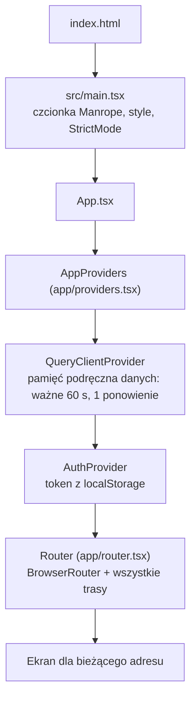
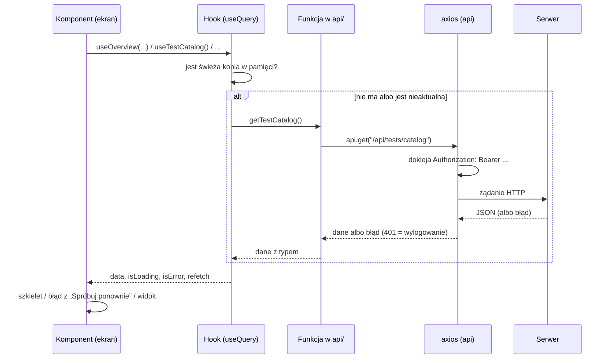

# 01. Architektura

[← Spis treści](README.md)

Ten dokument pokazuje całość z lotu ptaka: z czego zbudowany jest frontend, jak są ułożone katalogi, jak aplikacja
startuje i którędy płyną dane od serwera do ekranu.

## Technologie

| Co | Wersja (z `package.json`) | Do czego służy w projekcie |
|----|---------------------------|----------------------------|
| **React** | ^19.2.8 | Rysowanie ekranów z komponentów |
| **TypeScript** | ~6.0.2 | Typy w całym kodzie. Tryb ścisły (`strict`) jest włączony domyślnie, bo TypeScript 6 włącza go bez wpisu w `tsconfig` |
| **Vite** | ^8.3.0 | Serwer deweloperski (`npm run dev`) i budowanie (`npm run build`) |
| **Tailwind CSS** | ^4.3.3 (wtyczka `@tailwindcss/vite`) | Stylowanie klasami w kodzie. Kolory i czcionki są w `src/index.css` |
| **react-router-dom** | ^7.18.4 | Adresy i przechodzenie między ekranami (`BrowserRouter`) |
| **@tanstack/react-query** | ^5.104.1 | Pobieranie danych z serwera, pamięć podręczna, ponawianie, odświeżanie |
| **axios** | ^1.20.0 | Klient HTTP z dokładaniem tokenu i obsługą wygasłej sesji |
| **lucide-react** | ^1.54.0 | Ikony |
| **clsx** | ^2.1.1 | Składanie nazw klas (funkcja `cn`) |
| **@fontsource-variable/manrope**, **@fontsource/newsreader** | ^5.3.0 | Czcionki dołączone do paczki: Manrope w całej aplikacji, Newsreader (waga 500) na stronie głównej |

Kontrola jakości: **ESLint** (`npm run lint`, reguły `typescript-eslint`, `react-hooks`, `react-refresh`) i kompilator
TypeScript (`tsc -b`, uruchamiany przed każdym buildem). Testów automatycznych w repozytorium nie ma
(patrz [Znane ograniczenia](10-znane-ograniczenia.md)).

Frontend **nie zawiera** żadnej logiki nauki: terminy powtórek, ocenianie odpowiedzi i limity dzienne liczy serwer.
Frontend pokazuje wynik i przechowuje w pamięci tylko to, co potrzebne do bieżącej sesji (patrz
[04](04-nauka-w-aplikacji.md)).

## Układ katalogów

```
port-fe/
├── README.md               Krótki opis projektu, szybki start, odnośniki do dokumentacji
├── index.html              Jedyna strona HTML (tytuł, opis, ikony); ładuje src/main.tsx
├── package.json            Zależności i polecenia (dev, build, lint, preview, docs:*)
├── vite.config.ts          Wtyczki: React i Tailwind
├── eslint.config.js        Reguły ESLint (tylko pliki .ts i .tsx)
├── tsconfig*.json          Ustawienia TypeScript (app: katalog src, node: vite.config.ts)
├── .env, .env.example      VITE_API_BASE_URL dla pracy lokalnej
├── .env.production         VITE_API_BASE_URL dla buildu produkcyjnego (do uzupełnienia)
├── public/                 Pliki serwowane bez zmian: favicon, ikona dla iPhone'a
├── docs/                   Ta dokumentacja
└── src/
    ├── main.tsx            Punkt wejścia: czcionka, style, <App />
    ├── App.tsx             Składa dostawców (providers) i router
    ├── index.css           Tailwind i wszystkie kolory, czcionki, rozmiary tekstu
    ├── app/                providers.tsx (pamięć podręczna + sesja), router.tsx (wszystkie adresy)
    ├── auth/               Sesja: kontekst z tokenem (AuthContext, context, useAuth)
    ├── api/                Wywołania serwera i typy odpowiedzi, po jednym pliku na zasób
    ├── config/             routes.ts (adresy), navigation.ts (menu), legal.ts (dane administratora serwisu)
    ├── lib/                Małe funkcje pomocnicze: cn, daty, błędy, pochodzenie pytań, odmiana liczebników
    ├── components/         Wspólne klocki: ui/ (przyciski, okna), layout/ (menu, nagłówki), icons/ (toga)
    ├── pages/              Strony: logowanie i konto, wybór materiału Fiszek, sesje Fiszek i Testów, strona główna
    └── features/           Funkcje: każdy podkatalog to jeden temat (egzamin, statystyki, testy, ...)
```

### Co jest w `features/`

| Katalog | Pliki | Za co odpowiada |
|---------|-------|-----------------|
| `account` | 7 | Ekran Konto: zmiana hasła, pobranie danych, usunięcie konta, wywołania serwera |
| `admin` | 1 | Przycisk „Ukryj” (tylko dla administratora) |
| `auth` | 6 | Pola formularzy logowania, „wyślij link ponownie”, odczyt roli z tokenu, czyszczenie sesji |
| `dashboard` | 12 | Pulpit: odliczanie do egzaminu, powtórki na dziś, wykresy aktywności i skuteczności |
| `difficult` | 4 | Trudne i zawieszone pytania: podpowiedź, zawieszanie, lista w Koncie |
| `exam` | 8 | Egzamin próbny: ustawienia, przebieg z zegarem, raport, historia, zapis w przeglądarce |
| `flashcards` | 2 | Dane do wyboru materiału Fiszek oraz „Dodaj do fiszek” przy pytaniu |
| `landing` | 17 | Strona główna: sekcje, teksty, demo pytania, ilustracja |
| `legal` | 3 | Regulamin i polityka prywatności |
| `misc` | 1 | Strona 404 |
| `report` | 2 | „Zgłoś błąd w pytaniu” |
| `review` | 10 | Elementy wspólne sesji nauki: skróty klawiszowe, zaległości, podstawa prawna, etykieta pochodzenia |
| `settings` | 2 | Ustawienia nauki w Koncie (limity dzienne, retencja, data egzaminu) |
| `statistics` | 11 | Ekran Statystyki i dane statystyk |
| `tests` | 14 | Ekrany Testów (rodzaj, przedmiot, źródło), filtr pochodzenia, tasowanie odpowiedzi |

W repozytorium jest łącznie 161 plików w `src/`.

### Dlaczego strony są w dwóch miejscach

Komponenty „cały ekran” leżą w dwóch katalogach: część w `src/pages/` (logowanie, wybór materiału Fiszek, sesje
nauki, strona główna), część w `src/features/<temat>/` (Pulpit, Testy, Egzamin, Statystyki, Konto, strony prawne i 404).
Historycznie `pages/` było pierwsze, a nowsze ekrany trafiały do `features/`. Reguła praktyczna: **szukaj ekranu w
tabeli w [02](02-routing-i-strony.md)**, tam jest dokładna ścieżka każdego z nich.

## Start aplikacji



1. `index.html` ustawia tytuł, opis strony i ikony, i ładuje `src/main.tsx`.
2. `main.tsx` dołącza czcionkę Manrope oraz `index.css` i renderuje `<App />` w `StrictMode`
   (w trybie deweloperskim React uruchamia wtedy efekty dwa razy; kod jest na to przygotowany).
3. `App.tsx` składa dwóch dostawców i router.
4. `AppProviders` ustawia pamięć podręczną danych (React Query): dane są „świeże” 60 sekund, a nieudane zapytanie jest
   ponawiane raz. Poszczególne zapytania mogą to zmieniać (patrz [05](05-warstwa-api-i-dane.md)).
5. `AuthProvider` odczytuje token z `localStorage` (klucz `accessToken`) i udostępnia go całej aplikacji
   (patrz [03](03-logowanie-i-sesja.md)).
6. `Router` wybiera ekran według adresu (patrz [02](02-routing-i-strony.md)).

## Droga danych: od serwera do ekranu

Każdy ekran, który pokazuje dane z serwera, robi to w tych samych krokach:



Zasady, które to upraszczają:

- **Funkcje w `api/`** są cienkie: jedno wywołanie serwera, typ odpowiedzi, zero logiki ekranu.
- **Hooki** (`useQuery`) zamykają klucz pamięci podręcznej i czas ważności danych w jednym miejscu, zwykle w pliku
  `hooks.ts` danej funkcji (np. `features/tests/hooks.ts`).
- **Ekran** zawsze obsługuje trzy stany: ładowanie (szkielet `Skeleton`), błąd (`ErrorState` z przyciskiem
  „Spróbuj ponownie”) i dane. Pusty wynik ma własny komunikat (`EmptyState`).
- **Zapis** (zmiana ustawień, odpowiedź w teście, zawieszenie pytania) idzie przez `useMutation` albo bezpośrednio przez
  funkcję z `api/`, a po sukcesie unieważnia dane, które mogły się zmienić (patrz
  [05](05-warstwa-api-i-dane.md), część o odświeżaniu).
- Sesje nauki (`StudySessionPage`, `TestSessionPage`) pobierają kolejkę funkcją z `api/` bez React Query, bo trzymają ją
  we własnym stanie na czas sesji (patrz [04](04-nauka-w-aplikacji.md)).

## Zasady organizacji kodu

| Zasada | Gdzie widać |
|--------|-------------|
| Prawie jedno źródło adresów aplikacji | `config/routes.ts` (obiekt `ROUTES`); linki i przekierowania w ekranach biorą adresy stąd. Wyjątki (adresy wpisane osobno): definicje tras w `app/router.tsx`, `ProtectedRoute`, `VerifyPage`, `AuthLayout` i `activePrefixes` w menu (patrz [10](10-znane-ograniczenia.md)) |
| Jedno źródło menu | `config/navigation.ts` (`NAV_ITEMS`) |
| Jedno źródło tekstów strony głównej | `features/landing/copy.ts` |
| Jedno źródło kolorów i rozmiarów tekstu | `src/index.css` (blok `@theme`) |
| Odmiana liczebników po polsku | `lib/plural.ts` (`pluralizePl`) |
| Komunikaty błędów z serwera | `lib/errors.ts` (`serverMessage`, `loadErrorMessage`) |
| Skróty klawiszowe nie psują pisania | `features/review/keyboard.ts` (`isTyping`, atrybut `data-no-shortcuts`) |
| Odczyt pamięci przeglądarki zawsze w `try/catch` | `features/auth/tokenStorage.ts`, `features/exam/examStorage.ts` |

Szczegóły niedoskonałości (np. kilka powtórzonych funkcji pomocniczych) są w
[Znanych ograniczeniach](10-znane-ograniczenia.md).

## Polecenia

| Polecenie | Co robi |
|-----------|---------|
| `npm run dev` | Serwer deweloperski Vite (domyślnie `http://localhost:5173`) |
| `npm run build` | `tsc -b` (sprawdzenie typów), potem `vite build` do katalogu `dist/` |
| `npm run lint` | ESLint na całym projekcie |
| `npm run preview` | Podgląd zbudowanej wersji z `dist/` |
| `npm run docs:check` | Sprawdza, czy ta dokumentacja zgadza się z kodem |
| `npm run docs:build` | Buduje `docs/dokumentacja.html` (patrz [08](08-konfiguracja-i-uruchomienie.md)) |
