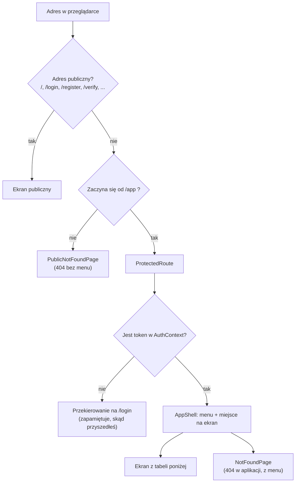
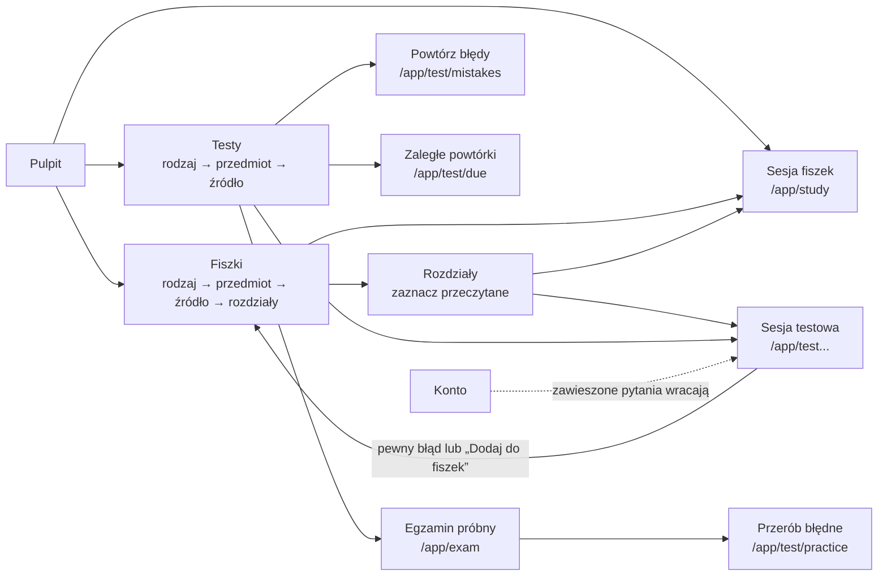

# 02. Routing i strony

[← Spis treści](README.md)

Ten dokument wymienia **wszystkie adresy** aplikacji, plik, który rysuje dany ekran, i to, co ekran robi. Adresy są
zdefiniowane w `app/router.tsx`. Żeby w linkach nie wpisywać ich na sztywno, każdy ma nazwę w `config/routes.ts`
(obiekt `ROUTES`). Oba pliki trzeba zmieniać razem: router ma własne napisy z adresami (patrz
[Znane ograniczenia](10-znane-ograniczenia.md)).

## Jak działa routing

- **Ekrany publiczne** (strona główna, logowanie, rejestracja, regulamin) są dostępne bez logowania.
- **Ekrany aplikacji** mają adres zaczynający się od `/app`. Przed nimi stoi `ProtectedRoute`
  (`components/ProtectedRoute.tsx`): bez tokenu odsyła na `/login` i zapamiętuje adres, z którego przyszedłeś. Po
  zalogowaniu `LoginPage` wraca na ten adres (zapamiętywana jest sama ścieżka, bez parametrów po znaku `?`;
  patrz [Znane ograniczenia](10-znane-ograniczenia.md)).
- `ProtectedRoute` sprawdza **tylko, czy token istnieje**, nie czy jest ważny. Ważność sprawdza serwer przy pierwszym
  żądaniu; odpowiedź 401 wylogowuje (patrz [03](03-logowanie-i-sesja.md)).
- Zalogowany użytkownik, który wejdzie na `/login` albo `/register`, **nie jest** przekierowywany: widzi formularz. Na
  stronie głównej dostaje przyciski „Przejdź do aplikacji” zamiast „Załóż konto”.
- Adres `/app` przekierowuje na `/app/dashboard` (Pulpit).
- Nieznany adres pod `/app/...` pokazuje 404 w ramce aplikacji (z menu), a nieznany adres poza nią 404 bez menu.
- Parametry w adresie (`:subjectId`) zamieniane są na liczby przez `parseId` (`features/flashcards/hooks.ts`); zły
  parametr daje ekran 404, a nie błąd.

## Ekrany publiczne

| Adres | Ekran (plik) | Co robi |
|-------|--------------|---------|
| `/` | `LandingPage` (`pages/LandingPage.tsx`) | Strona główna: hero, demo pytania, wyjaśnienie powtórek, funkcje, kroki, pytania i odpowiedzi. Z `?konto=usuniete` pokazuje potwierdzenie usunięcia konta. Opis w [07](07-strona-glowna.md) |
| `/login` | `LoginPage` (`pages/LoginPage.tsx`) | Logowanie mailem prywatnym i hasłem. Przy odpowiedzi 409 („konto nieaktywne”) pokazuje formularz „wyślij link ponownie” |
| `/register` | `RegisterPage` (`pages/RegisterPage.tsx`) | Rejestracja: mail prywatny, mail uczelniany, hasło (8–72 znaki), akceptacja regulaminu |
| `/check-email` | `CheckEmailPage` (`pages/CheckEmailPage.tsx`) | „Sprawdź skrzynkę” po rejestracji; ten sam tekst dla każdego adresu |
| `/verify` | `VerifyPage` (`pages/VerifyPage.tsx`) | Aktywacja konta z linku w mailu (`?token=`); pokazuje sukces albo błąd z opcją wysłania linku ponownie |
| `/forgot-password` | `ForgotPasswordPage` (`pages/ForgotPasswordPage.tsx`) | Prośba o link do zmiany hasła |
| `/reset-password` | `ResetPasswordPage` (`pages/ResetPasswordPage.tsx`) | Ustawienie nowego hasła z linku w mailu (`?token=`) |
| `/regulamin` | `TermsPage` (`features/legal/TermsPage.tsx`) | Regulamin (wersja robocza, dane administratora z `config/legal.ts`) |
| `/polityka-prywatnosci` | `PrivacyPage` (`features/legal/PrivacyPage.tsx`) | Polityka prywatności (wersja robocza) |
| `*` | `PublicNotFoundPage` (`features/misc/NotFoundPage.tsx`) | Strona 404 poza aplikacją |

## Ekrany aplikacji (po zalogowaniu)

Wszystkie poniższe adresy mają przedrostek `/app` i są wyświetlane wewnątrz `AppShell` (menu + treść). Wyjątek to sesje fiszek
i testów (`/app/study...` oraz `/app/test...`): tam `AppShell` chowa menu i pokazuje przycisk „Zakończ sesję” (patrz [Menu
aplikacji](#menu-aplikacji)).

| Adres | Ekran (plik) | Co robi |
|-------|--------------|---------|
| `/app/dashboard` | `DashboardPage` (`features/dashboard/DashboardPage.tsx`) | Pulpit: odliczanie do egzaminu, „Powtórki na dziś”, skróty do Fiszek i Testów, postępy (zakładki Fiszki i Testy) |
| `/app/flashcards` | `CategoriesPage` (`pages/CategoriesPage.tsx`) | Fiszki, poziom 1: rodzaje materiału oraz „Powtórki na dziś”. Gdy użytkownik nie ma jeszcze żadnej fiszki, wyjaśnia, skąd się biorą |
| `/app/flashcards/:categoryId/subjects` | `SubjectsPage` (`pages/SubjectsPage.tsx`) | Fiszki, poziom 2: przedmioty lub akty prawne wybranego rodzaju |
| `/app/flashcards/:subjectId/sources` | `SourcesPage` (`pages/SourcesPage.tsx`) | Fiszki, poziom 3: źródła przedmiotu z paskiem postępu. Podręcznik prowadzi do rozdziałów, pula płaska od razu do nauki |
| `/app/flashcards/:subjectId/sources/:sourceId/chapters` | `ChaptersPage` (`pages/ChaptersPage.tsx`) | Rozdziały podręcznika z polami „przeczytany”, paskami postępu i przyciskami „Rozpocznij naukę” / „Rozpocznij test” |
| `/app/study` | `StudySessionPage` (`pages/StudySessionPage.tsx`) | Sesja fiszek z całego materiału (zaległe powtórki i dzienna porcja nowych) |
| `/app/study/:subjectId` | `StudySessionPage` | Sesja fiszek z jednego przedmiotu; `?sourceId=` zawęża do źródła |
| `/app/test` | `TestSessionPage` (`pages/TestSessionPage.tsx`) | Sesja testowa z całego materiału; `?categoryId=` zawęża do rodzaju |
| `/app/test/mistakes` | `TestSessionPage` (tryb `mistakes`) | „Powtórz moje błędy” |
| `/app/test/due` | `TestSessionPage` (tryb `due`) | „Zaległe powtórki”: same zaległe pytania, bez nowych |
| `/app/test/practice` | `TestSessionPage` (tryb `practice`) | Sesja z podanych pytań (`?cardIds=1,2,3`), np. błędy z egzaminu próbnego |
| `/app/test/:subjectId` | `TestSessionPage` | Sesja testowa z jednego przedmiotu; `?sourceId=` zawęża do źródła |
| `/app/exam` | `ExamPage` (`features/exam/ExamPage.tsx`) | Egzamin próbny: ustawienia, przebieg z zegarem, raport i historia |
| `/app/tests` | `TestsPage` (`features/tests/TestsPage.tsx`) | Testy, poziom 1: znacznik filtra pochodzenia, pasek zaległych powtórek, „Szybki start” (cały materiał, moje błędy, egzamin), rodzaje |
| `/app/tests/:categoryId` | `TestCategoryPage` (`features/tests/TestCategoryPage.tsx`) | Testy, poziom 2: przedmioty lub akty prawne rodzaju, przycisk „Test z całego rodzaju” przy tytule |
| `/app/tests/:categoryId/:subjectId` | `TestSubjectPage` (`features/tests/TestSubjectPage.tsx`) | Testy, poziom 3: źródła przedmiotu w wierszach, przycisk „Test ze wszystkich źródeł” przy tytule i „Rozpocznij test” przy źródle |
| `/app/statistics` | `StatisticsPage` (`features/statistics/StatisticsPage.tsx`) | Statystyki: przegląd, według aplikacji i roku, opanowanie działów, najsłabsze karty |
| `/app/account` | `AccountPage` (`features/account/AccountPage.tsx`) | Konto: ustawienia nauki, trudne i zawieszone pytania, zmiana hasła, pobranie danych, usunięcie konta |
| `/app/*` | `NotFoundPage` (`features/misc/NotFoundPage.tsx`) | Strona 404 w ramce aplikacji |

Kolejność tras w `router.tsx` ma znaczenie dla czytelności: trasy stałe (`test/mistakes`, `test/due`, `test/practice`)
stoją przed `test/:subjectId`, żeby ich nazwy nie były brane za numer przedmiotu.

### Jak ekrany prowadzą jeden do drugiego

Dwie sprawy wynikają z tego układu:

- **Dwa drzewa wyboru materiału.** Fiszki prowadzą przez `/app/flashcards/...`, a Testy przez `/app/tests/...`. Oba
  kończą na sesji (`/app/study/...` albo `/app/test/...`), ale mają osobne ekrany, bo pokazują inne liczniki (fiszki
  i pytania liczone osobno).
- **Pierwszy parametr po `/app/flashcards/` znaczy co innego na różnych poziomach**: na drugim poziomie to numer
  rodzaju (`:categoryId`), na trzecim i czwartym numer przedmiotu (`:subjectId`). Każdy ekran czyta swój parametr.

## Menu aplikacji

Pozycje menu są zdefiniowane w `config/navigation.ts` (`NAV_ITEMS`) i jest ich pięć:

| Pozycja | Adres | Dodatkowo aktywna na | Odznaka |
|---------|-------|----------------------|---------|
| Pulpit | `/app/dashboard` | tylko dokładny adres | brak |
| Testy | `/app/tests` | `/app/exam` (egzamin próbny jest częścią Testów) | liczba pytań testowych do powtórki (`TEST`) |
| Fiszki | `/app/flashcards` | | liczba fiszek do powtórki (`FLASHCARD`) |
| Statystyki | `/app/statistics` | | brak |
| Konto | `/app/account` | | brak |

Menu rysuje `AppShell` (`components/layout/AppShell.tsx`) w trzech postaciach, zależnie od szerokości okna:

| Szerokość okna | Menu | Plik |
|----------------|------|------|
| od 1280 px (`xl`) | Panel po lewej (248 px): logo, przycisk zwijania, cztery pozycje (bez Konta) z odznakami, a na dole blok konta (litera, adres e-mail, „Konto i ustawienia”) i ikona wylogowania. Panel można zwinąć do wąskiego paska; wybór jest zapamiętany w przeglądarce | `components/layout/SideNav.tsx` (odmiana `full`) |
| od 768 px (`md`) do 1279 px | Wąski pasek po lewej (84 px): ikona z krótkim podpisem pod spodem, na dole kółko konta i wylogowanie | `components/layout/SideNav.tsx` (odmiana `rail`) |
| poniżej 768 px | Dolna belka z pięcioma pozycjami (łącznie z Kontem) | `components/layout/BottomNav.tsx` |

Odznaka (`NavBadge`) pokazuje liczbę do powtórki z `GET /api/review/due-count`; gdy nic nie zalega, nie pojawia się. Powyżej
99 pokazuje „99+”. Wylogowanie jest w panelu bocznym (ikona), a na telefonie, gdzie panelu nie ma, na ekranie Konto.

### Sesje nauki: bez menu

Na adresach sesji (`/app/study`, `/app/study/:subjectId`, `/app/test`, `/app/test/mistakes`, `/app/test/due`,
`/app/test/practice`, `/app/test/:subjectId`) menu znika, żeby nic nie odciągało od pytania. U góry jest wtedy przycisk
„Zakończ sesję”: z sesji fiszek prowadzi do Fiszek, z sesji testu do Testów. Regułę zapisuje funkcja `sessionExitRoute` w
`config/navigation.ts`; porównuje ona całe segmenty adresu, więc listy `/app/tests` i `/app/flashcards` zostają z menu.
Egzamin próbny (`/app/exam`) menu zachowuje, także w trakcie egzaminu.

## Co każdy ekran pobiera z serwera

Pełna lista wywołań serwera z nazwami funkcji jest w [05](05-warstwa-api-i-dane.md). Poniżej skrót według ekranów:

| Ekran | Dane z serwera |
|-------|----------------|
| Pulpit | Liczba powtórek (`due-count`), ustawienia nauki (data egzaminu), przegląd nauki i aktywność z 28 dni dla fiszek, statystyki Testów |
| Fiszki (poziomy 1–3) | Kategorie, przedmioty rodzaju, źródła przedmiotu z postępem |
| Rozdziały | Rozdziały źródła, opanowanie rozdziałów, zapis „przeczytany” |
| Sesja fiszek | Kolejka fiszek, zapis oceny, liczba nowych kart do dołożenia, zaległości |
| Sesja testowa | Kolejka pytań (zakres, błędy, ćwiczenia), zapis odpowiedzi, ustawienia (tasowanie), zaległości, „Dodaj do fiszek” |
| Testy (poziomy 1–3) | Katalog Testów, filtr pochodzenia, liczba błędów i zaległych |
| Egzamin | Katalog Testów, start i zakończenie egzaminu, historia |
| Statystyki | Przegląd, statystyki według pochodzenia, opanowanie rozdziałów, najsłabsze karty, lista przedmiotów |
| Konto | Adres konta, ustawienia nauki, trudne i zawieszone pytania, zmiana hasła, eksport i usunięcie konta |
| Logowanie i rejestracja | Wywołania `/api/auth/*` |
| Regulamin, polityka, strona główna | Brak (treść jest w kodzie) |

## Przegląd ekranów

### Pulpit (`features/dashboard`)

Od góry: nagłówek „Cześć!”, odliczanie do egzaminu (tylko gdy ustawiona jest przyszła data egzaminu; pigułka prowadzi
do Konta), baner „Powtórki na dziś” z przyciskiem startu, dwa skróty (Fiszki, Testy) i sekcja „Twoje postępy” z
przełącznikiem Fiszki / Testy. Zakładka **Fiszki** pokazuje pasek „rozwiązano X z Y dostępnych fiszek”, słupki aktywności
z bieżącego tygodnia (Pn–Nd, na podstawie 28 dni) i pierścień skuteczności z 30 dni. Zakładka **Testy** pokazuje to
samo dla pytań oraz dwa kafelki: „Pewne błędy” (błędy bez „Nie jestem pewien”) i „Trafione w ciemno” (poprawne z
„Nie jestem pewien”).

### Fiszki i rozdziały (`pages/CategoriesPage` ... `ChaptersPage`)

Fiszki **zaczynają puste**: pojawiają się po pewnym błędzie w teście albo po kliknięciu „Dodaj do fiszek” (patrz
[04](04-nauka-w-aplikacji.md)). Gdy użytkownik nie ma żadnej fiszki, pierwszy poziom pokazuje wyjaśnienie z odnośnikiem
do Testów zamiast pustej listy. Na liście źródeł pula samych pytań testowych bez fiszek jest ukrywana, a podręcznik
zostaje zawsze, bo tam oznacza się przeczytane rozdziały, od których zależy dostęp do pytań testowych. Zmiana pola
„przeczytany” działa od razu na ekranie (zapis „optymistyczny”), a gdy serwer jej nie przyjmie, ekran wraca do
poprzedniego stanu i pokazuje komunikat.

### Testy (`features/tests`)

Trzypoziomowy katalog (rodzaj → przedmiot lub akt prawny → źródło) z licznikami „Rozwiązano X / Y”. Pusta pozycja jest
wyszarzona i nie prowadzi dalej. Pytania z nieprzeczytanych rozdziałów podręczników są liczone osobno („+N po
przeczytaniu rozdziałów”). Na każdym z trzech poziomów przy tytule jest znacznik filtra pochodzenia pytań (patrz
[04](04-nauka-w-aplikacji.md)).

Strona ma **jedną główną akcję** (złoty przycisk), a resztę przycisków ciszej (ramka, bez złota):

- Poziom 1: pasek „N pytań do powtórki” ze złotym przyciskiem „Powtórz” (jest tylko wtedy, gdy coś zalega), potem rząd
  „Szybki start” z trzema cichymi przyciskami: „Cały materiał”, „Moje błędy” (z liczbą, tylko gdy są błędy) i
  „Egzamin próbny”, a pod nim rodzaje („Wybierz rodzaj”). Dzięki temu rodzaje zaczynają się wysoko, także na telefonie.
- Poziom 2: złoty „Test z całego rodzaju” przy tytule.
- Poziom 3: źródła w wierszach (nazwa, postęp, przycisk). Złoty jest „Test ze wszystkich źródeł” przy tytule, a gdy
  źródło jest jedno, złoty jest jego przycisk „Rozpocznij test”. Pozostałe przyciski w wierszach są ciche.

### Statystyki (`features/statistics`)

Cztery bloki: przegląd (wszystkie, rozpoczęte, opanowane, skuteczność), „Testy według aplikacji” (wybór aplikacji i
rozbicie na lata egzaminu), „Opanowanie działów” (rozdziały pierwszego podręcznika wybranego przedmiotu, od
najsłabszych) i „Do poprawy” (10 kart z największą liczbą błędów). Filtr przedmiotu w nagłówku działa na przegląd,
rozdziały i najsłabsze karty, ale **nie** na blok „według aplikacji”.

### Konto (`features/account`)

Karty w tej kolejności: adres konta, ustawienia nauki, trudne i zawieszone pytania, zmiana hasła, pobranie danych, usunięcie
konta. Szczegóły w [03](03-logowanie-i-sesja.md) (konto) i [04](04-nauka-w-aplikacji.md) (ustawienia nauki, zawieszanie).
