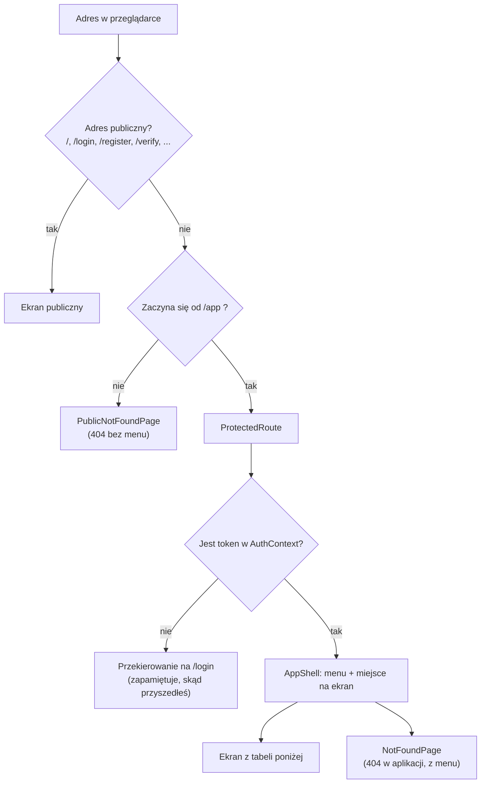
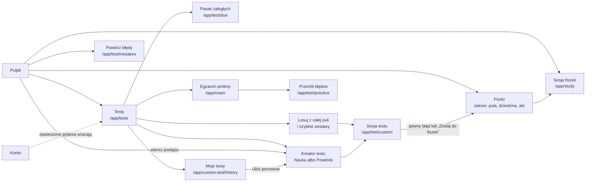

# 02. Routing i strony

[← Spis treści](README.md)

Ten dokument wymienia **wszystkie adresy** aplikacji, plik, który rysuje dany ekran, i to, co ekran robi. Adresy są
zdefiniowane w `app/router.tsx`. Żeby w linkach nie wpisywać ich na sztywno, każdy ma nazwę w `config/routes.ts`
(obiekt `ROUTES`). Oba pliki trzeba zmieniać razem: router ma własne napisy z adresami (patrz
[Znane ograniczenia](10-znane-ograniczenia.md)).

## Jak działa routing

- **Ekrany publiczne** (strona główna, logowanie, rejestracja, regulamin) są dostępne bez logowania.
- **Ekrany aplikacji** mają adres zaczynający się od `/app`. Przed nimi stoi `ProtectedRoute`
  (`components/ProtectedRoute.tsx`): bez tokenu odsyła na `/login` i zapamiętuje adres, z którego przyszedłeś. Po
  zalogowaniu `LoginPage` wraca na ten adres (zapamiętywana jest sama ścieżka, bez parametrów po znaku `?`;
  patrz [Znane ograniczenia](10-znane-ograniczenia.md)).
- `ProtectedRoute` sprawdza **tylko, czy token istnieje**, nie czy jest ważny. Ważność sprawdza serwer przy pierwszym
  żądaniu; odpowiedź 401 wylogowuje (patrz [03](03-logowanie-i-sesja.md)).
- Zalogowany użytkownik, który wejdzie na `/login` albo `/register`, **nie jest** przekierowywany: widzi formularz. Na
  stronie głównej dostaje przyciski „Przejdź do aplikacji” zamiast „Załóż konto”.
- Adres `/app` przekierowuje na `/app/dashboard` (Pulpit).
- Nieznany adres pod `/app/...` pokazuje 404 w ramce aplikacji (z menu), a nieznany adres poza nią 404 bez menu.
- Jedyny parametr trasy to `:id` w szczegółach „Moich testów”; zły albo nieistniejący numer daje ekran błędu z linkiem do
  listy, a nie wyjątek. Zakres sesji nauki jest w **adresie po znaku `?`**: `?fieldId=`,
  `?actId=`, `?sourceId=`; czyta je hook `useScopeParams` (`features/review/useScopeParams.ts`, liczby z napisów robi
  `parseId` z `lib/ids.ts`), a budują funkcje
  `ROUTES.studyScope` i `ROUTES.testScope`. Bez żadnego z tych parametrów sesja obejmuje całą pulę użytkownika.

## Ekrany publiczne

| Adres | Ekran (plik) | Co robi |
|-------|--------------|---------|
| `/` | `LandingPage` (`pages/LandingPage.tsx`) | Strona główna: hero, demo pytania, wyjaśnienie powtórek, funkcje, kroki, pytania i odpowiedzi. Z `?konto=usuniete` pokazuje potwierdzenie usunięcia konta. Opis w [07](07-strona-glowna.md) |
| `/login` | `LoginPage` (`pages/LoginPage.tsx`) | Logowanie mailem prywatnym i hasłem. Przy odpowiedzi 409 („konto nieaktywne”) pokazuje formularz „wyślij link ponownie” |
| `/register` | `RegisterPage` (`pages/RegisterPage.tsx`) | Rejestracja: mail prywatny, mail uczelniany, hasło (8–72 znaki), akceptacja regulaminu |
| `/check-email` | `CheckEmailPage` (`pages/CheckEmailPage.tsx`) | „Sprawdź skrzynkę” po rejestracji; ten sam tekst dla każdego adresu |
| `/verify` | `VerifyPage` (`pages/VerifyPage.tsx`) | Aktywacja konta z linku w mailu (`?token=`); pokazuje sukces albo błąd z opcją wysłania linku ponownie |
| `/forgot-password` | `ForgotPasswordPage` (`pages/ForgotPasswordPage.tsx`) | Prośba o link do zmiany hasła |
| `/reset-password` | `ResetPasswordPage` (`pages/ResetPasswordPage.tsx`) | Ustawienie nowego hasła z linku w mailu (`?token=`) |
| `/regulamin` | `TermsPage` (`features/legal/TermsPage.tsx`) | Regulamin (wersja robocza, dane administratora z `config/legal.ts`) |
| `/polityka-prywatnosci` | `PrivacyPage` (`features/legal/PrivacyPage.tsx`) | Polityka prywatności (wersja robocza) |
| `*` | `PublicNotFoundPage` (`features/misc/NotFoundPage.tsx`) | Strona 404 poza aplikacją |

## Ekrany aplikacji (po zalogowaniu)

Wszystkie poniższe adresy mają przedrostek `/app` i są wyświetlane wewnątrz `AppShell` (menu + treść). Wyjątek to sesje fiszek
i testów (`/app/study...` oraz `/app/test...`): tam `AppShell` chowa menu i pokazuje przycisk „Zakończ sesję” (patrz [Menu
aplikacji](#menu-aplikacji)).

| Adres | Ekran (plik) | Co robi |
|-------|--------------|---------|
| `/app/dashboard` | `DashboardPage` (`features/dashboard/DashboardPage.tsx`) | Pulpit: „Na dziś” (jeden główny przycisk), „Postęp”, wynik egzaminu próbnego, a na początku obowiązkowe okno wyboru ścieżki |
| `/app/flashcards` | `FlashcardsPage` (`features/flashcards/FlashcardsPage.tsx`) | Fiszki: „Powtórki na dziś” z całej puli i nauka z wybranej dziedziny albo aktu prawnego. Gdy użytkownik nie ma jeszcze żadnej fiszki, wyjaśnia, skąd się biorą |
| `/app/study` | `StudySessionPage` (`pages/StudySessionPage.tsx`) | Sesja fiszek (zaległe powtórki i dzienna porcja nowych). Zakres w adresie: `?fieldId=`, `?actId=`, `?sourceId=`; bez nich cała pula |
| `/app/test` | `TestSessionPage` (`pages/TestSessionPage.tsx`) | Sesja testowa z całej puli albo z zakresu podanego w adresie (`?fieldId=`, `?actId=`, `?sourceId=`) |
| `/app/test/mistakes` | `TestSessionPage` (tryb `mistakes`) | „Powtórz moje błędy” |
| `/app/test/due` | `TestSessionPage` (tryb `due`) | „Zaległe powtórki”: same zaległe pytania, bez nowych |
| `/app/test/practice` | `TestSessionPage` (tryb `practice`) | Sesja z podanych pytań (`?questionIds=1,2,3`), np. błędy z egzaminu próbnego |
| `/app/test/custom` | `TestSessionPage` (tryb `custom`) | Sesja „Własnego testu”: pytania wylosowane na ekranie układania (`?questionIds=1,2,3&sessionId=7`) |
| `/app/exam` | `ExamPage` (`features/exam/ExamPage.tsx`) | Egzamin próbny w stałym formacie (150 pytań, zaliczenie od 100 punktów): ustawienia (tylko limit czasu), przebieg z zegarem, raport i historia |
| `/app/tests` | `TestsPage` (`features/tests/TestsPage.tsx`) | Testy: jedyny ekran testów. Od góry pasek zaległych powtórek (złota obwódka), „Losuj z całej puli”, „Ułóż test” (Nauka, Powtórki, Egzamin próbny) i „Szybkie zestawy” (Moje błędy, Zmiany w prawie, Nowe pytania). Nauka i Powtórki otwierają kreator w oknie. Link „Moje testy” w nagłówku |
| `/app/tests/*` | przekierowanie na `/app/tests` | Dawne strony dziedziny (`/app/tests/:fieldId`) i przedmiotu (`/app/tests/subject/:courseId`): dziedziny, akty i rozdziały wybiera się teraz w kreatorze |
| `/app/custom-test` | przekierowanie na `/app/tests` | Dawny ekran „Własny test”: stare zakładki i linki trafiają do Testów |
| `/app/custom-test/history` | `MyTestsPage` (`features/customTest/MyTestsPage.tsx`) | „Moje testy”: lista zapisanych testów (z kreatora i z losowania), od najnowszego, z oznaczeniem „Nieukończony” i wynikiem |
| `/app/custom-test/history/:id` | `MyTestDetailPage` (`features/customTest/MyTestDetailPage.tsx`) | Szczegóły zapisanego testu: ustawienia (w tym źródło), wynik i wszystkie pytania z odpowiedziami (filtr „Błędne i bez odpowiedzi”). Przycisk „Ułóż ponownie z tymi ustawieniami” otwiera w Testach kreator z wypełnionym wyborem |
| `/app/statistics` | `StatisticsPage` (`features/statistics/StatisticsPage.tsx`) | Statystyki: opanowanie pytań według źródła, opanowanie aktów prawnych, „Podsumowanie nauki”, ostatnie 30 dni, aktywność, fiszki |
| `/app/account` | `AccountPage` (`features/account/AccountPage.tsx`) | Konto: wygląd, ustawienia nauki (w tym wybór ścieżki), terminy egzaminów (administrator), trudne i zawieszone pytania, zmiana hasła, pobranie danych, wyzerowanie postępów, usunięcie konta |
| `/app/*` | `NotFoundPage` (`features/misc/NotFoundPage.tsx`) | Strona 404 w ramce aplikacji |

Ekrany aplikacji (oprócz stron wejściowych: główna, logowanie, rejestracja i reszta kont) są ładowane **leniwie** (`React.lazy` i `Suspense`): ich kod pobiera się dopiero przy pierwszym wejściu, a w tym czasie widać krótki ekran ładowania (`components/RouteFallback.tsx`). Całość otacza granica błędów `ErrorBoundary` (`components/ErrorBoundary.tsx`): gdy ekran się wywróci, użytkownik widzi „Coś poszło nie tak” i przycisk „Odśwież stronę” zamiast pustej strony, a menu aplikacji zostaje. Przejście na inny adres naprawia widok.

Trasy `test/mistakes`, `test/due`, `test/practice` i `test/custom` są osobnymi, stałymi adresami (nie mają parametru w
ścieżce), więc ich kolejność w `router.tsx` nie ma znaczenia. Zakres sesji jest w adresie po znaku `?`, a nie w ścieżce.

### Jak ekrany prowadzą jeden do drugiego

Dwie sprawy wynikają z tego układu:

- **Jeden ekran Testy.** Wszystko, co zaczyna test, jest na `/app/tests`: losowanie z całej puli, szybkie zestawy,
  kreator Nauki i Powtórek oraz egzamin próbny. Dziedziny, akty prawne i ich rozdziały wybiera się w kreatorze, w jednym
  drzewie (dziedzina → akt → rozdział; Student zamiast dziedziny ma przedmiot, a pod nim te same akty). Fiszki mają tylko
  listę zakresu na jednym ekranie, bo fiszka jest trybem tego samego pytania i nie ma własnej struktury materiału. Obie
  sesje (`/app/study`, `/app/test`) przyjmują ten sam zakres w adresie.
- **Dwa poziomy zawężania.** Trwały jest **zakres nauki** (karta w Koncie: ścieżka i wybrane akty albo, u Studenta,
  przedmioty), który liczą Testy, Fiszki, Pulpit i Statystyki. Przy każdym teście dochodzi wybór chwilowy w kreatorze:
  **źródło pytań** (Wszystkie, Ministerstwo Sprawiedliwości, Autorskie) i rozdziały aktów. Nie ma już znacznika „Pula
  pytań” ani trwałego filtra źródeł.

## Menu aplikacji

Pozycje menu są zdefiniowane w `config/navigation.ts` (`NAV_ITEMS`) i jest ich pięć:

| Pozycja | Adres | Dodatkowo aktywna na | Odznaka |
|---------|-------|----------------------|---------|
| Pulpit | `/app/dashboard` | tylko dokładny adres | brak |
| Testy | `/app/tests` | `/app/exam` i `/app/custom-test/…` (egzamin próbny i „Moje testy” są częścią Testów) | liczba pytań testowych do powtórki (`TEST`) |
| Fiszki | `/app/flashcards` | | liczba fiszek do powtórki (`FLASHCARD`) |
| Statystyki | `/app/statistics` | | brak |
| Konto | `/app/account` | | brak |

Menu rysuje `AppShell` (`components/layout/AppShell.tsx`) w trzech postaciach, zależnie od szerokości okna:

| Szerokość okna | Menu | Plik |
|----------------|------|------|
| od 1280 px (`xl`) | Panel po lewej (248 px): logo, przycisk zwijania, cztery pozycje (bez Konta) z odznakami, a na dole blok konta (litera, adres e-mail, „Konto i ustawienia”) i ikona wylogowania. Panel można zwinąć do wąskiego paska; wybór jest zapamiętany w przeglądarce | `components/layout/SideNav.tsx` (odmiana `full`) |
| od 768 px (`md`) do 1279 px | Wąski pasek po lewej (84 px): ikona z krótkim podpisem pod spodem, na dole kółko konta i wylogowanie | `components/layout/SideNav.tsx` (odmiana `rail`) |
| poniżej 768 px | Dolna belka z pięcioma pozycjami (łącznie z Kontem) | `components/layout/BottomNav.tsx` |

Odznaka (`NavBadge`) pokazuje liczbę do powtórki z `GET /api/review/due-count`; gdy nic nie zalega, nie pojawia się. Powyżej
99 pokazuje „99+”. Wylogowanie jest w panelu bocznym (ikona), a na telefonie, gdzie panelu nie ma, na ekranie Konto.

### Sesje nauki: bez menu

Na adresach sesji (`/app/study`, `/app/test`, `/app/test/mistakes`, `/app/test/due`, `/app/test/practice`,
`/app/test/custom`, także z parametrami po znaku `?`) menu znika, żeby nic nie odciągało od pytania. U góry jest wtedy przycisk
„Zakończ sesję”: z sesji fiszek prowadzi do Fiszek, z każdej sesji testu (także z testu ułożonego w kreatorze albo wylosowanego) do Testów.
Regułę zapisuje funkcja `sessionExitRoute` w
`config/navigation.ts`; porównuje ona całe segmenty adresu, więc listy `/app/tests` i `/app/flashcards` zostają z menu.
Egzamin próbny (`/app/exam`) menu zachowuje, także w trakcie egzaminu.

## Co każdy ekran pobiera z serwera

Pełna lista wywołań serwera z nazwami funkcji jest w [05](05-warstwa-api-i-dane.md). Poniżej skrót według ekranów:

| Ekran | Dane z serwera |
|-------|----------------|
| Pulpit | Liczby powtórek pytań i fiszek (`due-count`), liczba błędów, ustawienia nauki (ścieżka, termin, plan dnia), lista ścieżek i terminów egzaminów (okno startowe), statystyki Testów, aktywność z 28 dni (seria), katalog Testów (postęp według dziedzin), pula pytań, historia egzaminów |
| Fiszki | Przegląd fiszek (`overview` z `mode=FLASHCARD`), katalog Testów (lista zakresów), zaległości i liczba nowych fiszek w wybranym zakresie |
| Sesja fiszek | Kolejka fiszek, zapis oceny, liczba nowych fiszek do dołożenia, zaległości |
| Sesja testowa | Kolejka pytań (zakres, błędy, ćwiczenia, test z kreatora), zapis odpowiedzi, zaległości, „Dodaj do fiszek” |
| Testy | Liczba zaległych (`due-count`, ta sama co w odznace menu), pula (notka o zawężeniu), liczby do „Losuj z całej puli” i szybkich zestawów (`custom-test/counts` z pustym zakresem), start losowania (`custom-test`) |
| Kreator testu | Katalog Testów dla wybranego źródła (`tests/catalog?source=`: drzewo dziedzin albo przedmiotów, aktów i rozdziałów z licznikami), liczby pytań dla zakresu i źródła (`custom-test/counts`), losowanie (`custom-test`) |
| Egzamin | Pula (tylko liczba dostępnych pytań), start (bez ciała, serwer losuje 150 pytań) i zakończenie egzaminu (serwer ocenia i ustala próg), historia |
| Statystyki | Statystyki według źródła, opanowanie aktów prawnych, statystyki Testów (ostatnie 30 dni), „Podsumowanie nauki”, aktywność, przegląd fiszek (`mode=FLASHCARD`), najsłabsze pytania |
| Konto | Adres konta, ustawienia nauki, lista ścieżek i terminy egzaminów, trudne i zawieszone pytania, zmiana hasła, eksport, zerowanie postępów (liczby `study-progress` dopiero po otwarciu okna) i usunięcie konta |
| Logowanie i rejestracja | Wywołania `/api/auth/*` |
| Regulamin, polityka, strona główna | Brak (treść jest w kodzie) |

## Przegląd ekranów

### Pulpit (`features/dashboard`)

Pulpit odpowiada na dwa pytania: **co zrobić teraz** i **czy jestem na dobrej drodze**. Ma tylko trzy karty, bo więcej
rozprasza; mapy aktywności, rozbicia błędów i „opanowane” są w Statystykach. Nie ma przełącznika Fiszki / Testy ani
powitania „Cześć!”; nagłówek to „Pulpit” z dzisiejszą datą. Na szerokim ekranie są dwie kolumny („Na dziś” i „Postęp”
po lewej, „Egzamin próbny” po prawej), na telefonie jedna.

Kolejność kart (na telefonie od góry, na szerokim ekranie lewa kolumna, potem prawa):

0. **Okno startowe** (`OnboardingGate` z `features/onboarding`, osadzone w `AppShell`, więc działa na każdej stronie
   aplikacji, nie tylko na Pulpicie): dopóki użytkownik nie wybrał **ścieżki**, na środku ekranu stoi **okno modalne „Witaj w
   Gradus iuris”**, którego nie da się zamknąć. Jest w nim wybór ścieżki („Do czego się przygotowujesz?”): pięć aplikacji
   (z wierszem terminu egzaminu albo „termin nieogłoszony”) i **Student** na końcu (bez terminu, z opisem „Bez odliczania i
   planu dnia”), a pod spodem wybór wyglądu strony (Ciemny, domyślny, albo Jasny) z podglądem na żywo. Przycisk „Zacznij
   naukę” jest nieaktywny, dopóki nie wybrano ścieżki; okno nie ma przycisku zamknięcia, Esc i kliknięcie w tło nic nie
   robią, a jedyne inne wyjście to „Wyloguj się”. Zapis: najpierw wygląd (`PUT /api/me/theme`, tylko gdy się zmienił), potem
   ścieżka (`PUT /api/me/track`; backend układa przy tym pulę pytań: akty ścieżki i własne arkusze aplikacji). Okno
   pojawia się dopiero, gdy ustawienia się wczytały i `track` jest dokładnie `null`: błąd ani ładowanie ustawień nie blokują
   aplikacji. Szczegóły w [04](04-nauka-w-aplikacji.md#okno-startowe-i-wygląd-strony).
1. **Na dziś** (`TodayCard`). Wiersz egzaminu pokazuje się tylko dla ścieżki-aplikacji (Student go nie ma): „Notarialna: do
   egzaminu 69 dni (22 grudnia 2026), tryb egzaminacyjny włączony” (tryb od 30 dni przed egzaminem), „termin nieogłoszony”,
   „egzamin z … już się odbył”. Dalej cel dnia: „Nowe pytania dziś: X z Y” z paskiem (Y to cel z planu serwera, liczony
   od stanu z początku dnia, więc nie maleje w ciągu dnia i nie przekracza rozsądnego maksimum 100), po wykonaniu „, cel na
   dziś zrobiony”. Gdy użytkownik ma **własny** limit niższy niż potrzeba (a potrzeba mieści się w maksimum), ostrzeżenie mówi:
   „Żeby zdążyć, potrzeba N nowych pytań dziennie, a Twój limit to M. Zmień go w Ustawieniach albo wybierz limit
   automatyczny.” Gdy potrzeba więcej niż maksimum, ostrzeżenie mówi to **wprost** i podpowiada zawężenie w karcie „Zakres
   nauki” w Koncie, zamiast prosić o podniesienie limitu, które nic by nie dało (`LimitNotice`, reguły w `newQuestionsLimit.ts`). W
   ostatnich 14 dniach przed egzaminem zamiast celu jest zdanie „Ostatnie dwa tygodnie: skup się na powtórkach.” Potem
   komunikat i **jedyny złoty przycisk na ekranie**, który sam wybiera następny krok: zaległe pytania → „Zacznij powtórkę
   pytań”, potem zaległe fiszki → „Zacznij powtórkę fiszek”, potem nowe pytania → „Ucz się nowych pytań”; gdy nic nie
   zalega, „Na dziś gotowe” i cichy przycisk „Ułóż test”. Pod spodem ciche linki „Fiszki do powtórki: N” i „Popraw
   moje błędy: N” (tylko gdy N > 0) oraz wiersz serii: „Seria: N dni  W tym tygodniu: M odpowiedzi” albo „Zacznij serię
   dziś”.
2. **Postęp** (`ProgressCard`): jeden pasek „Przerobione: 166 z 400 (42%)”. „Przerobione” to pytania z puli, które miały już
   choć jedną odpowiedź; to **nie** to samo co „opanowane” (to jest w Statystykach, bo przez pierwsze dwa tygodnie byłoby
   0). Pod paskiem podpis z objaśnieniem i, gdy pula jest zawężona, notka „Liczymy tylko pytania z Twojego zakresu nauki”. Niżej wiersze
   według dziedzin (każdy otwiera w Testach kreator na kroku 2 z tą dziedziną, przez stan nawigacji `prefill`); u Studenta wiersze są
   według przedmiotów.
3. **Egzamin próbny** (`ExamCard`, kolumna boczna): ostatni wynik („112 / 150”, „Zaliczony” albo „Niezaliczony”, data,
   próg), mały wykres ostatnich pięciu podejść z przerywaną linią progu (100 z 150) i przycisk „Nowy egzamin”. Bez żadnego
   podejścia karta opisuje format i zaprasza do pierwszego.

Każda karta pobiera dane sama i sama pokazuje błąd z przyciskiem „Spróbuj ponownie” (`InlineError`), więc awaria jednego
zapytania nie wywraca reszty Pulpitu (odpowiedź o złym kształcie, np. pusty obiekt zamiast listy w historii egzaminów albo
aktywności, jest traktowana jak błąd tej karty). Wybór głównego kroku i lista podejść do wykresu są liczone w
`selectors.ts` (czyste funkcje, bez wywołań serwera). Kolejność w kodzie jest zarazem kolejnością tabulatora, bez
przestawiania elementów w CSS.

### Zakres nauki (`features/pool`)

Karta **„Zakres nauki”** (`LearningScopeCard`) jest w Koncie, tuż pod ustawieniami nauki (kotwica `#zakres-nauki`, do której
prowadzą komunikaty o limicie nowych pytań i notka na ekranie Testy). Mówi jednym wierszem, z czego uczy się użytkownik
(„Notarialna”, „Notarialna, wybrane akty”, „Student, wybrane przedmioty”) i ile to pytań, a przycisk „Zmień zakres nauki”
otwiera okno (`PoolDialog`):

1. **Akty prawne** (aplikacje: pogrupowane w dziedziny, z polem „Cała dziedzina” w stanie „część zaznaczona”, rozwijaniem i
   polem przy każdym akcie z liczbą jego pytań) albo **przedmioty** (Student: płaska lista pól wyboru, bez aktów).
   Zaznaczone wszystko to brak zawężenia (do serwera idzie pusta lista).
2. „Zapisz” jest nieaktywny, gdy nic się nie zmieniło albo nie zaznaczono żadnej pozycji (komunikat w dolnej linii).
   Zapis wywołuje `PUT /api/me/pool/acts` (Student: `PUT /api/me/pool/courses`) i odświeża wszystko, co liczy pytania.

Zawężenie dotyczy Testów, Fiszek i statystyk, **nie** egzaminu próbnego. To jedyne trwałe zawężenie: **źródło pytań i
rozdziały wybiera się osobno przy każdym teście** w kreatorze, więc dawnego znacznika „Pula pytań” przy tytule Testów i
trwałego filtra źródeł już nie ma. Gdy zakres jest zawężony, ekran Testy mówi o tym notką z linkiem do Konta. Ścieżkę zmienia
się w Koncie, w karcie ustawień nauki. Szczegóły: [04](04-nauka-w-aplikacji.md#pula-pytań-i-zakres-nauki).

### Fiszki (`features/flashcards`)

Fiszka jest **trybem tego samego pytania**, więc Fiszki nie mają własnego drzewa materiału ani rozdziałów. Fiszki **zaczynają
puste**: pojawiają się po pewnym błędzie w teście (bez „Nie jestem pewien”) albo po kliknięciu „Dodaj do fiszek” (patrz
[04](04-nauka-w-aplikacji.md)). Gdy użytkownik nie ma żadnej fiszki, ekran pokazuje wyjaśnienie z przyciskiem „Przejdź do
Testów” zamiast pustych zakresów. W pozostałych przypadkach są dwie karty:

- **Powtórki na dziś** (`DueReviewBanner`): zaległe fiszki z całej puli i przycisk startu sesji.
- **Nauka z wybranego zakresu**: lista „Zakres” (cała pula, cała dziedzina albo jeden akt prawny, dziedziny w grupach; u
  Studenta grupami są przedmioty, a „Cała dziedzina” nie ma, bo przedmiot nie jest zakresem sesji), pod
  nią liczby „Do powtórki” i „Nowe” dla tego zakresu i przycisk „Ucz się z tego zakresu” (`/app/study?fieldId=…` albo
  `?actId=…`).

### Testy (`features/tests`)

Jeden ekran (`TestsPage`, `/app/tests`) bez pod-stron: dziedziny, akty prawne i rozdziały wybiera się w kreatorze. Strona ma
**jedną wyróżnioną rzecz**: pasek zaległych powtórek ze złotą obwódką. Od góry:

1. **Notka o zakresie** (`narrowed-note`), tylko gdy zakres nauki jest zawężony: „Uczysz się z wybranego zakresu: N pytań.
   Zmienisz to w Koncie.”
2. **Pasek „N pytań do powtórki”** (`DueBar`): jedyny element ze złotą obwódką. „Powtórz” zaczyna od razu sesję z samych
   zaległych pytań z całej puli (`/app/test/due`, bez nowych pytań). Gdy nic nie zalega, paska nie ma.
3. **„Losuj z całej puli”** (`DrawFromPoolCard`, bez obwódki): wybór liczby pytań (10, 20, 50, 100, tylko te, na które
   starcza pytań; przy mniej niż 10 pytaniach jedna opcja „Wszystkie (N)”) i złoty przycisk „Start”. Start losuje pytania ze
   wszystkich przepisów i obu źródeł, bez żadnych ustawień.
4. **„Ułóż test”** (`TestKindCards`): trzy karty. **Nauka** otwiera kreator (przepisy, rozdziały, źródło, rodzaj i liczba
   pytań). **Powtórki** otwiera ten sam kreator z rodzajem „Zaległe powtórki” (karta jest nieaktywna, gdy nic nie zalega).
   **Egzamin próbny** prowadzi do `/app/exam`. Na telefonie karty są wąskimi wierszami jedna pod drugą.
5. **„Szybkie zestawy”** (`QuickSets`): „Moje błędy”, „Zmiany w prawie” i „Nowe pytania”. Kliknięcie **zaczyna test od
   razu**: do 20 pytań (`QUICK_SET_SIZE`) danego rodzaju z całej puli, bez kreatora. Liczba na kafelku to wszystkie dostępne
   pytania tego rodzaju; zestaw bez pytań jest wyszarzony.

W nagłówku jest link „Moje testy”. **Student** ma ten sam ekran; różni się tylko drzewo w kreatorze (przedmioty zamiast
dziedzin). Wszystkie liczby liczy serwer z zakresu nauki. Dawne adresy `/app/tests/:fieldId`,
`/app/tests/subject/:courseId` i `/app/custom-test` przekierowują na `/app/tests`.

Kreator otwiera się też od razu, gdy ktoś wraca do Testów z gotowymi ustawieniami w stanie nawigacji (`location.state`,
`prefill`): z „Moich testów” („Ułóż ponownie z tymi ustawieniami”) albo z wiersza postępu na Pulpicie. Ustawienia są
zużywane raz: po odświeżeniu strony kreator się nie otwiera.

### Kreator testu (`features/customTest`)

Okno modalne `TestWizard` (na telefonie cały ekran) w dwóch krokach, w dwóch odmianach: **Nauka** (`STUDY`) i **Powtórki**
(`REVIEW`, rodzaj `DUE`). To **nauka, nie egzamin**: nie ma progu zaliczenia ani wyniku „zdał / nie zdał”.

1. **Krok „Przepisy”.** Najpierw **źródło pytań**: trzy karty „Wszystkie źródła”, „Ministerstwo Sprawiedliwości” (arkusze
   egzaminacyjne) i „Autorskie” (pytania napisane w aplikacji), każda z liczbą pytań (w Powtórkach: ile z nich czeka na
   powtórkę). Potem **zakres**: „Cała pula” albo „Wybrane przepisy”, czyli drzewo (`ScopePicker`) dziedzin, aktów prawnych i
   rozdziałów. Student zamiast dziedzin widzi przedmioty (te same akty i rozdziały). Drzewo pokazuje tylko to, w czym
   wybrane źródło ma pytania, więc po zmianie źródła niektóre akty znikają. Akt zaznaczony w całości obejmuje wszystkie jego
   pytania, także te bez rozdziału; zaznaczenie rozdziału zawęża wybór tylko do wskazanych rozdziałów (np. Kodeks karny,
   rozdziały XIX i XXXV). U aktu widać pierwsze 6 rozdziałów, a resztę po „Pokaż wszystkie rozdziały (N)”; zaznaczony rozdział
   jest widoczny zawsze. „Dalej” jest nieaktywne, gdy nic nie wybrano albo w zakresie nie ma pytań.
2. **Krok „Pytania i start”.** W Nauce: **które pytania** (Wszystkie, Nowe, Moje błędy, Zmiany w prawie, każde z liczbą
   dostępnych w zakresie). W Powtórkach rodzaj jest stały (zaległe). Potem **liczba pytań** (10, 20, 50, 100, 150; liczby, na
   które nie starcza pytań, są wyszarzone, a na końcu bywa „Wszystkie (N)”) i informacja, że **kolejność pytań i odpowiedzi
   jest zawsze losowa**. Panel „Twój test” (obok, a na telefonie pod spodem) podsumowuje rodzaj, źródło, zakres, pytania i
   liczbę, a „Zmień” przy źródle i zakresie wraca do kroku 1. „Zacznij test” jest nieaktywny, dopóki liczby nie są policzone
   albo nic nie spełnia warunków.

Liczby przychodzą z serwera po każdej zmianie zakresu albo źródła (z opóźnieniem 250 ms, żeby szybkie klikanie nie dawało
serii zapytań). Start robi dwa kroki: `POST /api/review/custom-test` (z `fieldIds`, `actIds`, `courseIds`, `sectionIds`,
`source`, `kind` i `questionCount`) losuje numery pytań i **zapisuje sesję** (odpowiedź ma `questionIds` i `sessionId`), a
ekran otwiera `/app/test/custom?questionIds=…&sessionId=…`, która pobiera te pytania zwykłą kolejką ćwiczeń
(`GET /api/review/practice-queue`). Odpowiedzi w sesji idą tak jak w zwykłym teście: dostają ocenę pamięci (FSRS), a błędne
trafiają do „Moich błędów”. Ostatni wybór („Nauka”) jest zapamiętany w przeglądarce (`gradus.customTest.v4`, patrz
[03](03-logowanie-i-sesja.md)). Zasady szczegółowe: [04](04-nauka-w-aplikacji.md#testy-do-ułożenia-kreator-i-szybkie-zestawy).

### Moje testy (`features/customTest`)

Zapisane testy: lista na `/app/custom-test/history` (`MyTestsPage`) i szczegóły na `/app/custom-test/history/:id`
(`MyTestDetailPage`). Test zapisuje się w chwili startu (z kreatora, z „Losuj z całej puli” i z szybkiego zestawu), więc
porzucony zostaje na liście z oznaczeniem „Nieukończony”. Szczegóły pokazują źródło, wynik, liczbę odpowiedzi, czas i pytania
z odpowiedziami; przycisk „Ułóż ponownie z tymi ustawieniami” otwiera w Testach kreator na kroku 2 z tym samym źródłem,
zakresem, rodzajem pytań i liczbą (pozycje, których nie ma już w zakresie nauki albo w tym źródle, odpadają, a kreator mówi, ile
pominął). Szczegóły zasad: [04](04-nauka-w-aplikacji.md#moje-testy).

### Statystyki (`features/statistics`)

Pięć części, od góry:

1. **Opanowanie pytań** (`MasterySection`): wybór zakresu „Źródło:” (domyślnie „Moje arkusze”, a gdy ich nie ma, jak u
   Studenta, „Cała pula”; do wyboru także „Arkusze innych ścieżek” i „Pytania autorskie”), pasek i liczby: opanowane, w nauce,
   nowe, do powtórki i skuteczność, a pod nimi tabela arkusz po arkuszu (lata egzaminów). Zawsze widoczne objaśnienie
   (`MasteryExplainer`): pytanie jest **opanowane**, gdy jego stabilność przekracza 21 dni; zwykle potrzeba trzech
   poprawnych odpowiedzi w terminie (około dwóch tygodni nauki), a błędna albo „Nie jestem pewien” cofa je do „W nauce”.
   Pierwsze dwa tygodnie „0 opanowanych” jest normalne. Ta część liczy całą pulę ścieżki: ignoruje zawężenie do
   aktów (zakres wybiera się tu).
2. **Opanowanie aktów prawnych** (`ActMasteryList`, `GET /api/statistics/acts`): dla każdego aktu z puli pasek i procent
   opanowanych pytań, akty pogrupowane w dziedziny, w dziedzinie najsłabsze na górze (kolor paska: poniżej 50% czerwony,
   do 80% żółty, powyżej zielony). Testy i fiszki liczą się razem (to te same pytania).
3. **Podsumowanie nauki** (`LearningSummarySection`, `GET /api/statistics/learning-summary`): liczba odpowiedzi (z podziałem
   na testy i fiszki), ukończone egzaminy próbne, ukończone własne testy (z linkiem do Moich testów), średni czas na pytanie i na
   fiszkę oraz **czas nauki**: dziś, ostatnie 7 dni i łącznie. Czas nauki to osobna miara od czasu odpowiedzi (patrz
   [04](04-nauka-w-aplikacji.md#czas-nauki)). Ta sekcja nie zależy od żadnego filtra.
4. **Ostatnie 30 dni** (`RecentAnswersCard`) obok **Aktywności** (`ActivityChart`: 28 słupków, seria dni, ostatnie 7 dni
   na tle poprzednich 7), na telefonie jedno pod drugim. Pod pierwszą cichy link „Popraw moje błędy: N”.
5. **Fiszki** (`FlashcardsSection`): liczby z przeglądu fiszek (zapytanie `overview` z `mode=FLASHCARD`: wszystkie fiszki,
   rozpoczęte, opanowane, zapamiętane), filtr „Akt prawny:” w nagłówku sekcji i tabela „Do poprawy” (10 pytań o najniższej
   szansie przypomnienia, `GET /api/statistics/weak-questions`). **Tylko ta sekcja zależy od filtra aktu prawnego.**

Każda sekcja pobiera dane sama i przy błędzie pokazuje komunikat z przyciskiem „Spróbuj ponownie”; odpowiedź o złym
kształcie (np. obiekt zamiast listy) jest traktowana jak błąd.

### Konto (`features/account`)

Karty w tej kolejności: adres konta („Zalogowano jako”), **wygląd** (`AppearanceCard`), **ustawienia nauki**
(`LearningSettingsCard`: „Moja ścieżka”, limity dzienne, retencja), **zakres nauki** (`LearningScopeCard`: z których aktów
albo przedmiotów się uczysz, przycisk „Zmień zakres nauki”), **terminy egzaminów** (tylko dla
administratora, `ExamTermsCard`: data dla każdej z pięciu aplikacji, „Zapisz” i „Usuń termin”; Student terminu nie ma),
trudne i zawieszone pytania (osobno w testach i w fiszkach), zmiana hasła, pobranie danych, **„Wyzeruj postępy”**
(`ResetProgressCard`), usunięcie konta. Zmiana ścieżki otwiera okno potwierdzenia z tekstem „Twoje postępy zostają” i
niezaznaczonym „Zacznij od zera”. Szczegóły w
[03](03-logowanie-i-sesja.md) (konto) i [04](04-nauka-w-aplikacji.md) (ustawienia nauki, zakres nauki, zawieszanie).
