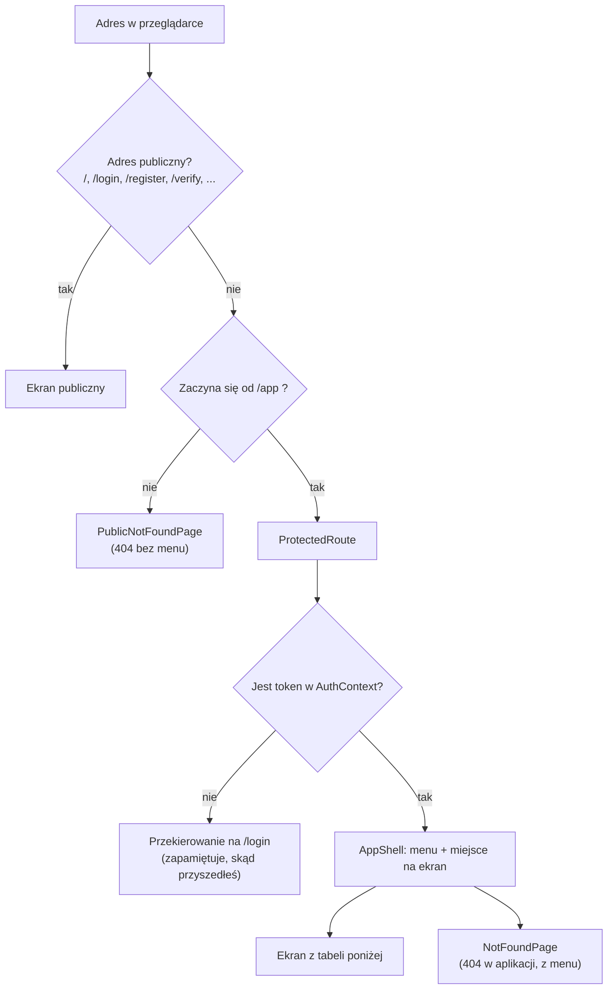
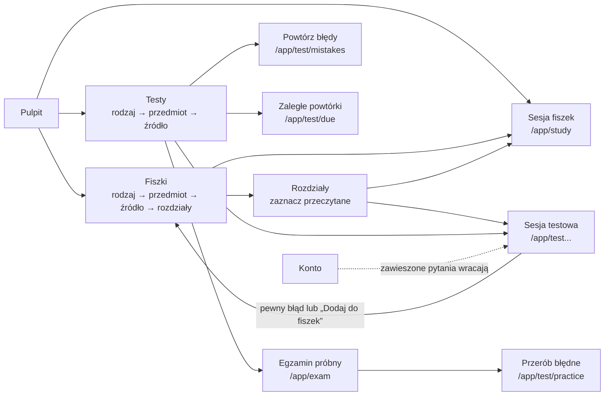

# 02. Routing i strony

[← Spis treści](README.md)

Ten dokument wymienia **wszystkie adresy** aplikacji, plik, który rysuje dany ekran, i to, co ekran robi. Adresy są
zdefiniowane w `app/router.tsx`. Żeby w linkach nie wpisywać ich na sztywno, każdy ma nazwę w `config/routes.ts`
(obiekt `ROUTES`). Oba pliki trzeba zmieniać razem: router ma własne napisy z adresami (patrz
[Znane ograniczenia](10-znane-ograniczenia.md)).

## Jak działa routing

- **Ekrany publiczne** (strona główna, logowanie, rejestracja, regulamin) są dostępne bez logowania.
- **Ekrany aplikacji** mają adres zaczynający się od `/app`. Przed nimi stoi `ProtectedRoute`
  (`components/ProtectedRoute.tsx`): bez tokenu odsyła na `/login` i zapamiętuje adres, z którego przyszedłeś. Po
  zalogowaniu `LoginPage` wraca na ten adres (zapamiętywana jest sama ścieżka, bez parametrów po znaku `?`;
  patrz [Znane ograniczenia](10-znane-ograniczenia.md)).
- `ProtectedRoute` sprawdza **tylko, czy token istnieje**, nie czy jest ważny. Ważność sprawdza serwer przy pierwszym
  żądaniu; odpowiedź 401 wylogowuje (patrz [03](03-logowanie-i-sesja.md)).
- Zalogowany użytkownik, który wejdzie na `/login` albo `/register`, **nie jest** przekierowywany: widzi formularz. Na
  stronie głównej dostaje przyciski „Przejdź do aplikacji” zamiast „Załóż konto”.
- Adres `/app` przekierowuje na `/app/dashboard` (Pulpit).
- Nieznany adres pod `/app/...` pokazuje 404 w ramce aplikacji (z menu), a nieznany adres poza nią 404 bez menu.
- Parametry w adresie (`:subjectId`) zamieniane są na liczby przez `parseId` (`features/flashcards/hooks.ts`); zły
  parametr daje ekran 404, a nie błąd.

## Ekrany publiczne

| Adres | Ekran (plik) | Co robi |
|-------|--------------|---------|
| `/` | `LandingPage` (`pages/LandingPage.tsx`) | Strona główna: hero, demo pytania, wyjaśnienie powtórek, funkcje, kroki, pytania i odpowiedzi. Z `?konto=usuniete` pokazuje potwierdzenie usunięcia konta. Opis w [07](07-strona-glowna.md) |
| `/login` | `LoginPage` (`pages/LoginPage.tsx`) | Logowanie mailem prywatnym i hasłem. Przy odpowiedzi 409 („konto nieaktywne”) pokazuje formularz „wyślij link ponownie” |
| `/register` | `RegisterPage` (`pages/RegisterPage.tsx`) | Rejestracja: mail prywatny, mail uczelniany, hasło (8–72 znaki), akceptacja regulaminu |
| `/check-email` | `CheckEmailPage` (`pages/CheckEmailPage.tsx`) | „Sprawdź skrzynkę” po rejestracji; ten sam tekst dla każdego adresu |
| `/verify` | `VerifyPage` (`pages/VerifyPage.tsx`) | Aktywacja konta z linku w mailu (`?token=`); pokazuje sukces albo błąd z opcją wysłania linku ponownie |
| `/forgot-password` | `ForgotPasswordPage` (`pages/ForgotPasswordPage.tsx`) | Prośba o link do zmiany hasła |
| `/reset-password` | `ResetPasswordPage` (`pages/ResetPasswordPage.tsx`) | Ustawienie nowego hasła z linku w mailu (`?token=`) |
| `/regulamin` | `TermsPage` (`features/legal/TermsPage.tsx`) | Regulamin (wersja robocza, dane administratora z `config/legal.ts`) |
| `/polityka-prywatnosci` | `PrivacyPage` (`features/legal/PrivacyPage.tsx`) | Polityka prywatności (wersja robocza) |
| `*` | `PublicNotFoundPage` (`features/misc/NotFoundPage.tsx`) | Strona 404 poza aplikacją |

## Ekrany aplikacji (po zalogowaniu)

Wszystkie poniższe adresy mają przedrostek `/app` i są wyświetlane wewnątrz `AppShell` (menu + treść). Wyjątek to sesje fiszek
i testów (`/app/study...` oraz `/app/test...`): tam `AppShell` chowa menu i pokazuje przycisk „Zakończ sesję” (patrz [Menu
aplikacji](#menu-aplikacji)).

| Adres | Ekran (plik) | Co robi |
|-------|--------------|---------|
| `/app/dashboard` | `DashboardPage` (`features/dashboard/DashboardPage.tsx`) | Pulpit: „Na dziś” (jeden główny przycisk), „Postęp”, wynik egzaminu próbnego, a na początku wybór egzaminu |
| `/app/flashcards` | `CategoriesPage` (`pages/CategoriesPage.tsx`) | Fiszki, poziom 1: rodzaje materiału oraz „Powtórki na dziś”. Gdy użytkownik nie ma jeszcze żadnej fiszki, wyjaśnia, skąd się biorą |
| `/app/flashcards/:categoryId/subjects` | `SubjectsPage` (`pages/SubjectsPage.tsx`) | Fiszki, poziom 2: przedmioty lub akty prawne wybranego rodzaju |
| `/app/flashcards/:subjectId/sources` | `SourcesPage` (`pages/SourcesPage.tsx`) | Fiszki, poziom 3: źródła przedmiotu z paskiem postępu. Podręcznik prowadzi do rozdziałów, pula płaska od razu do nauki |
| `/app/flashcards/:subjectId/sources/:sourceId/chapters` | `ChaptersPage` (`pages/ChaptersPage.tsx`) | Rozdziały podręcznika z polami „przeczytany”, paskami postępu i przyciskami „Rozpocznij naukę” / „Rozpocznij test” |
| `/app/study` | `StudySessionPage` (`pages/StudySessionPage.tsx`) | Sesja fiszek z całego materiału (zaległe powtórki i dzienna porcja nowych) |
| `/app/study/:subjectId` | `StudySessionPage` | Sesja fiszek z jednego przedmiotu; `?sourceId=` zawęża do źródła |
| `/app/test` | `TestSessionPage` (`pages/TestSessionPage.tsx`) | Sesja testowa z całego materiału; `?categoryId=` zawęża do rodzaju |
| `/app/test/mistakes` | `TestSessionPage` (tryb `mistakes`) | „Powtórz moje błędy” |
| `/app/test/due` | `TestSessionPage` (tryb `due`) | „Zaległe powtórki”: same zaległe pytania, bez nowych |
| `/app/test/practice` | `TestSessionPage` (tryb `practice`) | Sesja z podanych pytań (`?cardIds=1,2,3`), np. błędy z egzaminu próbnego |
| `/app/test/custom` | `TestSessionPage` (tryb `custom`) | Sesja „Własnego testu”: pytania wylosowane na ekranie układania (`?cardIds=1,2,3`) |
| `/app/test/:subjectId` | `TestSessionPage` | Sesja testowa z jednego przedmiotu; `?sourceId=` zawęża do źródła |
| `/app/exam` | `ExamPage` (`features/exam/ExamPage.tsx`) | Egzamin próbny w stałym formacie (150 pytań, zaliczenie od 100 punktów): ustawienia (tylko limit czasu), przebieg z zegarem, raport i historia |
| `/app/custom-test` | `CustomTestPage` (`features/customTest/CustomTestPage.tsx`) | Własny test: wybór rodzajów i aktów prawnych, rodzaju pytań i liczby pytań (10, 20, 50, 100 albo 150; przy małym zakresie „Wszystkie (N)”). Link „Moje testy”. To ekran układania, nie sesja, więc menu zostaje |
| `/app/custom-test/history` | `MyTestsPage` (`features/customTest/MyTestsPage.tsx`) | „Moje testy”: lista zapisanych własnych testów, od najnowszego, z oznaczeniem „Nieukończony” i wynikiem |
| `/app/custom-test/history/:id` | `MyTestDetailPage` (`features/customTest/MyTestDetailPage.tsx`) | Szczegóły zapisanego testu: ustawienia, wynik i wszystkie pytania z odpowiedziami (filtr „Błędne i bez odpowiedzi”). Przycisk „Ułóż ponownie z tymi ustawieniami” otwiera ekran układania z wypełnionym wyborem |
| `/app/tests` | `TestsPage` (`features/tests/TestsPage.tsx`) | Testy, poziom 1: znacznik filtra pochodzenia, pasek zaległych powtórek, „Szybki start” (cały materiał, własny test, moje błędy, egzamin), rodzaje |
| `/app/tests/:categoryId` | `TestCategoryPage` (`features/tests/TestCategoryPage.tsx`) | Testy, poziom 2: przedmioty lub akty prawne rodzaju, przycisk „Test z całego rodzaju” przy tytule |
| `/app/tests/:categoryId/:subjectId` | `TestSubjectPage` (`features/tests/TestSubjectPage.tsx`) | Testy, poziom 3: źródła przedmiotu w wierszach, przycisk „Test ze wszystkich źródeł” przy tytule i „Rozpocznij test” przy źródle |
| `/app/statistics` | `StatisticsPage` (`features/statistics/StatisticsPage.tsx`) | Statystyki: „Podsumowanie nauki” (odpowiedzi, egzaminy, własne testy, czas nauki, średni czas odpowiedzi), opanowanie według aplikacji i roku, ostatnie 30 dni, aktywność, fiszki |
| `/app/account` | `AccountPage` (`features/account/AccountPage.tsx`) | Konto: ustawienia nauki, terminy egzaminów (administrator), trudne i zawieszone pytania, zmiana hasła, pobranie danych, usunięcie konta |
| `/app/*` | `NotFoundPage` (`features/misc/NotFoundPage.tsx`) | Strona 404 w ramce aplikacji |

Ekrany aplikacji (oprócz stron wejściowych: główna, logowanie, rejestracja i reszta kont) są ładowane **leniwie** (`React.lazy` i `Suspense`): ich kod pobiera się dopiero przy pierwszym wejściu, a w tym czasie widać krótki ekran ładowania (`components/RouteFallback.tsx`). Całość otacza granica błędów `ErrorBoundary` (`components/ErrorBoundary.tsx`): gdy ekran się wywróci, użytkownik widzi „Coś poszło nie tak” i przycisk „Odśwież stronę” zamiast pustej strony, a menu aplikacji zostaje. Przejście na inny adres naprawia widok.

Kolejność tras w `router.tsx` ma znaczenie dla czytelności: trasy stałe (`test/mistakes`, `test/due`, `test/practice`, `test/custom`)
stoją przed `test/:subjectId`, żeby ich nazwy nie były brane za numer przedmiotu.

### Jak ekrany prowadzą jeden do drugiego

Dwie sprawy wynikają z tego układu:

- **Dwa drzewa wyboru materiału.** Fiszki prowadzą przez `/app/flashcards/...`, a Testy przez `/app/tests/...`. Oba
  kończą na sesji (`/app/study/...` albo `/app/test/...`), ale mają osobne ekrany, bo pokazują inne liczniki (fiszki
  i pytania liczone osobno).
- **Pierwszy parametr po `/app/flashcards/` znaczy co innego na różnych poziomach**: na drugim poziomie to numer
  rodzaju (`:categoryId`), na trzecim i czwartym numer przedmiotu (`:subjectId`). Każdy ekran czyta swój parametr.

## Menu aplikacji

Pozycje menu są zdefiniowane w `config/navigation.ts` (`NAV_ITEMS`) i jest ich pięć:

| Pozycja | Adres | Dodatkowo aktywna na | Odznaka |
|---------|-------|----------------------|---------|
| Pulpit | `/app/dashboard` | tylko dokładny adres | brak |
| Testy | `/app/tests` | `/app/exam` i `/app/custom-test` (egzamin próbny i układanie własnego testu są częścią Testów) | liczba pytań testowych do powtórki (`TEST`) |
| Fiszki | `/app/flashcards` | | liczba fiszek do powtórki (`FLASHCARD`) |
| Statystyki | `/app/statistics` | | brak |
| Konto | `/app/account` | | brak |

Menu rysuje `AppShell` (`components/layout/AppShell.tsx`) w trzech postaciach, zależnie od szerokości okna:

| Szerokość okna | Menu | Plik |
|----------------|------|------|
| od 1280 px (`xl`) | Panel po lewej (248 px): logo, przycisk zwijania, cztery pozycje (bez Konta) z odznakami, a na dole blok konta (litera, adres e-mail, „Konto i ustawienia”) i ikona wylogowania. Panel można zwinąć do wąskiego paska; wybór jest zapamiętany w przeglądarce | `components/layout/SideNav.tsx` (odmiana `full`) |
| od 768 px (`md`) do 1279 px | Wąski pasek po lewej (84 px): ikona z krótkim podpisem pod spodem, na dole kółko konta i wylogowanie | `components/layout/SideNav.tsx` (odmiana `rail`) |
| poniżej 768 px | Dolna belka z pięcioma pozycjami (łącznie z Kontem) | `components/layout/BottomNav.tsx` |

Odznaka (`NavBadge`) pokazuje liczbę do powtórki z `GET /api/review/due-count`; gdy nic nie zalega, nie pojawia się. Powyżej
99 pokazuje „99+”. Wylogowanie jest w panelu bocznym (ikona), a na telefonie, gdzie panelu nie ma, na ekranie Konto.

### Sesje nauki: bez menu

Na adresach sesji (`/app/study`, `/app/study/:subjectId`, `/app/test`, `/app/test/mistakes`, `/app/test/due`,
`/app/test/practice`, `/app/test/custom`, `/app/test/:subjectId`) menu znika, żeby nic nie odciągało od pytania. U góry jest wtedy przycisk
„Zakończ sesję”: z sesji fiszek prowadzi do Fiszek, z sesji testu do Testów, a z sesji własnego testu z powrotem do ekranu
układania (`/app/custom-test`) z zapamiętanym wyborem. Regułę zapisuje funkcja `sessionExitRoute` w
`config/navigation.ts`; porównuje ona całe segmenty adresu, więc listy `/app/tests` i `/app/flashcards` zostają z menu.
Egzamin próbny (`/app/exam`) menu zachowuje, także w trakcie egzaminu.

## Co każdy ekran pobiera z serwera

Pełna lista wywołań serwera z nazwami funkcji jest w [05](05-warstwa-api-i-dane.md). Poniżej skrót według ekranów:

| Ekran | Dane z serwera |
|-------|----------------|
| Pulpit | Liczby powtórek pytań i fiszek (`due-count`), liczba błędów, ustawienia nauki (wybrana aplikacja, termin, plan dnia), terminy egzaminów (okno startowe), statystyki Testów, aktywność z 28 dni (seria), katalog Testów (postęp według rodzajów), historia egzaminów |
| Fiszki (poziomy 1–3) | Kategorie, przedmioty rodzaju, źródła przedmiotu z postępem |
| Rozdziały | Rozdziały źródła, opanowanie rozdziałów, zapis „przeczytany” |
| Sesja fiszek | Kolejka fiszek, zapis oceny, liczba nowych kart do dołożenia, zaległości |
| Sesja testowa | Kolejka pytań (zakres, błędy, ćwiczenia, własny test), zapis odpowiedzi, ustawienia (tasowanie), zaległości, „Dodaj do fiszek” |
| Testy (poziomy 1–3) | Katalog Testów, filtr pochodzenia, liczba błędów i zaległych |
| Własny test | Katalog Testów (drzewo wyboru), liczniki „Dostępnych: N” (`custom-test/counts`), statystyki według pochodzenia (lista lat), losowanie pytań (`custom-test`) |
| Egzamin | Katalog Testów (tylko liczba dostępnych pytań), start (bez ciała, serwer losuje 150 pytań) i zakończenie egzaminu (serwer ocenia i ustala próg), historia |
| Statystyki | Statystyki według pochodzenia (opanowanie), statystyki Testów (ostatnie 30 dni), aktywność, przegląd fiszek (`mode=FLASHCARD`), opanowanie rozdziałów, najsłabsze karty, lista przedmiotów, liczba błędów |
| Konto | Adres konta, ustawienia nauki (wybór egzaminu), terminy egzaminów (administrator), trudne i zawieszone pytania, zmiana hasła, eksport i usunięcie konta |
| Logowanie i rejestracja | Wywołania `/api/auth/*` |
| Regulamin, polityka, strona główna | Brak (treść jest w kodzie) |

## Przegląd ekranów

### Pulpit (`features/dashboard`)

Pulpit odpowiada na dwa pytania: **co zrobić teraz** i **czy jestem na dobrej drodze**. Ma tylko trzy karty, bo więcej
rozprasza; mapy aktywności, rozbicia błędów i „opanowane” są w Statystykach. Nie ma przełącznika Fiszki / Testy ani
powitania „Cześć!”; nagłówek to „Pulpit” z dzisiejszą datą. Na szerokim ekranie są dwie kolumny („Na dziś” i „Postęp”
po lewej, „Egzamin próbny” po prawej), na telefonie jedna.

Kolejność kart (na telefonie od góry, na szerokim ekranie lewa kolumna, potem prawa):

0. **Okno startowe** (`OnboardingGate` z `features/onboarding`, osadzone w `AppShell`, więc działa na każdej stronie
   aplikacji, nie tylko na Pulpicie): dopóki użytkownik nie wybrał aplikacji, na środku ekranu stoi **okno modalne „Witaj w
   Tutlaw”**, którego nie da się zamknąć. Jest w nim wybór aplikacji („Do jakiego egzaminu się przygotowujesz?”, pięć opcji z
   wierszem terminu albo „termin nieogłoszony”) i wybór wyglądu strony (Ciemny, domyślny, albo Jasny) z podglądem na żywo.
   Przycisk „Zacznij naukę” jest nieaktywny, dopóki nie wybrano aplikacji; okno nie ma przycisku zamknięcia, Esc i kliknięcie
   w tło nic nie robią, a jedyne inne wyjście to „Wyloguj się”. Zapis: najpierw wygląd (`PUT /api/me/theme`, tylko gdy się
   zmienił), potem aplikacja (`PUT /api/me/exam`; backend ustawia przy tym filtr pochodzenia na wybraną aplikację i pytania
   autorskie). Okno pojawia się dopiero, gdy ustawienia się wczytały i `examOrigin` jest dokładnie `null`: błąd ani ładowanie
   ustawień nie blokują aplikacji. Szczegóły w [04](04-nauka-w-aplikacji.md#okno-startowe-i-wygląd-strony).
1. **Na dziś** (`TodayCard`). Wiersz egzaminu: „Aplikacja notarialna: do egzaminu 69 dni (22 grudnia 2026), tryb
   egzaminacyjny włączony” (tryb od 30 dni przed egzaminem), „termin nieogłoszony”, „już się odbył”. Dalej cel dnia: „Nowe pytania dziś: X z Y” z paskiem (Y to cel z planu serwera, liczony
   od stanu z początku dnia, więc nie maleje w ciągu dnia i nie przekracza rozsądnego maksimum 100), po wykonaniu „, cel na
   dziś zrobiony”. Gdy użytkownik ma **własny** limit niższy niż potrzeba (a potrzeba mieści się w maksimum), ostrzeżenie mówi:
   „Żeby zdążyć, potrzeba N nowych pytań dziennie, a Twój limit to M. Zmień go w Ustawieniach albo wybierz limit
   automatyczny.” Gdy potrzeba więcej niż maksimum, ostrzeżenie mówi to **wprost** („Wszystkich nowych pytań nie zdążysz
   zacząć przed ostatnimi dwoma tygodniami: trzeba by N nowych pytań dziennie, a 100 dziennie to rozsądne maksimum”, przy
   limicie automatycznym z dopiskiem „Limit ustawiliśmy na 100.”) i podpowiada zawężenie zakresu filtrem „Pochodzenie pytań w
   Testach”, zamiast prosić o podniesienie limitu, które nic by nie dało (`LimitNotice`, reguły w `newQuestionsLimit.ts`). W
   ostatnich 14 dniach przed egzaminem zamiast celu jest zdanie „Ostatnie dwa tygodnie: skup się na powtórkach.” Potem
   komunikat i **jedyny złoty przycisk na ekranie**, który sam wybiera następny krok: zaległe pytania → „Zacznij powtórkę
   pytań”, potem zaległe fiszki → „Zacznij powtórkę fiszek”, potem nowe pytania → „Ucz się nowych pytań”; gdy nic nie
   zalega, „Na dziś gotowe” i cichy przycisk „Ułóż własny test”. Pod spodem ciche linki „Fiszki do powtórki: N” i „Popraw
   moje błędy: N” (tylko gdy N > 0) oraz wiersz serii: „Seria: N dni  W tym tygodniu: M odpowiedzi” albo „Zacznij serię
   dziś”.
2. **Postęp** (`ProgressCard`): jeden pasek „Przerobione: 166 z 400 (42%)”. „Przerobione” to pytania, które miały już choć
   jedną odpowiedź; to **nie** to samo co „opanowane” (to jest w Statystykach, bo przez pierwsze dwa tygodnie byłoby 0).
   Pod paskiem podpis z objaśnieniem i, gdy jest filtr pochodzenia, notka o nim. Niżej wiersze według rodzajów (każdy
   prowadzi do tego rodzaju w Testach).
3. **Egzamin próbny** (`ExamCard`, kolumna boczna): ostatni wynik („112 / 150”, „Zaliczony” albo „Niezaliczony”, data,
   próg), mały wykres ostatnich pięciu podejść z przerywaną linią progu (100 z 150) i przycisk „Nowy egzamin”. Wykres
   bierze tylko podejścia w stałym formacie (z progiem w punktach); starsze podejścia z progiem w procentach są pomijane,
   bo ich wyników nie da się uczciwie porównać. Bez żadnego takiego podejścia karta opisuje format i zaprasza do pierwszego.

Każda karta pobiera dane sama i sama pokazuje błąd z przyciskiem „Spróbuj ponownie” (`InlineError`), więc awaria jednego
zapytania nie wywraca reszty Pulpitu (odpowiedź o złym kształcie, np. pusty obiekt zamiast listy w historii egzaminów albo
aktywności, jest traktowana jak błąd tej karty). Wybór głównego kroku i lista podejść do wykresu są liczone w
`selectors.ts` (czyste funkcje, bez wywołań serwera). Kolejność w kodzie jest zarazem kolejnością tabulatora, bez
przestawiania elementów w CSS.

### Fiszki i rozdziały (`pages/CategoriesPage` ... `ChaptersPage`)

Fiszki **zaczynają puste**: pojawiają się po pewnym błędzie w teście albo po kliknięciu „Dodaj do fiszek” (patrz
[04](04-nauka-w-aplikacji.md)). Gdy użytkownik nie ma żadnej fiszki, pierwszy poziom pokazuje wyjaśnienie z odnośnikiem
do Testów zamiast pustej listy. Na liście źródeł pula samych pytań testowych bez fiszek jest ukrywana, a podręcznik
zostaje zawsze, bo tam oznacza się przeczytane rozdziały, od których zależy dostęp do pytań testowych. Zmiana pola
„przeczytany” działa od razu na ekranie (zapis „optymistyczny”), a gdy serwer jej nie przyjmie, ekran wraca do
poprzedniego stanu i pokazuje komunikat.

### Testy (`features/tests`)

Trzypoziomowy katalog (rodzaj → przedmiot lub akt prawny → źródło) z licznikami „Rozwiązano X / Y”. Pusta pozycja jest
wyszarzona i nie prowadzi dalej. Pytania z nieprzeczytanych rozdziałów podręczników są liczone osobno („+N po
przeczytaniu rozdziałów”). Na każdym z trzech poziomów przy tytule jest znacznik filtra pochodzenia pytań (patrz
[04](04-nauka-w-aplikacji.md)).

Strona ma **jedną główną akcję** (złoty przycisk), a resztę przycisków ciszej (ramka, bez złota):

- Poziom 1: pasek „N pytań do powtórki” ze złotym przyciskiem „Powtórz” (jest tylko wtedy, gdy coś zalega), potem rząd
  „Szybki start” z czterema cichymi przyciskami: „Cały materiał”, „Własny test”, „Moje błędy” (z liczbą, tylko gdy są
  błędy) i „Egzamin próbny” (na telefonie układają się w 2×2), a pod nim rodzaje („Wybierz rodzaj”). Dzięki temu rodzaje zaczynają się wysoko, także na telefonie.
- Poziom 2: złoty „Test z całego rodzaju” przy tytule.
- Poziom 3: źródła w wierszach (nazwa, postęp, przycisk). Złoty jest „Test ze wszystkich źródeł” przy tytule, a gdy
  źródło jest jedno, złoty jest jego przycisk „Rozpocznij test”. Pozostałe przyciski w wierszach są ciche.

### Własny test (`features/customTest`)

Ekran układania sesji nauki na adresie `/app/custom-test`; wchodzi się do niego z „Szybkiego startu” na ekranie Testy
(przycisk „Własny test”). To **nauka, nie egzamin**: nie ma progu zaliczenia ani wyniku „zdał / nie zdał”. Użytkownik
składa test w trzech krokach na jednym ekranie:

1. **Co** — drzewo rodzajów i aktów prawnych z polami wyboru (rodzaj zaznaczony w całości, częściowo albo wcale;
   domyślnie zaznaczone jest wszystko). Pokazuje tylko działy, w których jest teraz co rozwiązywać (według katalogu
   Testów, czyli z filtrem pochodzenia).
2. **Które pytania** — wszystkie, nowe, „Moje błędy” albo zaległe, każde z liczbą dostępnych pytań w wybranym zakresie.
3. **Ile pytań** — tylko 10, 20, 50, 100 albo 150 (bez pola „Inna liczba” i bez wyboru lat egzaminu). Pokazane są wyłącznie
   liczby, które mieszczą się w dostępnych pytaniach, a gdy nie wypada żadna pełna liczba, na końcu jest „Wszystkie (N)”; przy
   bardzo małym zakresie jedyną opcją jest „Wszystkie (N)”.

Liczby „Dostępnych: N” przychodzą z serwera po każdej zmianie zakresu (z opóźnieniem 250 ms, żeby szybkie klikanie
nie dawało serii zapytań). Przycisk „Rozpocznij test” jest nieaktywny, dopóki liczby nie są policzone albo gdy nic nie
spełnia warunków. Na komputerze podsumowanie z przyciskiem stoi w prawej kolumnie, na telefonie w pasku przyklejonym
do dołu ekranu.

Start robi dwa kroki: `POST /api/review/custom-test` losuje numery pytań i **zapisuje sesję** (odpowiedź ma `cardIds` i
`sessionId`), a ekran otwiera `/app/test/custom?cardIds=…&sessionId=…`, która pobiera te pytania zwykłą kolejką ćwiczeń
(`GET /api/review/practice-queue`). Odpowiedzi w sesji idą tak jak w zwykłym teście: dostają ocenę pamięci (FSRS), a błędne
trafiają do „Moich błędów”. Ostatni wybór jest zapamiętany w przeglądarce (`tutlaw.customTest.v1`, patrz
[03](03-logowanie-i-sesja.md)). W nagłówku ekranu jest link „Moje testy”.

### Moje testy (`features/customTest`)

Zapisane własne testy: lista na `/app/custom-test/history` (`MyTestsPage`) i szczegóły na `/app/custom-test/history/:id`
(`MyTestDetailPage`). Test zapisuje się w chwili startu, więc porzucony zostaje na liście z oznaczeniem „Nieukończony”.
Szczegóły pokazują wynik, liczbę odpowiedzi, czas i pytania z odpowiedziami; przycisk „Ułóż ponownie z tymi ustawieniami” wraca
na ekran układania z tym samym zakresem, rodzajem pytań i liczbą. Szczegóły zasad: [04](04-nauka-w-aplikacji.md#moje-testy).

### Statystyki (`features/statistics`)

Cztery części, od góry:

1. **Opanowanie** (`MasterySection`): wybór zakresu „Aplikacja:” (domyślnie wybrany egzamin, jeśli ma pytania, w przeciwnym
   razie „Wszystkie”), pasek i liczby: opanowane, w nauce, nowe, do powtórki i skuteczność, a pod nimi tabela według roku
   egzaminu. Zawsze widoczne objaśnienie (`MasteryExplainer`): pytanie jest **opanowane**, gdy jego stabilność przekracza
   21 dni; zwykle potrzeba trzech poprawnych odpowiedzi w terminie (około dwóch tygodni nauki), a błędna albo „Nie jestem
   pewien” cofa je do „W nauce”. Pierwsze dwa tygodnie „0 opanowanych” jest normalne. Ta część ignoruje filtr pochodzenia
   pytań (zakres wybiera się tu).
2. **Podsumowanie nauki** (`LearningSummarySection`, `GET /api/statistics/learning-summary`): liczba odpowiedzi (z podziałem
   na testy i fiszki), ukończone egzaminy próbne, ukończone własne testy (z linkiem do Moich testów), średni czas na pytanie i na
   fiszkę oraz **czas nauki**: dziś, ostatnie 7 dni i łącznie. Czas nauki to osobna miara od czasu odpowiedzi (patrz
   [04](04-nauka-w-aplikacji.md#czas-nauki)). Ta sekcja nie zależy od żadnego filtra.
3. **Ostatnie 30 dni** (`RecentAnswersCard`) obok **Aktywności** (`ActivityChart`: 28 słupków, seria dni, ostatnie 7 dni
   na tle poprzednich 7), na telefonie jedno pod drugim. Pod pierwszą cichy link „Popraw moje błędy: N”.
4. **Fiszki** (`FlashcardsSection`): liczby z przeglądu fiszek (zapytanie `overview` z `mode=FLASHCARD`), filtr
   przedmiotu w nagłówku sekcji, po wybraniu przedmiotu opanowanie rozdziałów (`ChapterMasteryList`) i zawsze tabela „Do
   poprawy” (10 kart z największą liczbą błędów). **Tylko ta sekcja zależy od filtra przedmiotu.**

Każda sekcja pobiera dane sama i przy błędzie pokazuje komunikat z przyciskiem „Spróbuj ponownie”; odpowiedź o złym
kształcie (np. obiekt zamiast listy) jest traktowana jak błąd.

### Konto (`features/account`)

Karty w tej kolejności: adres konta, ustawienia nauki (z wyborem egzaminu), **terminy egzaminów** (tylko dla administratora,
`ExamTermsCard`: data dla każdej z pięciu aplikacji, „Zapisz” i „Usuń termin”), trudne i zawieszone pytania, zmiana hasła,
pobranie danych, usunięcie konta. Szczegóły w [03](03-logowanie-i-sesja.md) (konto) i [04](04-nauka-w-aplikacji.md) (ustawienia nauki, zawieszanie).
