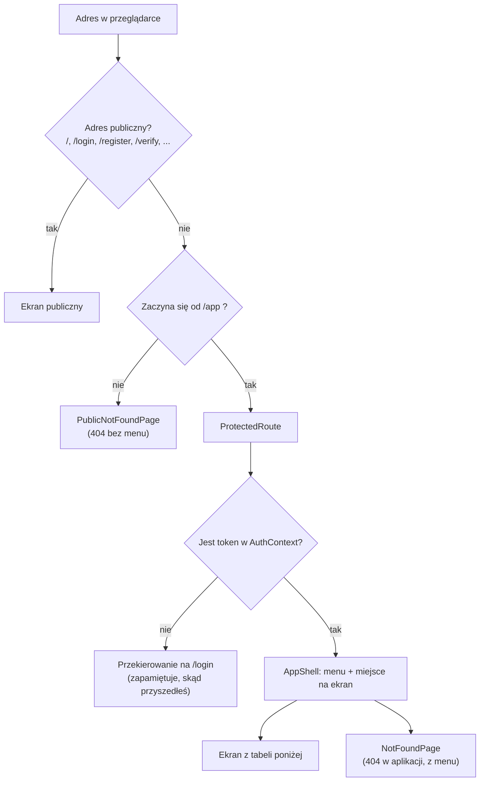
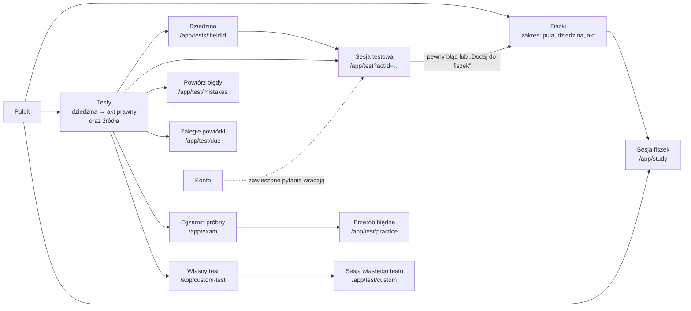

# 02. Routing i strony

[← Spis treści](README.md)

Ten dokument wymienia **wszystkie adresy** aplikacji, plik, który rysuje dany ekran, i to, co ekran robi. Adresy są
zdefiniowane w `app/router.tsx`. Żeby w linkach nie wpisywać ich na sztywno, każdy ma nazwę w `config/routes.ts`
(obiekt `ROUTES`). Oba pliki trzeba zmieniać razem: router ma własne napisy z adresami (patrz
[Znane ograniczenia](10-znane-ograniczenia.md)).

## Jak działa routing

- **Ekrany publiczne** (strona główna, logowanie, rejestracja, regulamin) są dostępne bez logowania.
- **Ekrany aplikacji** mają adres zaczynający się od `/app`. Przed nimi stoi `ProtectedRoute`
  (`components/ProtectedRoute.tsx`): bez tokenu odsyła na `/login` i zapamiętuje adres, z którego przyszedłeś. Po
  zalogowaniu `LoginPage` wraca na ten adres (zapamiętywana jest sama ścieżka, bez parametrów po znaku `?`;
  patrz [Znane ograniczenia](10-znane-ograniczenia.md)).
- `ProtectedRoute` sprawdza **tylko, czy token istnieje**, nie czy jest ważny. Ważność sprawdza serwer przy pierwszym
  żądaniu; odpowiedź 401 wylogowuje (patrz [03](03-logowanie-i-sesja.md)).
- Zalogowany użytkownik, który wejdzie na `/login` albo `/register`, **nie jest** przekierowywany: widzi formularz. Na
  stronie głównej dostaje przyciski „Przejdź do aplikacji” zamiast „Załóż konto”.
- Adres `/app` przekierowuje na `/app/dashboard` (Pulpit).
- Nieznany adres pod `/app/...` pokazuje 404 w ramce aplikacji (z menu), a nieznany adres poza nią 404 bez menu.
- Parametr trasy (`:fieldId`, `:id`) zamieniany jest na liczbę przez `parseId` (`lib/ids.ts`); zły parametr daje ekran
  „Nie ma takiej dziedziny” albo 404, a nie błąd. Zakres sesji nauki jest w **adresie po znaku `?`**: `?fieldId=`,
  `?actId=`, `?sourceId=`; czyta je hook `useScopeParams` (`features/review/useScopeParams.ts`), a budują funkcje
  `ROUTES.studyScope` i `ROUTES.testScope`. Bez żadnego z tych parametrów sesja obejmuje całą pulę użytkownika.

## Ekrany publiczne

| Adres | Ekran (plik) | Co robi |
|-------|--------------|---------|
| `/` | `LandingPage` (`pages/LandingPage.tsx`) | Strona główna: hero, demo pytania, wyjaśnienie powtórek, funkcje, kroki, pytania i odpowiedzi. Z `?konto=usuniete` pokazuje potwierdzenie usunięcia konta. Opis w [07](07-strona-glowna.md) |
| `/login` | `LoginPage` (`pages/LoginPage.tsx`) | Logowanie mailem prywatnym i hasłem. Przy odpowiedzi 409 („konto nieaktywne”) pokazuje formularz „wyślij link ponownie” |
| `/register` | `RegisterPage` (`pages/RegisterPage.tsx`) | Rejestracja: mail prywatny, mail uczelniany, hasło (8–72 znaki), akceptacja regulaminu |
| `/check-email` | `CheckEmailPage` (`pages/CheckEmailPage.tsx`) | „Sprawdź skrzynkę” po rejestracji; ten sam tekst dla każdego adresu |
| `/verify` | `VerifyPage` (`pages/VerifyPage.tsx`) | Aktywacja konta z linku w mailu (`?token=`); pokazuje sukces albo błąd z opcją wysłania linku ponownie |
| `/forgot-password` | `ForgotPasswordPage` (`pages/ForgotPasswordPage.tsx`) | Prośba o link do zmiany hasła |
| `/reset-password` | `ResetPasswordPage` (`pages/ResetPasswordPage.tsx`) | Ustawienie nowego hasła z linku w mailu (`?token=`) |
| `/regulamin` | `TermsPage` (`features/legal/TermsPage.tsx`) | Regulamin (wersja robocza, dane administratora z `config/legal.ts`) |
| `/polityka-prywatnosci` | `PrivacyPage` (`features/legal/PrivacyPage.tsx`) | Polityka prywatności (wersja robocza) |
| `*` | `PublicNotFoundPage` (`features/misc/NotFoundPage.tsx`) | Strona 404 poza aplikacją |

## Ekrany aplikacji (po zalogowaniu)

Wszystkie poniższe adresy mają przedrostek `/app` i są wyświetlane wewnątrz `AppShell` (menu + treść). Wyjątek to sesje fiszek
i testów (`/app/study...` oraz `/app/test...`): tam `AppShell` chowa menu i pokazuje przycisk „Zakończ sesję” (patrz [Menu
aplikacji](#menu-aplikacji)).

| Adres | Ekran (plik) | Co robi |
|-------|--------------|---------|
| `/app/dashboard` | `DashboardPage` (`features/dashboard/DashboardPage.tsx`) | Pulpit: „Na dziś” (jeden główny przycisk), „Postęp”, wynik egzaminu próbnego, a na początku obowiązkowe okno wyboru ścieżki |
| `/app/flashcards` | `FlashcardsPage` (`features/flashcards/FlashcardsPage.tsx`) | Fiszki: „Powtórki na dziś” z całej puli i nauka z wybranej dziedziny albo aktu prawnego. Gdy użytkownik nie ma jeszcze żadnej fiszki, wyjaśnia, skąd się biorą |
| `/app/study` | `StudySessionPage` (`pages/StudySessionPage.tsx`) | Sesja fiszek (zaległe powtórki i dzienna porcja nowych). Zakres w adresie: `?fieldId=`, `?actId=`, `?sourceId=`; bez nich cała pula |
| `/app/test` | `TestSessionPage` (`pages/TestSessionPage.tsx`) | Sesja testowa z całej puli albo z zakresu podanego w adresie (`?fieldId=`, `?actId=`, `?sourceId=`) |
| `/app/test/mistakes` | `TestSessionPage` (tryb `mistakes`) | „Powtórz moje błędy” |
| `/app/test/due` | `TestSessionPage` (tryb `due`) | „Zaległe powtórki”: same zaległe pytania, bez nowych |
| `/app/test/practice` | `TestSessionPage` (tryb `practice`) | Sesja z podanych pytań (`?questionIds=1,2,3`), np. błędy z egzaminu próbnego |
| `/app/test/custom` | `TestSessionPage` (tryb `custom`) | Sesja „Własnego testu”: pytania wylosowane na ekranie układania (`?questionIds=1,2,3&sessionId=7`) |
| `/app/exam` | `ExamPage` (`features/exam/ExamPage.tsx`) | Egzamin próbny w stałym formacie (150 pytań, zaliczenie od 100 punktów): ustawienia (tylko limit czasu), przebieg z zegarem, raport i historia |
| `/app/custom-test` | `CustomTestPage` (`features/customTest/CustomTestPage.tsx`) | Własny test: wybór dziedzin i aktów prawnych, rodzaju pytań i liczby pytań (10, 20, 50, 100 albo 150; przy małym zakresie „Wszystkie (N)”). Link „Moje testy”. To ekran układania, nie sesja, więc menu zostaje |
| `/app/custom-test/history` | `MyTestsPage` (`features/customTest/MyTestsPage.tsx`) | „Moje testy”: lista zapisanych własnych testów, od najnowszego, z oznaczeniem „Nieukończony” i wynikiem |
| `/app/custom-test/history/:id` | `MyTestDetailPage` (`features/customTest/MyTestDetailPage.tsx`) | Szczegóły zapisanego testu: ustawienia, wynik i wszystkie pytania z odpowiedziami (filtr „Błędne i bez odpowiedzi”). Przycisk „Ułóż ponownie z tymi ustawieniami” otwiera ekran układania z wypełnionym wyborem |
| `/app/tests` | `TestsPage` (`features/tests/TestsPage.tsx`) | Testy, poziom 1: znacznik „Pula pytań”, pasek zaległych powtórek, „Szybki start” (cała pula, własny test, moje błędy, egzamin), dziedziny prawa i sekcja „Według źródła” |
| `/app/tests/:fieldId` | `TestFieldPage` (`features/tests/TestFieldPage.tsx`) | Testy, poziom 2: akty prawne wybranej dziedziny (tylko z puli użytkownika), przycisk „Test z całej dziedziny” przy tytule. Akt prawny od razu otwiera sesję |
| `/app/statistics` | `StatisticsPage` (`features/statistics/StatisticsPage.tsx`) | Statystyki: opanowanie pytań według źródła, opanowanie aktów prawnych, „Podsumowanie nauki”, ostatnie 30 dni, aktywność, fiszki |
| `/app/account` | `AccountPage` (`features/account/AccountPage.tsx`) | Konto: wygląd, ustawienia nauki (w tym wybór ścieżki), terminy egzaminów (administrator), trudne i zawieszone pytania, zmiana hasła, pobranie danych, usunięcie konta |
| `/app/*` | `NotFoundPage` (`features/misc/NotFoundPage.tsx`) | Strona 404 w ramce aplikacji |

Ekrany aplikacji (oprócz stron wejściowych: główna, logowanie, rejestracja i reszta kont) są ładowane **leniwie** (`React.lazy` i `Suspense`): ich kod pobiera się dopiero przy pierwszym wejściu, a w tym czasie widać krótki ekran ładowania (`components/RouteFallback.tsx`). Całość otacza granica błędów `ErrorBoundary` (`components/ErrorBoundary.tsx`): gdy ekran się wywróci, użytkownik widzi „Coś poszło nie tak” i przycisk „Odśwież stronę” zamiast pustej strony, a menu aplikacji zostaje. Przejście na inny adres naprawia widok.

Trasy `test/mistakes`, `test/due`, `test/practice` i `test/custom` są osobnymi, stałymi adresami (nie mają parametru w
ścieżce), więc ich kolejność w `router.tsx` nie ma znaczenia. Zakres sesji jest w adresie po znaku `?`, a nie w ścieżce.

### Jak ekrany prowadzą jeden do drugiego

Dwie sprawy wynikają z tego układu:

- **Jedno drzewo materiału.** Testy prowadzą przez dziedzinę do aktu prawnego (`/app/tests` → `/app/tests/:fieldId` →
  sesja z `?actId=`), a Fiszki mają tylko listę zakresu na jednym ekranie, bo fiszka jest trybem tego samego pytania i
  nie ma własnej struktury materiału. Obie sesje (`/app/study`, `/app/test`) przyjmują ten sam zakres w adresie.
- **Pula ogranicza wszystko.** Każdy ekran z liczbami pytań (Testy, Fiszki, Pulpit, Statystyki, własny test) liczy
  pytania z puli użytkownika: ścieżka, wybrane akty i filtr źródeł. Znacznik „Pula pytań” (`features/pool/PoolChip.tsx`)
  stoi przy tytule Testów i dziedziny i otwiera okno zmiany puli.

## Menu aplikacji

Pozycje menu są zdefiniowane w `config/navigation.ts` (`NAV_ITEMS`) i jest ich pięć:

| Pozycja | Adres | Dodatkowo aktywna na | Odznaka |
|---------|-------|----------------------|---------|
| Pulpit | `/app/dashboard` | tylko dokładny adres | brak |
| Testy | `/app/tests` | `/app/exam` i `/app/custom-test` (egzamin próbny i układanie własnego testu są częścią Testów) | liczba pytań testowych do powtórki (`TEST`) |
| Fiszki | `/app/flashcards` | | liczba fiszek do powtórki (`FLASHCARD`) |
| Statystyki | `/app/statistics` | | brak |
| Konto | `/app/account` | | brak |

Menu rysuje `AppShell` (`components/layout/AppShell.tsx`) w trzech postaciach, zależnie od szerokości okna:

| Szerokość okna | Menu | Plik |
|----------------|------|------|
| od 1280 px (`xl`) | Panel po lewej (248 px): logo, przycisk zwijania, cztery pozycje (bez Konta) z odznakami, a na dole blok konta (litera, adres e-mail, „Konto i ustawienia”) i ikona wylogowania. Panel można zwinąć do wąskiego paska; wybór jest zapamiętany w przeglądarce | `components/layout/SideNav.tsx` (odmiana `full`) |
| od 768 px (`md`) do 1279 px | Wąski pasek po lewej (84 px): ikona z krótkim podpisem pod spodem, na dole kółko konta i wylogowanie | `components/layout/SideNav.tsx` (odmiana `rail`) |
| poniżej 768 px | Dolna belka z pięcioma pozycjami (łącznie z Kontem) | `components/layout/BottomNav.tsx` |

Odznaka (`NavBadge`) pokazuje liczbę do powtórki z `GET /api/review/due-count`; gdy nic nie zalega, nie pojawia się. Powyżej
99 pokazuje „99+”. Wylogowanie jest w panelu bocznym (ikona), a na telefonie, gdzie panelu nie ma, na ekranie Konto.

### Sesje nauki: bez menu

Na adresach sesji (`/app/study`, `/app/test`, `/app/test/mistakes`, `/app/test/due`, `/app/test/practice`,
`/app/test/custom`, także z parametrami po znaku `?`) menu znika, żeby nic nie odciągało od pytania. U góry jest wtedy przycisk
„Zakończ sesję”: z sesji fiszek prowadzi do Fiszek, z sesji testu do Testów, a z sesji własnego testu z powrotem do ekranu
układania (`/app/custom-test`) z zapamiętanym wyborem. Regułę zapisuje funkcja `sessionExitRoute` w
`config/navigation.ts`; porównuje ona całe segmenty adresu, więc listy `/app/tests` i `/app/flashcards` zostają z menu.
Egzamin próbny (`/app/exam`) menu zachowuje, także w trakcie egzaminu.

## Co każdy ekran pobiera z serwera

Pełna lista wywołań serwera z nazwami funkcji jest w [05](05-warstwa-api-i-dane.md). Poniżej skrót według ekranów:

| Ekran | Dane z serwera |
|-------|----------------|
| Pulpit | Liczby powtórek pytań i fiszek (`due-count`), liczba błędów, ustawienia nauki (ścieżka, termin, plan dnia), lista ścieżek i terminów egzaminów (okno startowe), statystyki Testów, aktywność z 28 dni (seria), katalog Testów (postęp według dziedzin), pula pytań, historia egzaminów |
| Fiszki | Przegląd fiszek (`overview` z `mode=FLASHCARD`), katalog Testów (lista zakresów), zaległości i liczba nowych fiszek w wybranym zakresie |
| Sesja fiszek | Kolejka fiszek, zapis oceny, liczba nowych fiszek do dołożenia, zaległości |
| Sesja testowa | Kolejka pytań (zakres, błędy, ćwiczenia, własny test), zapis odpowiedzi, ustawienia (tasowanie), zaległości, „Dodaj do fiszek” |
| Testy i dziedzina | Katalog Testów (dziedziny, akty, źródła z licznikami), pula pytań, liczba błędów i zaległych |
| Własny test | Katalog Testów (drzewo wyboru), liczniki „Dostępnych: N” (`custom-test/counts`), losowanie pytań (`custom-test`) |
| Egzamin | Katalog Testów (tylko liczba dostępnych pytań), start (bez ciała, serwer losuje 150 pytań) i zakończenie egzaminu (serwer ocenia i ustala próg), historia |
| Statystyki | Statystyki według źródła, opanowanie aktów prawnych, statystyki Testów (ostatnie 30 dni), „Podsumowanie nauki”, aktywność, przegląd fiszek (`mode=FLASHCARD`), najsłabsze pytania |
| Konto | Adres konta, ustawienia nauki, lista ścieżek i terminy egzaminów, trudne i zawieszone pytania, zmiana hasła, eksport i usunięcie konta |
| Logowanie i rejestracja | Wywołania `/api/auth/*` |
| Regulamin, polityka, strona główna | Brak (treść jest w kodzie) |

## Przegląd ekranów

### Pulpit (`features/dashboard`)

Pulpit odpowiada na dwa pytania: **co zrobić teraz** i **czy jestem na dobrej drodze**. Ma tylko trzy karty, bo więcej
rozprasza; mapy aktywności, rozbicia błędów i „opanowane” są w Statystykach. Nie ma przełącznika Fiszki / Testy ani
powitania „Cześć!”; nagłówek to „Pulpit” z dzisiejszą datą. Na szerokim ekranie są dwie kolumny („Na dziś” i „Postęp”
po lewej, „Egzamin próbny” po prawej), na telefonie jedna.

Kolejność kart (na telefonie od góry, na szerokim ekranie lewa kolumna, potem prawa):

0. **Okno startowe** (`OnboardingGate` z `features/onboarding`, osadzone w `AppShell`, więc działa na każdej stronie
   aplikacji, nie tylko na Pulpicie): dopóki użytkownik nie wybrał **ścieżki**, na środku ekranu stoi **okno modalne „Witaj w
   Gradus iuris”**, którego nie da się zamknąć. Jest w nim wybór ścieżki („Do czego się przygotowujesz?”): pięć aplikacji
   (z wierszem terminu egzaminu albo „termin nieogłoszony”) i **Student** na końcu (bez terminu, z opisem „Bez odliczania i
   planu dnia”), a pod spodem wybór wyglądu strony (Ciemny, domyślny, albo Jasny) z podglądem na żywo. Przycisk „Zacznij
   naukę” jest nieaktywny, dopóki nie wybrano ścieżki; okno nie ma przycisku zamknięcia, Esc i kliknięcie w tło nic nie
   robią, a jedyne inne wyjście to „Wyloguj się”. Zapis: najpierw wygląd (`PUT /api/me/theme`, tylko gdy się zmienił), potem
   ścieżka (`PUT /api/me/track`; backend układa przy tym pulę pytań: akty ścieżki i własne arkusze aplikacji). Okno
   pojawia się dopiero, gdy ustawienia się wczytały i `track` jest dokładnie `null`: błąd ani ładowanie ustawień nie blokują
   aplikacji. Szczegóły w [04](04-nauka-w-aplikacji.md#okno-startowe-i-wygląd-strony).
1. **Na dziś** (`TodayCard`). Wiersz egzaminu pokazuje się tylko dla ścieżki-aplikacji (Student go nie ma): „Notarialna: do
   egzaminu 69 dni (22 grudnia 2026), tryb egzaminacyjny włączony” (tryb od 30 dni przed egzaminem), „termin nieogłoszony”,
   „egzamin z … już się odbył”. Dalej cel dnia: „Nowe pytania dziś: X z Y” z paskiem (Y to cel z planu serwera, liczony
   od stanu z początku dnia, więc nie maleje w ciągu dnia i nie przekracza rozsądnego maksimum 100), po wykonaniu „, cel na
   dziś zrobiony”. Gdy użytkownik ma **własny** limit niższy niż potrzeba (a potrzeba mieści się w maksimum), ostrzeżenie mówi:
   „Żeby zdążyć, potrzeba N nowych pytań dziennie, a Twój limit to M. Zmień go w Ustawieniach albo wybierz limit
   automatyczny.” Gdy potrzeba więcej niż maksimum, ostrzeżenie mówi to **wprost** i podpowiada zawężenie puli w oknie „Pula
   pytań”, zamiast prosić o podniesienie limitu, które nic by nie dało (`LimitNotice`, reguły w `newQuestionsLimit.ts`). W
   ostatnich 14 dniach przed egzaminem zamiast celu jest zdanie „Ostatnie dwa tygodnie: skup się na powtórkach.” Potem
   komunikat i **jedyny złoty przycisk na ekranie**, który sam wybiera następny krok: zaległe pytania → „Zacznij powtórkę
   pytań”, potem zaległe fiszki → „Zacznij powtórkę fiszek”, potem nowe pytania → „Ucz się nowych pytań”; gdy nic nie
   zalega, „Na dziś gotowe” i cichy przycisk „Ułóż własny test”. Pod spodem ciche linki „Fiszki do powtórki: N” i „Popraw
   moje błędy: N” (tylko gdy N > 0) oraz wiersz serii: „Seria: N dni  W tym tygodniu: M odpowiedzi” albo „Zacznij serię
   dziś”.
2. **Postęp** (`ProgressCard`): jeden pasek „Przerobione: 166 z 400 (42%)”. „Przerobione” to pytania z puli, które miały już
   choć jedną odpowiedź; to **nie** to samo co „opanowane” (to jest w Statystykach, bo przez pierwsze dwa tygodnie byłoby
   0). Pod paskiem podpis z objaśnieniem i, gdy pula jest zawężona, notka „Liczymy tylko pytania z Twojej puli”. Niżej wiersze
   według dziedzin (każdy prowadzi do tej dziedziny w Testach, `/app/tests/:fieldId`).
3. **Egzamin próbny** (`ExamCard`, kolumna boczna): ostatni wynik („112 / 150”, „Zaliczony” albo „Niezaliczony”, data,
   próg), mały wykres ostatnich pięciu podejść z przerywaną linią progu (100 z 150) i przycisk „Nowy egzamin”. Bez żadnego
   podejścia karta opisuje format i zaprasza do pierwszego.

Każda karta pobiera dane sama i sama pokazuje błąd z przyciskiem „Spróbuj ponownie” (`InlineError`), więc awaria jednego
zapytania nie wywraca reszty Pulpitu (odpowiedź o złym kształcie, np. pusty obiekt zamiast listy w historii egzaminów albo
aktywności, jest traktowana jak błąd tej karty). Wybór głównego kroku i lista podejść do wykresu są liczone w
`selectors.ts` (czyste funkcje, bez wywołań serwera). Kolejność w kodzie jest zarazem kolejnością tabulatora, bez
przestawiania elementów w CSS.

### Pula pytań (`features/pool`)

Znacznik **„Pula pytań: …”** (`PoolChip`) stoi przy tytule Testów i dziedziny. Pokazuje, z czego użytkownik się teraz uczy,
np. „Notarialna”, „Notarialna, wybrane akty” albo „Student, filtr źródeł”. Gdy pula jest zawężona, znacznik ma złotą kropkę
i w podpowiedzi liczbę pytań, bo zawężenie po cichu zmienia liczby w Testach. Kliknięcie otwiera **okno „Pula pytań”**
(`PoolDialog`) z dwiema niezależnymi rzeczami:

1. **Akty prawne** (pogrupowane w dziedziny, z polami wyboru i stanem „część zaznaczona”): do których aktów ścieżki ogranicza
   się nauka. Dla Studenta nad listą aktów są **przedmioty** (`GET /api/courses`), które zaznaczają i odznaczają swoje akty
   hurtem. Zaznaczone wszystkie akty to brak zawężenia (do serwera idzie pusta lista). Zawężenie dotyczy Testów, Fiszek,
   własnych testów i statystyk, **nie** egzaminu próbnego.
2. **Źródła pytań w Testach**: trzy grupy do włączenia lub wyłączenia, każda z liczbą pytań: „Moje arkusze”, „Arkusze innych
   ścieżek” i „Pytania autorskie”. Filtr dotyczy Testów, egzaminu i planu nauki, ale **nie fiszek**. Grupa bez pytań jest
   wyłączona z wyboru.

„Zapisz” jest nieaktywny, gdy nic się nie zmieniło albo nie zaznaczono żadnego aktu ani żadnej grupy (komunikat w
dolnej linii). Zapis wywołuje `PUT /api/me/pool/acts` i `PUT /api/me/pool/source-filter` i odświeża wszystko, co liczy
pytania (katalog Testów, liczniki powtórek i błędów, własny test, ustawienia, statystyki). Ścieżkę zmienia się w Koncie,
nie tutaj (link w oknie). Szczegóły: [04](04-nauka-w-aplikacji.md#pula-pytań-użytkownika).

### Fiszki (`features/flashcards`)

Fiszka jest **trybem tego samego pytania**, więc Fiszki nie mają własnego drzewa materiału ani rozdziałów. Fiszki **zaczynają
puste**: pojawiają się po pewnym błędzie w teście (bez „Nie jestem pewien”) albo po kliknięciu „Dodaj do fiszek” (patrz
[04](04-nauka-w-aplikacji.md)). Gdy użytkownik nie ma żadnej fiszki, ekran pokazuje wyjaśnienie z przyciskiem „Przejdź do
Testów” zamiast pustych zakresów. W pozostałych przypadkach są dwie karty:

- **Powtórki na dziś** (`DueReviewBanner`): zaległe fiszki z całej puli i przycisk startu sesji.
- **Nauka z wybranego zakresu**: lista „Zakres” (cała pula, cała dziedzina albo jeden akt prawny, dziedziny w grupach), pod
  nią liczby „Do powtórki” i „Nowe” dla tego zakresu i przycisk „Ucz się z tego zakresu” (`/app/study?fieldId=…` albo
  `?actId=…`).

### Testy (`features/tests`)

Dwupoziomowy katalog: dziedzina → akt prawny (akt jest liściem i od razu otwiera sesję). Każdy użytkownik widzi **wszystkie
dziedziny**, ale w każdej tylko akty swojej puli; dziedzina bez aktów w puli jest wyszarzona i oznaczona „Poza pulą”. Przy
tytule stoi znacznik „Pula pytań”. Liczniki „Rozwiązano X / Y” liczą pytania z puli (z zawężeniem i filtrem źródeł).

Strona ma **jedną główną akcję** (złoty przycisk), a resztę przycisków ciszej (ramka, bez złota):

- Poziom 1 (`TestsPage`): pasek „N pytań do powtórki” ze złotym przyciskiem „Powtórz” (jest tylko wtedy, gdy coś zalega),
  potem rząd „Szybki start” z cichymi przyciskami: „Cała pula”, „Własny test”, „Moje błędy” (z liczbą, tylko gdy są błędy) i
  „Egzamin próbny” (na telefonie układają się w 2×2), potem kafelki dziedzin („Wybierz dziedzinę”) i na końcu sekcja
  **„Według źródła”**: te same pytania pogrupowane na „Moje arkusze”, „Arkusze innych ścieżek” i „Pytania autorskie”, z
  przyciskiem „Rozwiąż” przy arkuszu (`/app/test?sourceId=…`). Sekcji nie ma, gdy filtr źródeł nie zostawia żadnego źródła.
- Poziom 2 (`TestFieldPage`, `/app/tests/:fieldId`): kafelki aktów prawnych (zagadnienia, które nie są ustawami, mają podpis
  „Zagadnienie”) i złoty „Test z całej dziedziny” przy tytule. Gdy dziedzina nie ma aktów w puli, ekran mówi to wprost i kieruje
  do okna „Pula pytań”.

### Własny test (`features/customTest`)

Ekran układania sesji nauki na adresie `/app/custom-test`; wchodzi się do niego z „Szybkiego startu” na ekranie Testy
(przycisk „Własny test”). To **nauka, nie egzamin**: nie ma progu zaliczenia ani wyniku „zdał / nie zdał”. Użytkownik
składa test w trzech krokach na jednym ekranie:

1. **Co** — drzewo dziedzin i aktów prawnych z polami wyboru (dziedzina zaznaczona w całości, częściowo albo wcale;
   domyślnie zaznaczone jest wszystko). Pokazuje tylko akty, w których jest teraz co rozwiązywać (według katalogu Testów,
   czyli z uwzględnieniem puli, zawężenia i filtra źródeł). Własny test łączy źródła w obrębie aktu, więc drzewo ma dwa
   poziomy.
2. **Które pytania** — wszystkie, nowe, „Moje błędy” albo zaległe, każde z liczbą dostępnych pytań w wybranym zakresie.
3. **Ile pytań** — tylko 10, 20, 50, 100 albo 150. Pokazane są wyłącznie liczby, które mieszczą się w dostępnych pytaniach, a
   gdy nie wypada żadna pełna liczba, na końcu jest „Wszystkie (N)”; przy bardzo małym zakresie jedyną opcją jest „Wszystkie (N)”.

Liczby „Dostępnych: N” przychodzą z serwera po każdej zmianie zakresu (z opóźnieniem 250 ms, żeby szybkie klikanie
nie dawało serii zapytań). Przycisk „Rozpocznij test” jest nieaktywny, dopóki liczby nie są policzone albo gdy nic nie
spełnia warunków. Na komputerze podsumowanie z przyciskiem stoi w prawej kolumnie, na telefonie w pasku przyklejonym
do dołu ekranu.

Start robi dwa kroki: `POST /api/review/custom-test` (z `fieldIds` i `actIds`) losuje numery pytań i **zapisuje sesję**
(odpowiedź ma `questionIds` i `sessionId`), a ekran otwiera `/app/test/custom?questionIds=…&sessionId=…`, która pobiera te
pytania zwykłą kolejką ćwiczeń (`GET /api/review/practice-queue`). Odpowiedzi w sesji idą tak jak w zwykłym teście: dostają
ocenę pamięci (FSRS), a błędne trafiają do „Moich błędów”. Ostatni wybór jest zapamiętany w przeglądarce
(`gradus.customTest.v2`, patrz [03](03-logowanie-i-sesja.md)). W nagłówku ekranu jest link „Moje testy”.

### Moje testy (`features/customTest`)

Zapisane własne testy: lista na `/app/custom-test/history` (`MyTestsPage`) i szczegóły na `/app/custom-test/history/:id`
(`MyTestDetailPage`). Test zapisuje się w chwili startu, więc porzucony zostaje na liście z oznaczeniem „Nieukończony”.
Szczegóły pokazują wynik, liczbę odpowiedzi, czas i pytania z odpowiedziami; przycisk „Ułóż ponownie z tymi ustawieniami” wraca
na ekran układania z tym samym zakresem, rodzajem pytań i liczbą (pozycje, których nie ma już w puli, odpadają, a ekran
mówi, ile pominął). Szczegóły zasad: [04](04-nauka-w-aplikacji.md#moje-testy).

### Statystyki (`features/statistics`)

Pięć części, od góry:

1. **Opanowanie pytań** (`MasterySection`): wybór zakresu „Źródło:” (domyślnie „Moje arkusze”, a gdy ich nie ma, jak u
   Studenta, „Cała pula”; do wyboru także „Arkusze innych ścieżek” i „Pytania autorskie”), pasek i liczby: opanowane, w nauce,
   nowe, do powtórki i skuteczność, a pod nimi tabela arkusz po arkuszu (lata egzaminów). Zawsze widoczne objaśnienie
   (`MasteryExplainer`): pytanie jest **opanowane**, gdy jego stabilność przekracza 21 dni; zwykle potrzeba trzech
   poprawnych odpowiedzi w terminie (około dwóch tygodni nauki), a błędna albo „Nie jestem pewien” cofa je do „W nauce”.
   Pierwsze dwa tygodnie „0 opanowanych” jest normalne. Ta część liczy całą pulę ścieżki: ignoruje filtr źródeł i zawężenie do
   aktów (zakres wybiera się tu).
2. **Opanowanie aktów prawnych** (`ActMasteryList`, `GET /api/statistics/acts`): dla każdego aktu z puli pasek i procent
   opanowanych pytań, akty pogrupowane w dziedziny, w dziedzinie najsłabsze na górze (kolor paska: poniżej 50% czerwony,
   do 80% żółty, powyżej zielony). Testy i fiszki liczą się razem (to te same pytania).
3. **Podsumowanie nauki** (`LearningSummarySection`, `GET /api/statistics/learning-summary`): liczba odpowiedzi (z podziałem
   na testy i fiszki), ukończone egzaminy próbne, ukończone własne testy (z linkiem do Moich testów), średni czas na pytanie i na
   fiszkę oraz **czas nauki**: dziś, ostatnie 7 dni i łącznie. Czas nauki to osobna miara od czasu odpowiedzi (patrz
   [04](04-nauka-w-aplikacji.md#czas-nauki)). Ta sekcja nie zależy od żadnego filtra.
4. **Ostatnie 30 dni** (`RecentAnswersCard`) obok **Aktywności** (`ActivityChart`: 28 słupków, seria dni, ostatnie 7 dni
   na tle poprzednich 7), na telefonie jedno pod drugim. Pod pierwszą cichy link „Popraw moje błędy: N”.
5. **Fiszki** (`FlashcardsSection`): liczby z przeglądu fiszek (zapytanie `overview` z `mode=FLASHCARD`: wszystkie fiszki,
   rozpoczęte, opanowane, zapamiętane), filtr „Akt prawny:” w nagłówku sekcji i tabela „Do poprawy” (10 pytań o najniższej
   szansie przypomnienia, `GET /api/statistics/weak-questions`). **Tylko ta sekcja zależy od filtra aktu prawnego.**

Każda sekcja pobiera dane sama i przy błędzie pokazuje komunikat z przyciskiem „Spróbuj ponownie”; odpowiedź o złym
kształcie (np. obiekt zamiast listy) jest traktowana jak błąd.

### Konto (`features/account`)

Karty w tej kolejności: adres konta („Zalogowano jako”), **wygląd** (`AppearanceCard`), **ustawienia nauki**
(`LearningSettingsCard`: „Moja ścieżka”, limity dzienne, retencja, mieszanie odpowiedzi), **terminy egzaminów** (tylko dla
administratora, `ExamTermsCard`: data dla każdej z pięciu aplikacji, „Zapisz” i „Usuń termin”; Student terminu nie ma),
trudne i zawieszone pytania (osobno w testach i w fiszkach), zmiana hasła, pobranie danych, usunięcie konta. Szczegóły w
[03](03-logowanie-i-sesja.md) (konto) i [04](04-nauka-w-aplikacji.md) (ustawienia nauki, zawieszanie).
