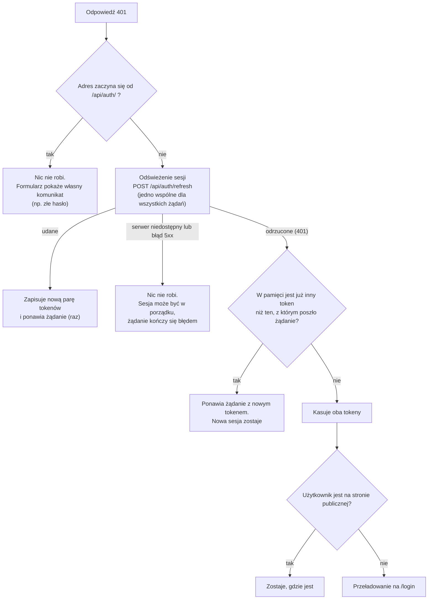
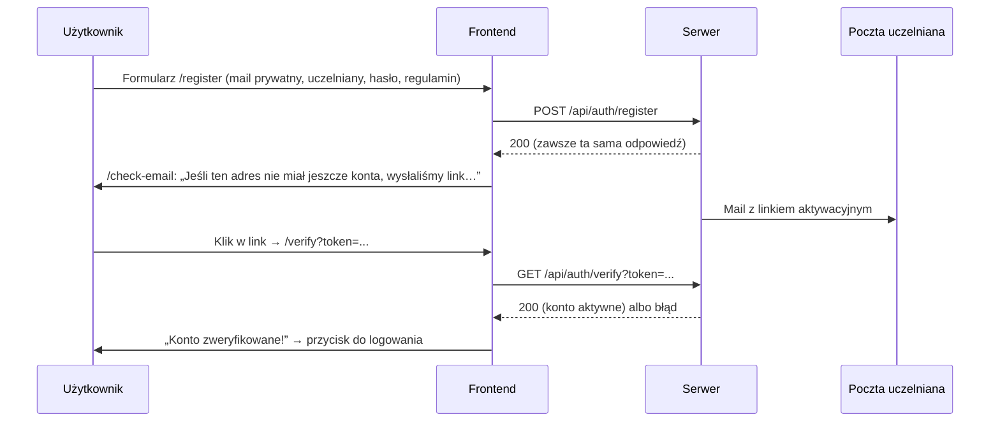

# 03. Logowanie i sesja

[← Spis treści](README.md)

Ten dokument opisuje, jak frontend trzyma sesję użytkownika, co robi po wygaśnięciu tokenu, jak działają formularze
konta (rejestracja, aktywacja, logowanie, reset hasła, zmiana hasła, usunięcie konta) i co aplikacja zapisuje w
przeglądarce. Po stronie serwera to samo opisuje dokumentacja backendu (rozdział „Bezpieczeństwo i konta”), dostępna
w repozytorium backendu i w podglądzie `dokumentacja.html`.

## Sesja w skrócie

- Po zalogowaniu serwer zwraca **parę tokenów**: krótki **token dostępu** JWT (`accessToken`, ważny 30 minut) i
  **token odświeżający** (`refreshToken`, ważny 30 dni, jednorazowy). Frontend zapisuje oba w `localStorage` (klucze
  `accessToken` i `refreshToken`) i dokleja do każdego żądania nagłówek `Authorization: Bearer <accessToken>`.
- „Zalogowany” znaczy tu: w pamięci przeglądarki jest token. Frontend **nie sprawdza**, czy token jest ważny; robi to
  serwer przy każdym żądaniu. Gdy token dostępu wygaśnie (`401`), przeglądarka **po cichu wymienia** token odświeżający
  na nową parę i ponawia żądanie, więc aktywny użytkownik nie musi się logować co 30 minut. Wylogować go może dopiero
  wygaśnięcie tokenu odświeżającego (30 dni), zmiana hasła, wylogowanie albo wykrycie kradzieży tokenu po stronie serwera.
- Wylogowanie z własnej woli unieważnia sesję na serwerze (`POST /api/auth/logout`), kasuje tokeny i wszystko, co
  aplikacja zapisała w przeglądarce. Wygaśnięcie sesji kasuje tylko tokeny (powód poniżej).

## Gdzie co jest w kodzie

| Plik | Rola |
|------|------|
| `auth/AuthContext.tsx` | `AuthProvider`: trzyma token dostępu w stanie Reacta, startuje od wartości z `localStorage`. Daje `login(accessToken, refreshToken)` i `logout()` (to drugie wysyła też wylogowanie na serwer) |
| `auth/context.ts` | Sam kontekst i jego typ (osobny plik, żeby nie mieszać go z komponentem) |
| `auth/useAuth.ts` | Hook `useAuth()` → `{ token, isAuthenticated, login, logout }`; poza `AuthProvider` rzuca błąd |
| `features/auth/tokenStorage.ts` | Odczyt, zapis (`storeTokens`) i kasowanie obu tokenów z `localStorage` (z obsługą błędów pamięci), używane przez klienta HTTP |
| `features/auth/session.ts` | `clearSession()`: pełne czyszczenie po wylogowaniu lub usunięciu konta |
| `features/auth/role.ts` | `roleFromToken()` i `useIsAdmin()`: rola z tokenu (tylko do pokazywania przycisków) |
| `api/axiosInstance.ts` | Klient HTTP: dokleja token, po 401 odświeża sesję i ponawia żądanie, a gdy się nie da, wylogowuje |
| `api/refreshSession.ts` | Odświeżanie sesji: jedno wspólne dla wszystkich żądań w karcie i blokada Web Locks między kartami |
| `api/keepalive.ts` | `postKeepalive`: żądanie, które dochodzi do serwera mimo zamykania karty (wylogowanie, ostatnie sekundy czasu nauki) |
| `components/ProtectedRoute.tsx` | Wpuszcza na `/app/...` tylko z tokenem |
| `components/layout/LogoutButton.tsx` | Przycisk „Wyloguj się”: ikona w panelu bocznym (odmiana `icon`), napis na ekranie Konto na telefonie (odmiana `text`) |

## Klient HTTP: token i błąd 401

Wszystkie wywołania serwera idą przez jeden obiekt `api` (`api/axiosInstance.ts`). Jego adres bazowy to
`VITE_API_BASE_URL` (patrz [08](08-konfiguracja-i-uruchomienie.md)).

**Przed każdym żądaniem** (interceptor żądań): jeśli w `localStorage` jest token dostępu, dopisuje `Authorization: Bearer ...`.

**Po każdej odpowiedzi** (interceptor odpowiedzi) reaguje na błąd tylko w jednym przypadku: **status 401 na adres
spoza `/api/auth/`**. Wtedy:

Dlaczego tak:

- **Odświeżanie jest jednokrotne.** Serwer przy każdej wymianie unieważnia stary token odświeżający, a użycie zużytego
  uznaje za kradzież i kończy całą sesję. Dlatego gdy kilka żądań naraz dostanie 401, wszystkie czekają na **jedno**
  odświeżenie (jedna obietnica w pamięci karty). Między kartami przeglądarki robi to samo blokada **Web Locks**: karta,
  która wejdzie druga, widzi już nowe tokeny w `localStorage` i ich używa, zamiast zużywać token drugi raz. Serwer
  dodatkowo przepuszcza ponowne użycie w ciągu 10 sekund od wymiany.
- **Błędy 403 nie wylogowują.** 403 znaczy „nie masz uprawnień do tej czynności” (np. zwykły użytkownik próbuje ukryć
  kartę), a sesja jest w porządku.
- **Adresy `/api/auth/...`** (logowanie, rejestracja, reset hasła, samo odświeżanie) zwracają 401 przy złych danych albo
  nieważnym tokenie. Takie błędy pokazuje sam formularz albo obsługuje odświeżanie; nie uruchamiają kolejnego odświeżania.
- **Brak sieci to nie wylogowanie.** Gdy odświeżenie nie dojdzie do serwera albo ten odpowie błędem 5xx, tokenów nie
  kasujemy: użytkownik zobaczy błąd, ale po powrocie połączenia nadal jest zalogowany.
- **Stary token.** Zmiana hasła daje nową parę tokenów i unieważnia stare. Żądanie wysłane tuż przed zmianą może wrócić z
  401, ale nie może wylogować już nowej sesji, dlatego interceptor porównuje token wysłany z tym, który jest teraz w
  pamięci.
- **Tylko tokeny.** Przy wygaśnięciu sesji nie czyścimy reszty danych aplikacji: użytkownik, który zaloguje się ponownie na
  to samo konto, nie traci rozpoczętego egzaminu próbnego (patrz [04](04-nauka-w-aplikacji.md)).
- Przekierowanie robi `window.location.href`, czyli **pełne przeładowanie** strony. Dzięki temu znika też pamięć
  podręczna danych (React Query) poprzedniej sesji.
- Strony publiczne, na których przekierowania nie ma, to: `/`, `/login`, `/register`, `/check-email`, `/verify`,
  `/forgot-password`, `/reset-password`, `/regulamin`, `/polityka-prywatnosci` (lista `PUBLIC_PATHS` w kliencie HTTP).

### Czy to dobra praktyka produkcyjna?

Krótki token dostępu plus długi, **jednorazowy** token odświeżający z rotacją i wykrywaniem kradzieży to standardowy,
zalecany wzorzec (backend trzyma w bazie tylko skrót tokenu odświeżającego, więc wyciek bazy nie daje sesji). Słabym
punktem jest **miejsce przechowywania**: `localStorage` jest dostępne dla każdego skryptu na stronie, więc przy ataku XSS
token da się wykraść. Docelowo token odświeżający powinien leżeć w ciasteczku `HttpOnly; Secure; SameSite`, niedostępnym
dla skryptów; wymaga to zmian w CORS i wdrożenia (frontend i backend pod jedną domeną), więc zostało na etap wdrożenia
(patrz [10](10-znane-ograniczenia.md)).

## Wylogowanie i czyszczenie danych

| Funkcja | Co kasuje | Kiedy jest używana |
|---------|-----------|--------------------|
| `clearStoredToken()` | Tylko tokeny: `accessToken` i `refreshToken` | Wygasła sesja (odświeżenie odrzucone) |
| `clearSession()` | Tokeny oraz **wszystkie klucze zaczynające się od `tutlaw.`** (szkic egzaminu, zapamiętane ustawienia egzaminu, ostatni własny test, wybór zwiniętego panelu), **poza kopią wyglądu** `tutlaw.theme.v1` (patrz niżej) | Przycisk „Wyloguj się” i usunięcie konta |

Przycisk „Wyloguj się” (`LogoutButton`; w panelu bocznym, a na telefonie na ekranie Konto) wywołuje `logout()` z kontekstu (`clearSession()` i token w stanie na `null`),
a potem przenosi na stronę główną przez `window.location.href`, czyli również z pełnym przeładowaniem. Efekt: na
wspólnym komputerze nie zostają ślady po poprzednim użytkowniku (w szkicu egzaminu jest adres e-mail właściciela).

## Co aplikacja zapisuje w przeglądarce

| Gdzie | Klucz | Co | Kto zapisuje | Kiedy znika |
|-------|-------|----|--------------|-------------|
| `localStorage` | `accessToken` | Krótki token dostępu (JWT, 30 minut) | `AuthProvider.login`, odświeżanie sesji (`api/refreshSession.ts`) | Wylogowanie lub odrzucone odświeżenie |
| `localStorage` | `refreshToken` | Token odświeżający (30 dni, jednorazowy: po każdym użyciu serwer wydaje nowy) | `AuthProvider.login`, odświeżanie sesji | Wylogowanie lub odrzucone odświeżenie |
| `localStorage` | `tutlaw.exam.draft.v1` | Niedokończony egzamin próbny: pytania, odpowiedzi, termin końca, próg w punktach z serwera, adres konta właściciela (zapis w wersji 2; wersja 1 sprzed Etapu 28 też się wznawia) | `features/exam/examStorage.ts` | Po wysłaniu egzaminu, po porzuceniu, po wylogowaniu |
| `localStorage` | `tutlaw.exam.settings.v1` | Ostatnio użyty limit czasu egzaminu (zakres, liczbę pytań i próg ustala format egzaminu, więc ich nie zapamiętujemy; zapis ze starszych wersji ma je jeszcze w sobie i są pomijane) | `features/exam/examStorage.ts` | Po wylogowaniu |
| `localStorage` | `tutlaw.customTest.v1` | Ostatnio ułożony własny test: zaznaczone akty prawne (albo „wszystko”), rodzaj pytań, liczba pytań (10, 20, 50, 100 albo 150 lub „wszystkie”). Zapis ze starszych wersji ma jeszcze lata egzaminu; są pomijane | `features/customTest/customTestStorage.ts` | Po wylogowaniu |
| `localStorage` | `tutlaw.nav.collapsed.v1` | Czy panel boczny jest zwinięty (`1`) czy rozwinięty (`0`) | `components/layout/useNavCollapsed.ts` | Po wylogowaniu |
| `localStorage` | `tutlaw.theme.v1` | Kopia wyglądu strony z konta (`DARK` albo `LIGHT`). Źródłem prawdy jest serwer (`PUT /api/me/theme`); kopia służy tylko temu, żeby od pierwszej klatki, zanim serwer odpowie, strona miała dobry kolor (skrypt w `index.html` czyta ten sam klucz, tylko na ścieżkach `/app`). Gdy ustawienia z serwera dotrą, wygrywa konto i kopia się odświeża | `features/settings/ThemeSync.tsx`, `lib/theme.ts` | **Przeżywa wylogowanie** (to nie jest dana osobowa; wyjątek wpisany w `features/auth/session.ts`), znika dopiero z ręcznym wyczyszczeniem danych przeglądarki |

Aplikacja nie używa `sessionStorage`, plików cookie ani IndexedDB. Każdy odczyt i zapis jest w `try/catch`: gdy
pamięć jest niedostępna (np. tryb prywatny), aplikacja działa dalej, tylko bez zapamiętywania.

Tokeny leżą w `localStorage` (a nie w ciasteczku `HttpOnly`), co jest świadomą decyzją projektu na ten etap, opisaną w
[Znanych ograniczeniach](10-znane-ograniczenia.md). Polityka prywatności w aplikacji wspomina o tokenach, a nie wymienia
szkicu egzaminu ani zapamiętanych ustawień (patrz tamże).

## Rola administratora

Token zawiera pole `role` (`STUDENT` albo `ADMIN`). Funkcja `roleFromToken()` dekoduje środkową część tokenu (zwykłe
base64, bez sprawdzania podpisu) i zwraca rolę, a hook `useIsAdmin()` mówi, czy to `ADMIN`. Służy to **wyłącznie do
pokazania lub ukrycia przycisków** dla administratora, dziś jedynego: „Ukryj” (`features/admin/HideCardButton.tsx`).
Prawdziwa kontrola jest w serwerze przy każdym żądaniu, więc podrobienie roli w przeglądarce niczego nie daje.

Zmiana roli w bazie działa dopiero po następnym odświeżeniu sesji (do 30 minut) albo ponownym zalogowaniu, bo rola siedzi w tokenie dostępu.

## Rejestracja i aktywacja konta

- **Rejestracja** (`pages/RegisterPage.tsx`) wymaga: mail prywatny (będzie loginem), mail uczelniany (tam przychodzą linki),
  hasło 8–72 znaków i zaznaczoną zgodę na regulamin i politykę prywatności. Po sukcesie przechodzi na `/check-email` i
  przekazuje adres w stanie nawigacji.
- Komunikat po rejestracji jest **taki sam dla każdego adresu**, żeby nie zdradzać, czy konto już istniało.
- **Aktywacja** (`pages/VerifyPage.tsx`) wywołuje serwer raz (strażnik `useRef` chroni przed podwójnym wywołaniem w trybie
  deweloperskim). Bez tokenu w adresie od razu pokazuje błąd. Przy błędzie („Link nieprawidłowy lub wygasł”) oferuje
  formularz wysłania linku ponownie.
- **„Wyślij link ponownie”** (`features/auth/ResendVerification.tsx`) jest na stronach `/check-email`, `/verify` (przy
  błędzie) i `/login` (po odpowiedzi 409). Odpowiedź serwera jest zawsze ta sama, a przycisk po wysłaniu jest zablokowany
  na 60 sekund. Serwer dodatkowo ogranicza liczbę wysyłek (patrz dokumentacja backendu).

## Logowanie

`pages/LoginPage.tsx` wysyła `POST /api/auth/login` z `privateEmail` i `password`.

| Odpowiedź | Co robi frontend |
|-----------|------------------|
| 200 | Zapisuje `accessToken` i `refreshToken` (`login(...)`) i przechodzi na adres, z którego użytkownik przyszedł, a bez niego na Pulpit |
| 409 | Hasło dobre, ale konto jeszcze nieaktywne: pokazuje komunikat serwera i formularz „wyślij link ponownie” |
| inne | Pokazuje komunikat serwera (`message`) albo „Logowanie nie powiodło się”; brak połączenia ma osobny komunikat |

Komunikaty błędów wyciąga funkcja `serverMessage` (`lib/errors.ts`): bierze pole `message` z odpowiedzi serwera, a gdy go
nie ma, tekst zastępczy podany przez ekran. Jeśli serwer w ogóle nie odpowiedział, mówi „Brak połączenia z serwerem”.

## Reset hasła

1. `/forgot-password` (`ForgotPasswordPage`): użytkownik podaje mail prywatny → `POST /api/auth/forgot-password`.
   Zawsze pokazuje ten sam komunikat („Jeśli konto o tym adresie istnieje i jest aktywne, wysłaliśmy link…”). Link idzie na
   mail uczelniany i jest ważny godzinę.
2. `/reset-password?token=...` (`ResetPasswordPage`): dwa pola hasła (muszą być takie same, 8–72 znaki) →
   `POST /api/auth/reset-password`. Bez `token` w adresie ekran mówi, że brakuje linku, i odsyła po nowy. Po sukcesie
   odsyła do logowania. Błąd (np. link wygasł) pokazuje komunikat serwera i odnośnik „Link wygasł? Poproś o nowy”.

## Zmiana hasła (w Koncie)

`features/account/ChangePasswordCard.tsx` → `PUT /api/users/me/password` z `currentPassword` i `newPassword`.

- Frontend sprawdza, czy oba nowe hasła są takie same i czy nowe różni się od obecnego.
- Serwer unieważnia wszystkie dotychczasowe tokeny konta i **zwraca nową parę tokenów**; frontend od razu ją zapisuje
  (`login(accessToken, refreshToken)`), więc ta przeglądarka zostaje zalogowana, a pozostałe urządzenia zostają wylogowane.

## Pobranie danych i usunięcie konta (RODO)

- **Pobierz moje dane** (`ExportCard`): `GET /api/users/me/export` → plik JSON zapisywany na dysku użytkownika
  (`saveTextFile`, nazwa `tutlaw-moje-dane-RRRR-MM-DD.json`). Dane nie są nigdzie indziej wysyłane.
- **Usuń konto** (`DeleteAccountCard`): wymaga hasła i zaznaczenia „Rozumiem, że usunięcia konta i danych nie można
  cofnąć”. `DELETE /api/users/me` z hasłem w treści. Po sukcesie `clearSession()` i przejście na `/?konto=usuniete`,
  gdzie strona główna pokazuje potwierdzenie.
