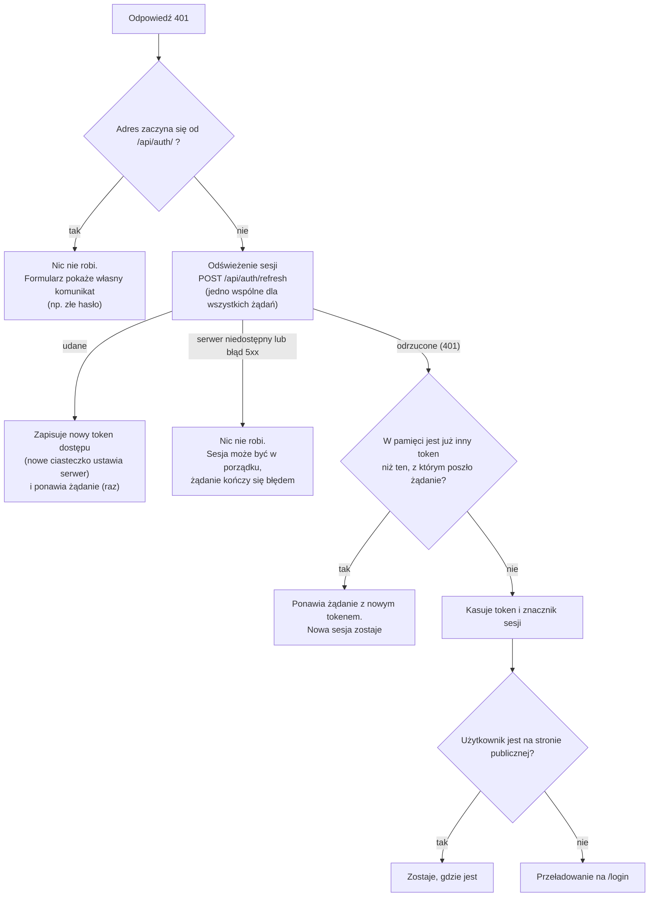
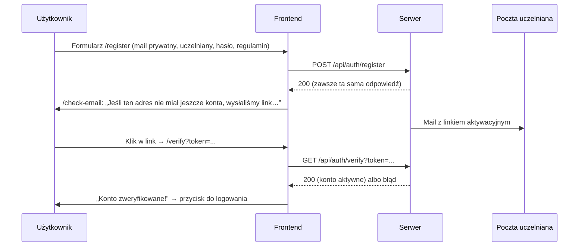

# 03. Logowanie i sesja

[← Spis treści](README.md)

Ten dokument opisuje, jak frontend trzyma sesję użytkownika, co robi po wygaśnięciu tokenu, jak działają formularze
konta (rejestracja, aktywacja, logowanie, reset hasła, zmiana hasła, usunięcie konta) i co aplikacja zapisuje w
przeglądarce. Po stronie serwera to samo opisuje dokumentacja backendu (rozdział „Bezpieczeństwo i konta”), dostępna
w repozytorium backendu i w podglądzie `dokumentacja.html`.

## Sesja w skrócie

- Sesja ma dwa tokeny, ale **żaden nie leży w `localStorage`**. **Token dostępu** (JWT, `accessToken` w odpowiedzi
  logowania, ważny 30 minut) żyje wyłącznie w pamięci karty (zmienna w `tokenStorage.ts`) i jest doklejany do żądań jako
  `Authorization: Bearer <accessToken>`. **Token odświeżający** (ważny 30 dni, jednorazowy) przeglądarka dostaje od
  serwera w ciasteczku `gradus_refresh` (`HttpOnly; Secure; SameSite=Strict; Path=/api/auth`). Skrypt na stronie go nie
  widzi, a przeglądarka wysyła go sama, tylko do `/api/auth/...`.
- „Zalogowany” znaczy tu: w pamięci karty jest token dostępu. Po przeładowaniu strony pamięć jest pusta, więc
  `AuthProvider` sprawdza **znacznik sesji** `gradus.session.v1` w `localStorage` (sama wartość `1`, nic tajnego) i jeśli
  jest, wywołuje `POST /api/auth/refresh`: serwer po ciasteczku wydaje nowy token dostępu. Bez znacznika odwiedzający
  nie robi zbędnych wywołań. Do czasu odpowiedzi trasy chronione pokazują ekran ładowania (`isInitializing`).
- Frontend **nie sprawdza**, czy token jest ważny; robi to serwer przy każdym żądaniu. Gdy token dostępu wygaśnie
  (`401`), przeglądarka **po cichu odświeża sesję** (ciasteczkiem) i ponawia żądanie, więc aktywny użytkownik nie musi
  się logować co 30 minut. Wylogować go może dopiero wygaśnięcie sesji (30 dni), zmiana hasła, wylogowanie albo wykrycie
  kradzieży tokenu po stronie serwera.
- Wylogowanie z własnej woli (`POST /api/auth/logout`) unieważnia sesję na serwerze, a serwer kasuje ciasteczko; frontend
  kasuje token z pamięci, znacznik i wszystko, co aplikacja zapisała w przeglądarce. Wygaśnięcie sesji kasuje tylko token
  i znacznik (powód poniżej). Wylogowanie lub zalogowanie w jednej karcie obejmuje pozostałe: zmiana znacznika w
  `localStorage` wywołuje zdarzenie `storage` w innych kartach.

## Gdzie co jest w kodzie

| Plik | Rola |
|------|------|
| `auth/AuthContext.tsx` | `AuthProvider`: czyta token dostępu z pamięci (`useSyncExternalStore`), a po przeładowaniu odtwarza go z ciasteczka (jedno ponowienie po 1,5 s, gdy serwer chwilowo nie odpowiada), słucha zdarzenia `storage` z innych kart. Daje `login(accessToken)` i `logout()` (to drugie wysyła też wylogowanie na serwer) |
| `auth/context.ts` | Sam kontekst i jego typ (osobny plik, żeby nie mieszać go z komponentem) |
| `auth/useAuth.ts` | Hook `useAuth()` → `{ token, isAuthenticated, isInitializing, login, logout }`; poza `AuthProvider` rzuca błąd |
| `features/auth/tokenStorage.ts` | Token dostępu w pamięci (`getAccessToken`, `setAccessToken`, subskrypcja), znacznik sesji `gradus.session.v1` w `localStorage` (z obsługą błędów pamięci) i `purgeLegacyTokens()`, które przy starcie usuwa stare klucze `accessToken` i `refreshToken` |
| `features/auth/session.ts` | `clearSession()`: pełne czyszczenie po wylogowaniu lub usunięciu konta |
| `features/auth/role.ts` | `roleFromToken()` i `useIsAdmin()`: rola z tokenu (tylko do pokazywania przycisków) |
| `api/axiosInstance.ts` | Klient HTTP: dokleja token, po 401 odświeża sesję i ponawia żądanie, a gdy się nie da, wylogowuje |
| `api/refreshSession.ts` | Odświeżanie sesji ciasteczkiem (`withCredentials`): jedno wspólne dla wszystkich żądań w karcie i blokada Web Locks między kartami |
| `api/keepalive.ts` | `postKeepalive`: żądanie, które dochodzi do serwera mimo zamykania karty (wylogowanie, ostatnie sekundy czasu nauki) |
| `components/ProtectedRoute.tsx` | Wpuszcza na `/app/...` tylko z tokenem; gdy trwa odtwarzanie sesji po przeładowaniu, czeka z ekranem ładowania |
| `components/layout/LogoutButton.tsx` | Przycisk „Wyloguj się”: ikona w panelu bocznym (odmiana `icon`), napis na ekranie Konto na telefonie (odmiana `text`) |

## Klient HTTP: token i błąd 401

Wszystkie wywołania serwera idą przez jeden obiekt `api` (`api/axiosInstance.ts`). Jego adres bazowy to
`VITE_API_BASE_URL` (patrz [08](08-konfiguracja-i-uruchomienie.md)).

**Przed każdym żądaniem** (interceptor żądań): jeśli w pamięci jest token dostępu, dopisuje `Authorization: Bearer ...`.

**Po każdej odpowiedzi** (interceptor odpowiedzi) reaguje na błąd tylko w jednym przypadku: **status 401 na adres
spoza `/api/auth/`**. Wtedy:

Dlaczego tak:

- **Odświeżanie jest jednokrotne.** Serwer przy każdej wymianie unieważnia stary token odświeżający, a użycie zużytego
  uznaje za kradzież i kończy całą sesję. Dlatego gdy kilka żądań naraz dostanie 401, wszystkie czekają na **jedno**
  odświeżenie (jedna obietnica w pamięci karty). Między kartami przeglądarki robi to samo blokada **Web Locks**: karta,
  która wejdzie druga, czeka na zakończenie odświeżenia w pierwszej karcie i dostaje to samo, nowe ciasteczko (przeglądarka
  współdzieli je między kartami), zamiast zużywać stary token drugi raz. Serwer dodatkowo przepuszcza ponowne użycie w
  ciągu 10 sekund od wymiany.
- **Błędy 403 nie wylogowują.** 403 znaczy „nie masz uprawnień do tej czynności” (np. zwykły użytkownik próbuje ukryć
  kartę), a sesja jest w porządku.
- **Adresy `/api/auth/...`** (logowanie, rejestracja, reset hasła, samo odświeżanie) zwracają 401 przy złych danych albo
  nieważnym tokenie. Takie błędy pokazuje sam formularz albo obsługuje odświeżanie; nie uruchamiają kolejnego odświeżania.
- **Brak sieci to nie wylogowanie.** Gdy odświeżenie nie dojdzie do serwera albo ten odpowie błędem 5xx, sesji nie
  kasujemy: użytkownik zobaczy błąd, ale po powrocie połączenia nadal jest zalogowany.
- **Stary token.** Zmiana hasła daje nowy token dostępu i nowe ciasteczko, a stare sesje unieważnia. Żądanie wysłane tuż przed zmianą może wrócić z
  401, ale nie może wylogować już nowej sesji, dlatego interceptor porównuje token wysłany z tym, który jest teraz w
  pamięci.
- **Tylko sesja.** Przy wygaśnięciu sesji nie czyścimy reszty danych aplikacji: użytkownik, który zaloguje się ponownie na
  to samo konto, nie traci rozpoczętego egzaminu próbnego (patrz [04](04-nauka-w-aplikacji.md)).
- Przekierowanie robi `window.location.href`, czyli **pełne przeładowanie** strony. Dzięki temu znika też pamięć
  podręczna danych (React Query) poprzedniej sesji.
- Strony publiczne, na których przekierowania nie ma, to: `/`, `/login`, `/register`, `/check-email`, `/verify`,
  `/forgot-password`, `/reset-password`, `/regulamin`, `/polityka-prywatnosci` (lista `PUBLIC_PATHS` w kliencie HTTP).

### Czy to dobra praktyka produkcyjna?

Tak. Krótki token dostępu w pamięci plus długi, **jednorazowy** token odświeżający w ciasteczku
`HttpOnly; Secure; SameSite=Strict` z rotacją i wykrywaniem kradzieży to standardowy, zalecany wzorzec (backend trzyma w
bazie tylko skrót tokenu odświeżającego, więc wyciek bazy nie daje sesji). Skrypt wstrzyknięty do strony (XSS) nie może
odczytać ciasteczka `HttpOnly`, a token dostępu żyje tylko w pamięci karty i 30 minut. Ciasteczko nie wymaga wspólnej
domeny: frontend (`gradusiuris.pl`) i API (`api.gradusiuris.pl`) to ta sama witryna (*site*), więc `SameSite=Strict` działa,
a CORS wpuszcza dokładnie jeden adres frontendu z `allowCredentials`. Zostaje ryzyko XSS w trakcie otwartej karty
(skrypt może wywoływać API w imieniu użytkownika), ale nie może wynieść sesji na zewnątrz ani jej przedłużyć po
zamknięciu karty (patrz [10](10-znane-ograniczenia.md)).

## Wylogowanie i czyszczenie danych

| Funkcja | Co kasuje | Kiedy jest używana |
|---------|-----------|--------------------|
| `clearStoredToken()` | Tylko token dostępu z pamięci i znacznik `gradus.session.v1` | Wygasła sesja (odświeżenie odrzucone) |
| `clearSession()` | Token, znacznik oraz **wszystkie klucze zaczynające się od `gradus.`** (szkic egzaminu, zapamiętane ustawienia egzaminu, ostatni własny test, wybór zwiniętego panelu), **poza kopią wyglądu** `gradus.theme.v1` i **decyzją o zgodzie** `gradus.consent.v1` (patrz niżej) | Przycisk „Wyloguj się” i usunięcie konta |

Przycisk „Wyloguj się” (`LogoutButton`; w panelu bocznym, a na telefonie na ekranie Konto) wywołuje `logout()` z kontekstu (`clearSession()` i token w stanie na `null`),
a potem przenosi na stronę główną przez `window.location.href`, czyli również z pełnym przeładowaniem. Efekt: na
wspólnym komputerze nie zostają ślady po poprzednim użytkowniku (w szkicu egzaminu jest adres e-mail właściciela).

## Co aplikacja zapisuje w przeglądarce

| Gdzie | Klucz | Co | Kto zapisuje | Kiedy znika |
|-------|-------|----|--------------|-------------|
| `localStorage` | `gradus.session.v1` | Znacznik „ta przeglądarka ma sesję” (wartość `1`, nic tajnego): po przeładowaniu mówi, czy próbować odtworzyć sesję z ciasteczka, a zmiana wywołuje zdarzenie `storage` w innych kartach | `AuthProvider.login`, odświeżanie sesji (`api/refreshSession.ts`) | Wylogowanie lub odrzucone odświeżenie |
| ciasteczko | `gradus_refresh` | Token odświeżający (30 dni, jednorazowy: po każdym użyciu serwer wydaje nowy). `HttpOnly; Secure; SameSite=Strict; Path=/api/auth`: skrypty go nie widzą | Ustawia serwer (logowanie, odświeżenie, zmiana hasła) | Wylogowanie, usunięcie konta, wygaśnięcie po 30 dniach |
| `localStorage` | `gradus.consent.v1` | Decyzja o zgodzie na statystyki (Google Analytics): `{"analytics": true/false, "version": 1, "at": "..."}`. Baner pyta, gdy wpisu nie ma lub zmieniła się wersja | `lib/consent.ts`, `components/ConsentBanner.tsx` | **Przeżywa wylogowanie** (ustawienie urządzenia, nie dane konta; wyjątek w `features/auth/session.ts`), znika z ręcznym wyczyszczeniem danych przeglądarki |
| `localStorage` | `gradus.exam.draft.v2` | Niedokończony egzamin próbny: pytania (z numerami `questionId` z bazy), odpowiedzi, termin końca, próg w punktach z serwera, adres konta właściciela, wybrane źródło i numer egzaminu MS (`sheetId`) (wersja zapisu 3). Szkice z poprzedniej wersji klucza (`v1`) mają numery pytań sprzed przebudowy bazy, więc nie są wczytywane | `features/exam/examStorage.ts` | Po wysłaniu egzaminu, po porzuceniu, po wylogowaniu |
| `localStorage` | `gradus.exam.settings.v1` | Ostatnio użyte ustawienia egzaminu: źródło pytań (`ALL`, `MINISTRY`, `AUTHORED` albo `SHEETS` dla egzaminów MS), wybrany egzamin MS (aplikacja i rok) i limit czasu (zakres, liczbę pytań i próg ustala format egzaminu, więc ich nie zapamiętujemy; zapis ze starszych wersji ma je jeszcze w sobie i są pomijane) | `features/exam/examStorage.ts` | Po wylogowaniu |
| `localStorage` | `gradus.customTest.v4` | Ostatnio ułożony test „Nauka” w kreatorze: źródło pytań (`ALL`, `MINISTRY`, `AUTHORED`), „cała pula” albo numery aktów zaznaczonych w całości i rozdziałów zaznaczonych osobno (Student też wybiera akty i rozdziały, pod przedmiotami), rodzaj pytań (bez „Zaległych”, które mają własną odmianę kreatora) i liczba pytań (10, 20, 50, 100 albo 150 lub „wszystkie”). Starsze wersje klucza (`v1`–`v3`) są pomijane, bo nie znały źródła ani rozdziałów | `features/customTest/customTestStorage.ts` | Po wylogowaniu |
| `localStorage` | `gradus.nav.collapsed.v1` | Czy panel boczny jest zwinięty (`1`) czy rozwinięty (`0`) | `components/layout/useNavCollapsed.ts` | Po wylogowaniu |
| `localStorage` | `gradus.theme.v1` | Kopia wyglądu strony z konta (`DARK` albo `LIGHT`). Źródłem prawdy jest serwer (`PUT /api/me/theme`); kopia służy tylko temu, żeby od pierwszej klatki, zanim serwer odpowie, strona miała dobry kolor (skrypt w `index.html` czyta ten sam klucz, tylko na ścieżkach `/app`). Gdy ustawienia z serwera dotrą, wygrywa konto i kopia się odświeża | `features/settings/ThemeSync.tsx`, `lib/theme.ts` | **Przeżywa wylogowanie** (to nie jest dana osobowa; wyjątek wpisany w `features/auth/session.ts`), znika dopiero z ręcznym wyczyszczeniem danych przeglądarki |

Aplikacja nie używa `sessionStorage` ani IndexedDB, a jedyne własne ciasteczko to `gradus_refresh`, które ustawia serwer.
Po zgodzie na statystyki Google Analytics ustawia własne ciasteczka `_ga*`; po wycofaniu zgody `lib/analytics.ts` je kasuje.
Przy starcie `purgeLegacyTokens()` usuwa stare klucze `accessToken` i `refreshToken` z wcześniejszych wersji. Każdy odczyt i zapis jest w `try/catch`: gdy
pamięć jest niedostępna (np. tryb prywatny), aplikacja działa dalej, tylko bez zapamiętywania.

Polityka prywatności w aplikacji wspomina o ciasteczku sesji i znaczniku w `localStorage`, a nie wymienia szkicu
egzaminu ani zapamiętanych ustawień (patrz [Znane ograniczenia](10-znane-ograniczenia.md)).

## Rola administratora

Token zawiera pole `role` (`STUDENT` albo `ADMIN`). Funkcja `roleFromToken()` dekoduje środkową część tokenu (zwykłe
base64, bez sprawdzania podpisu) i zwraca rolę, a hook `useIsAdmin()` mówi, czy to `ADMIN`. Służy to **wyłącznie do
pokazania lub ukrycia elementów** dla administratora: przycisków „Ukryj pytanie” i „Ukryj fiszkę” (`features/admin/HideQuestionButton.tsx`) karty „Terminy egzaminów” w Koncie (`features/settings/ExamTermsCard.tsx`), wejść do panelu administratora (pozycja w pasku bocznym i karta
w Koncie) oraz samego panelu `/admin`: `AdminRoute` (`features/admin/AdminRoute.tsx`) odsyła kogoś bez roli `ADMIN` na Pulpit.
Prawdziwa kontrola jest w serwerze przy każdym żądaniu, więc podrobienie roli w przeglądarce niczego nie daje.

Backend chroni całą ścieżkę `/api/admin/**` na dwóch poziomach (konfiguracja zabezpieczeń i `@PreAuthorize` w każdym kontrolerze).

Zmiana roli w bazie działa dopiero po następnym odświeżeniu sesji (do 30 minut) albo ponownym zalogowaniu, bo rola siedzi w tokenie dostępu.

## Rejestracja i aktywacja konta

- **Rejestracja** (`pages/RegisterPage.tsx`) wymaga: mail prywatny (będzie loginem), mail uczelniany (tam przychodzą linki),
  hasło 8–72 znaków i zaznaczoną zgodę na regulamin i politykę prywatności. Po sukcesie przechodzi na `/check-email` i
  przekazuje adres w stanie nawigacji.
- Komunikat po rejestracji jest **taki sam dla każdego adresu**, żeby nie zdradzać, czy konto już istniało.
- **Aktywacja** (`pages/VerifyPage.tsx`) wywołuje serwer raz (strażnik `useRef` chroni przed podwójnym wywołaniem w trybie
  deweloperskim). Bez tokenu w adresie od razu pokazuje błąd. Przy błędzie („Link nieprawidłowy lub wygasł”) oferuje
  formularz wysłania linku ponownie.
- **„Wyślij link ponownie”** (`features/auth/ResendVerification.tsx`) jest na stronach `/check-email`, `/verify` (przy
  błędzie) i `/login` (po odpowiedzi 409). Odpowiedź serwera jest zawsze ta sama, a przycisk po wysłaniu jest zablokowany
  na 60 sekund. Serwer dodatkowo ogranicza liczbę wysyłek (patrz dokumentacja backendu).

## Logowanie

`pages/LoginPage.tsx` wysyła `POST /api/auth/login` z `privateEmail` i `password`.

| Odpowiedź | Co robi frontend |
|-----------|------------------|
| 200 | Zapisuje `accessToken` w pamięci (`login(res.data.accessToken)`; ciasteczko sesji ustawia serwer) i przechodzi na adres, z którego użytkownik przyszedł, a bez niego na Pulpit |
| 409 | Hasło dobre, ale konto jeszcze nieaktywne: pokazuje komunikat serwera i formularz „wyślij link ponownie” |
| 400 z komunikatem o robocie | Nie przeszło sprawdzenie Turnstile (brak albo zużyty token): pokazuje komunikat, a widget odnawia się sam. Token jest jednorazowy, więc po każdej próbie dostaje się nowy |
| 503 | Cloudflare chwilowo nie odpowiada: serwer blokuje zamiast przepuszczać, ekran prosi o ponowienie |
| inne | Pokazuje komunikat serwera (`message`) albo „Logowanie nie powiodło się”; brak połączenia ma osobny komunikat |

Komunikaty błędów wyciąga funkcja `serverMessage` (`lib/errors.ts`): bierze pole `message` z odpowiedzi serwera, a gdy go
nie ma, tekst zastępczy podany przez ekran. Jeśli serwer w ogóle nie odpowiedział, mówi „Brak połączenia z serwerem”.

## Reset hasła

1. `/forgot-password` (`ForgotPasswordPage`): użytkownik podaje mail prywatny → `POST /api/auth/forgot-password`.
   Zawsze pokazuje ten sam komunikat („Jeśli konto o tym adresie istnieje i jest aktywne, wysłaliśmy link…”). Link idzie na
   mail uczelniany i jest ważny godzinę.
2. `/reset-password?token=...` (`ResetPasswordPage`): dwa pola hasła (muszą być takie same, 8–72 znaki) →
   `POST /api/auth/reset-password`. Bez `token` w adresie ekran mówi, że brakuje linku, i odsyła po nowy. Po sukcesie
   odsyła do logowania. Błąd (np. link wygasł) pokazuje komunikat serwera i odnośnik „Link wygasł? Poproś o nowy”.

## Zmiana hasła (w Koncie)

`features/account/ChangePasswordCard.tsx` → `PUT /api/users/me/password` z `currentPassword` i `newPassword`.

- Frontend sprawdza, czy oba nowe hasła są takie same i czy nowe różni się od obecnego.
- Serwer unieważnia wszystkie dotychczasowe tokeny konta i **zwraca nowy token dostępu i nowe ciasteczko**; frontend od razu zapisuje token
  (`login(accessToken)`), więc ta przeglądarka zostaje zalogowana, a pozostałe urządzenia zostają wylogowane.

## Pobranie danych i usunięcie konta (RODO)

- **Pobierz moje dane** (`ExportCard`): `GET /api/users/me/export` → plik JSON zapisywany na dysku użytkownika
  (`saveTextFile`, nazwa `gradus-iuris-moje-dane-RRRR-MM-DD.json`). Dane nie są nigdzie indziej wysyłane.
- **Usuń konto** (`DeleteAccountCard`): wymaga hasła i zaznaczenia „Rozumiem, że usunięcia konta i danych nie można
  cofnąć”. `DELETE /api/users/me` z hasłem w treści. Po sukcesie `clearSession()` i przejście na `/?konto=usuniete`,
  gdzie strona główna pokazuje potwierdzenie.
