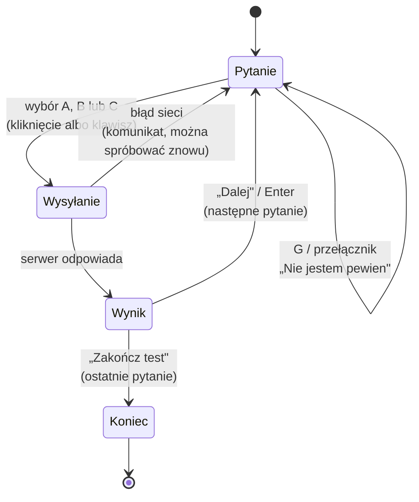
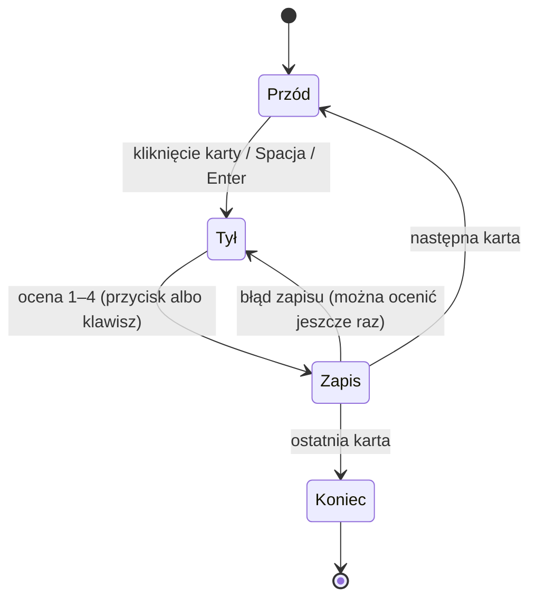
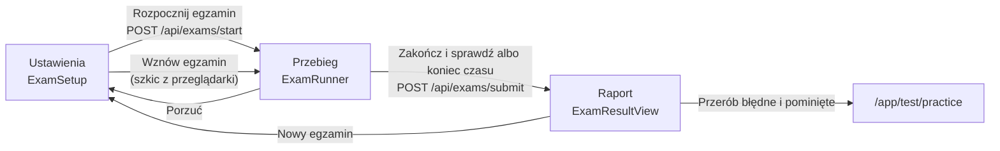

# 04. Nauka w aplikacji

[← Spis treści](README.md)

To najważniejszy dokument frontendu: opisuje, co dzieje się na ekranie podczas nauki. Przypominam podział pracy:
**frontend pokazuje i zbiera odpowiedzi, a o tym, kiedy pytanie wróci, decyduje serwer** (algorytm FSRS-6; jego opis jest
w dokumentacji backendu, rozdział „Nauka: testy, fiszki, FSRS”). Dlatego tu nie ma żadnych wzorów ani dat powtórek,
są tylko ekrany, stany i reguły interfejsu.

## Dwa rodzaje kart i trzy rodzaje sesji

| | Pytanie testowe (Testy) | Fiszka (Fiszki) |
|---|---|---|
| Wygląd | Pytanie i trzy odpowiedzi A, B, C, dokładnie jedna poprawna | Przód z pytaniem, po kliknięciu tył z odpowiedzią |
| Kto ocenia | Serwer (porównuje wybraną odpowiedź z poprawną) | Użytkownik, czterema przyciskami |
| Pole „Nie jestem pewien” | Tak | Nie dotyczy |
| Plik sesji | `pages/TestSessionPage.tsx` | `pages/StudySessionPage.tsx` |
| Skąd się biorą | Z materiału (Testy) | Z błędów w testach i z „Dodaj do fiszek” |

Fiszki **zaczynają puste**: każde pytanie testowe ma w bazie własną fiszkę, ale użytkownik dostaje ją dopiero po
**pewnym błędzie** w teście (błędna odpowiedź bez „Nie jestem pewien”) albo po kliknięciu „Dodaj do fiszek”.

## Sesja testowa (`TestSessionPage`)

### Cztery tryby tej samej strony

Ta sama strona obsługuje cztery tryby (parametr `mode`, ustawiany w `app/router.tsx`):

| Tryb | Adres | Skąd pytania | Co jeszcze |
|------|-------|--------------|------------|
| `scope` (domyślny) | `/app/test`, `/app/test/:subjectId` (`?sourceId=`, `?categoryId=`) | `GET /api/review/test-queue` (zaległe + dzienna porcja nowych) | Informacja o zaległościach, „Rozwiąż jeszcze”, „Powtórz jeszcze” |
| `due` | `/app/test/due` | To samo, ale z `extraNewCards=0`: same zaległe, bez nowych | Jak wyżej; gdy nic nie zalega, ekran „Nie masz zaległych powtórek” |
| `mistakes` | `/app/test/mistakes` | `GET /api/review/mistakes-queue` | Zamknięta lista, bez dokładania nowych |
| `practice` | `/app/test/practice?cardIds=1,2,3` | `GET /api/review/practice-queue` | Zamknięta lista (np. błędy z egzaminu); numery z adresu: tylko dodatnie liczby całkowite, bez powtórzeń, do 200 |

W trybach `mistakes` i `practice` (lista zamknięta) nie ma informacji o zaległościach ani przycisku „Rozwiąż jeszcze”, a
przycisk powrotu prowadzi do Testów (dla `practice` do Egzaminu).

### Przebieg jednego pytania

1. Użytkownik widzi pytanie, trzy odpowiedzi i przełącznik **„Nie jestem pewien”** (skrót `G`). Przełącznik zaznacza się
   **przed** odpowiedzią i znika po jej wybraniu.
2. Wybór odpowiedzi blokuje pozostałe i wysyła `POST /api/review/test-answer` z numerem karty, wybraną opcją (A, B lub C), czasem
   odpowiedzi w sekundach i znacznikiem `guessed`. Czas liczy się od pokazania pytania, a podgląd poprzednich pytań go
   wstrzymuje.
3. Odpowiedź serwera (`TestAnswerResult`) steruje wynikiem:
   - poprawna odpowiedź podświetla się na zielono, wybrana błędna na czerwono, pozostałe wyszarzają;
   - nagłówek „Poprawnie!” albo „Niepoprawnie” i zdanie o zapisanej ocenie (tabela niżej);
   - wyjaśnienie (jeśli jest), podstawa prawna i data stanu prawnego (`LegalBasisLine`);
   - podpowiedź o trudnym pytaniu, jeśli `leech` jest prawdą (patrz niżej);
   - informacja o fiszce: „Dodałem fiszkę do tego pytania w Fiszkach.” przy pierwszym pewnym błędzie.
4. Pod wynikiem są przyciski: **Dodaj do fiszek / Usuń z fiszek**, **Zgłoś błąd w pytaniu**, **Ukryj** (tylko administrator),
   **Zawieś pytanie** (tylko przy trudnym pytaniu) oraz **Dalej** albo **Zakończ test**.
5. Gdy zapis się nie uda (np. brak internetu), odpowiedzi odblokowują się i pojawia się komunikat „Nie udało się zapisać
   odpowiedzi. Spróbuj ponownie.”: nic nie przepada.

Jaką ocenę zapisuje serwer, pokazuje zdanie w panelu wyniku (to, co widzi użytkownik, a nie osobna logika frontendu):

| Wynik | „Nie jestem pewien” | Zdanie w panelu | Skutek |
|-------|---------------------|-----------------|--------|
| poprawna | nie | „Zapisano jako „Znam”.” | Pytanie wraca po dłuższej przerwie |
| poprawna | tak | „Zaznaczone jako niepewne: zapisano jako „Nie pamiętam”, pytanie wróci w powtórkach.” | Wraca szybko |
| błędna | nie (pewny błąd) | „Zapisano jako „Nie pamiętam”…” + informacja o fiszce | Wraca szybko, a fiszka trafia do Fiszek |
| błędna | tak | „Zapisano jako „Nie pamiętam”…” | Wraca szybko, bez fiszki |

### Mieszanie odpowiedzi

Domyślnie kolejność odpowiedzi A, B, C jest losowana przy każdym ułożeniu kolejki, żeby użytkownik uczył się treści, a nie
pozycji („zawsze B”). Zasady (`features/tests/shuffle.ts`):

- Litery A, B, C na ekranie to **pozycje**. Serwer zna odpowiedzi pod oryginalnymi kluczami, więc przed wysłaniem litera z
  ekranu jest zamieniana z powrotem (`originalKeyOf`), a poprawna odpowiedź z serwera jest przeliczana na pozycję
  (`displayKeyOf`).
- Pytania, w których odpowiedzi odwołują się do siebie („A i B”, „Żadna z powyższych”, „Obie odpowiedzi są poprawne”,
  „odpowiedź B”), **zostają w oryginalnej kolejności**. Wykrywanie jest ostrożne: lepiej raz nie wymieszać, niż
  wymieszać pytanie, które przestaje mieć sens.
- Ustawienie „Mieszaj kolejność odpowiedzi w testach” jest w Koncie (`shuffleOptions`) i jest pobierane razem z kolejką;
  gdy nie uda się go pobrać, odpowiedzi są mieszane.
- **Egzamin próbny nie miesza odpowiedzi** (zawsze kolejność z bazy).

### Cofanie (podgląd)

Strzałki `←` i `→` (albo przyciski nad pytaniem) pozwalają obejrzeć poprzednie pytania tej sesji w trybie tylko do odczytu
z oznaczeniem „Podgląd”. Historia siedzi **tylko w pamięci strony**: niczego nie wysyła do serwera i znika po wyjściu z
sesji. Z podglądu wraca się przyciskiem „Kontynuuj” (albo „Wróć do podsumowania”).

### Koniec sesji

Ekran „Brawo!” pokazuje liczbę poprawnych odpowiedzi i, zależnie od sytuacji:

| Przycisk | Kiedy | Co robi |
|----------|-------|---------|
| **Powtórz teraz (N)** | Są pytania błędne albo z „Nie jestem pewien” (poza zawieszonymi w tej sesji) | Zaczyna od razu drugi przebieg przez te pytania. Każda odpowiedź jest znowu wysyłana do serwera |
| **Powtórz jeszcze N pytań** | Serwer mówi, że część zaległości nie zmieściła się w dziennym limicie (`deferred > 0`) | Dokłada kolejną porcję zaległych ponad limit: `N = min(20, zaległe)` |
| **Rozwiąż jeszcze N pytań** | Są jeszcze nowe pytania do dołożenia | Dokłada nowe pytania: `N = min(10, dostępne)` |
| **Wróć do Testów** | zawsze | Powrót do listy |
| **Przejrzyj odpowiedzi** | Sesja miała odpowiedzi | Wejście w podgląd |

Dodatkowe porcje („Rozwiąż jeszcze”, „Powtórz jeszcze”, „Powtórz teraz”) są traktowane jak nowa, mniejsza sesja: informacja o
zaległościach z początku znika, bo jej już nie dotyczy.

## Sesja fiszek (`StudySessionPage`)

- Kolejka to `GET /api/review/queue` (zaległe fiszki od tych, które najłatwiej zapomnieć, plus dzienna porcja nowych).
- Karta ma **przód** (pytanie) i **tył** (odpowiedź), a odwracanie to animacja 3D (obrót o 180°). Strona, która jest
  schowana, ma `aria-hidden`, żeby czytnik ekranu czytał tylko widoczną.
- Cztery oceny, wysyłane przez `POST /api/review` jako liczby 1–4:

| Klawisz | Przycisk | Liczba | Kolor |
|---------|----------|--------|-------|
| 1 | Nie pamiętam | 1 | czerwony |
| 2 | Trudne | 2 | pomarańczowy |
| 3 | Znam | 3 | zielony |
| 4 | Łatwe | 4 | złoty (kolor akcentu) |

- **„Nie pamiętam” (1) odkłada kartę na koniec tej samej sesji**, zamiast czekać do następnego dnia. Pod pytaniem pojawia się
  wtedy oznaczenie, że to powtórka. Wyjątek: karta zawieszona w tej sesji nie wraca.
- Jeśli zapis oceny się nie uda, karta zostaje na ekranie z odkrytą odpowiedzią i komunikatem; można ocenić ją jeszcze raz.
- Koniec sesji i przyciski dodatkowe działają jak w teście: „Ucz się jeszcze N fiszek” (max 10 nowych), „Powtórz jeszcze N fiszek”
  (zaległe ponad limit, max 20), „Wróć do Fiszek”, „Przejrzyj powtórki”.
- Pod kartą są te same przyciski pomocnicze: „Zgłoś błąd w pytaniu”, „Zawieś” (przy trudnej fiszce) i „Ukryj” (administrator).

## Skróty klawiszowe

Skróty działają na całym oknie, ale **nie** wtedy, gdy użytkownik pisze w polu tekstowym, gdy trzyma `Ctrl`, `Alt` albo
`Cmd`, ani w obszarach oznaczonych `data-no-shortcuts` (formularz zgłoszenia, przyciski pomocnicze). Reguła jest w
`features/review/keyboard.ts` (`isTyping`). Podpowiedź skrótów (`KeyboardHint`) pokazuje się tylko na szerokich ekranach.

| Ekran | Klawisze | Działanie |
|-------|----------|-----------|
| Test | `A` `B` `C` albo `1` `2` `3` | Wybór odpowiedzi |
| Test | `G` | Przełączenie „Nie jestem pewien” (przed odpowiedzią) |
| Test | `Enter` | Następne pytanie (po odpowiedzi) |
| Test, fiszki | `←` `→` | Poprzednie i następne (podgląd) |
| Fiszki | `Spacja` albo `Enter` | Odsłonięcie odpowiedzi |
| Fiszki | `1` `2` `3` `4` | Ocena |
| Egzamin | `A` `B` `C` albo `1` `2` `3` | Wybór odpowiedzi (ponowny wybór tej samej ją odznacza) |
| Egzamin | `←` `→` | Poprzednie i następne pytanie |
| Egzamin | `F` | Oznaczenie pytania „do sprawdzenia” |

W fiszkach, gdy widać przyciski ocen albo podgląd, `Spacja` jest zablokowana i niczego nie robi (żeby nie oceniać przez
przypadek).

## Zaległości i dzienny limit

Serwer ogranicza liczbę zaległych powtórek na dzień (limit użytkownika, osobny dla fiszek i testów). Frontend tylko to
pokazuje (`features/review/useBacklog.ts`, `BacklogNotice.tsx`):

- Na początku sesji, jeśli `deferred > 0`: „Na dziś najpilniejsze: zaczynasz od tego, co najłatwiej zapomnieć. Jeszcze N
  zaległych powtórek poczeka na kolejne dni.” (nie pokazuje się w dodatkowych porcjach, w podglądzie ani w listach zamkniętych).
- Na końcu sesji dane są pobierane od nowa, a komunikat „Dzienny limit zaległych powtórek wykonany…” zawiera przycisk
  „Powtórz jeszcze”.
- Zapytanie o zaległości **zawsze jest świeże** (bez pamięci podręcznej), nie ponawia się, a jego błąd nie przeszkadza w
  nauce: po prostu nie pokazuje się informacja o zaległościach.

## Fiszka z pytania: „Dodaj do fiszek”

Odpowiedź serwera niesie stan fiszki tego pytania (`FlashcardStatus`):

| Stan | Znaczenie | Co widać pod odpowiedzią |
|------|-----------|--------------------------|
| `UNAVAILABLE` | Pytanie nie ma widocznej fiszki | Nic |
| `AVAILABLE` | Fiszkę można dodać | Przycisk **Dodaj do fiszek** |
| `ADDED_MANUALLY` | Użytkownik sam ją dodał | „W fiszkach” i przycisk **Usuń z fiszek** (cofnięcie) |
| `ADDED_BY_MISTAKE` | Trafiła do Fiszek po pewnym błędzie | Zdanie w panelu wyniku; przycisku nie ma (tego nie da się cofnąć) |

Zmiany w tej sesji są pamiętane (`flashcardOverrides`), więc podgląd poprzednich pytań pokazuje aktualny stan. Po zmianie
odświeżane są liczniki (patrz [05](05-warstwa-api-i-dane.md)).

## Trudne pytania i zawieszanie

- Serwer oznacza pytanie jako **trudne** (`leech`), gdy liczba błędów osiągnie próg (domyślnie 8). Wtedy pod odpowiedzią
  pojawia się `LeechHint`: „To pytanie sprawia Ci trudność: pomyliłeś się w nim już N razy. Jeśli jest niejasne albo
  nieaktualne, zgłoś błąd. Możesz też zawiesić je na jakiś czas.”
- **Zawieś pytanie** (`SuspendCardButton`): `PUT /api/me/suspended-cards/{id}`. Pytanie znika z powtórek i testów, postęp
  zostaje. Przycisk zmienia tylko opis na „Zawieszone” i podpowiada „Przywrócisz je w Koncie.”
- W **Koncie** (`DifficultCardsCard`) są dwie listy: „Zawieszone” (z przyciskiem „Przywróć”) i trudne pytania, które nadal
  są w nauce (z przyciskiem „Zawieś”). Każda lista ma limit 200 pozycji (limit serwera). Po akcji lista się odświeża, a
  fokus przechodzi na nagłówek sekcji, z której wiersz zniknął.

## Zgłaszanie błędu w pytaniu

`ReportCardButton` rozwija mały formularz: powód (cztery do wyboru: „Zaznaczona odpowiedź jest błędna”, „Przepis się zmienił”,
„Literówka albo niejasne sformułowanie”, „Coś innego”) i komentarz do 1000 znaków (przy „Coś innego” wymagany). Wysyła
`POST /api/cards/{id}/reports`. Jeśli użytkownik miał już otwarte zgłoszenie tego pytania, serwer je uzupełnia (`updated: true`)
i ekran mówi o tym osobnym zdaniem. Zgłoszenia nie mają ekranu do przeglądania: administrator rozpatruje je w bazie.

## Ukrywanie kart (administrator)

`HideCardButton` jest widoczny tylko dla roli `ADMIN` (patrz [03](03-logowanie-i-sesja.md)). Wymaga potwierdzenia „Ukryć dla
wszystkich użytkowników?”, wysyła `PUT /api/cards/{id}/hidden` i odświeża liczniki oraz katalog. Karta znika wszystkim, a
historia zostaje. Przywrócenie jest tylko w bazie (nie ma przycisku).

## Filtr pochodzenia pytań

Znacznik „Pochodzenie pytań” (`features/tests/OriginFilterChip.tsx`) stoi przy tytule na wszystkich ekranach Testów i w
ustawieniach egzaminu. Pokazuje, co jest wybrane („wszystkie”, jedna lub dwie nazwy albo „3 z 6 pochodzeń”). Gdy filtr
coś zawęża, znacznik ma złotą ramkę i kropkę, a podpowiedź (atrybut `title` i tekst dla czytnika ekranu) podaje łączną
liczbę pytań. Kliknięcie otwiera okno z sześcioma polami wyboru (pięć aplikacji prawniczych i pytania autorskie, każde
z liczbą pytań).

- Trzeba zaznaczyć co najmniej jedno pochodzenie; „Zaznacz wszystkie” przywraca stan domyślny.
- Zapis: `PUT /api/me/origin-filter`. Filtr jest na koncie, więc działa też na innym urządzeniu.
- **Filtr stosuje serwer**: katalog Testów, kolejki, powtórki, błędy i egzamin. Frontend niczego nie filtruje u siebie, a
  po zapisie unieważnia tylko dane Testów (katalog, liczniki powtórek i błędów, ustawienia/plan). **Fiszek i statystyk
  filtr nie dotyczy.**
- Gdy filtr zawęża, puste pozycje katalogu mają napis „Brak w filtrze” zamiast „Wkrótce”.
- Gdy filtru nie uda się pobrać, znacznika po prostu nie ma, a Testy działają normalnie.

## Ustawienia nauki (Konto)

`features/settings/LearningSettingsCard.tsx` ↔ `GET` i `PUT /api/me/settings`.

| Pole | Zakres sprawdzany we frontendzie | Uwagi |
|------|----------------------------------|-------|
| Nowe fiszki dziennie | liczba całkowita 0–200 | Domyślną wartość podaje serwer |
| Nowe pytania testowe dziennie | 0–500 | |
| Najwięcej powtórek dziennie | 10–1000 | Osobno dla fiszek i testów; nadmiar czeka do jutra |
| Docelowa retencja | 70%–97% (lista: 80, 85, 90, 95, 97%) | Wartość spoza listy (ustawiona innym kanałem) jest dodawana do listy |
| Data egzaminu | data od dziś (opcjonalna) | Włącza tryb egzaminacyjny na 30 dni przed egzaminem |
| Mieszaj kolejność odpowiedzi | pole wyboru | Domyślnie włączone |

- Wartość równa domyślnej jest wysyłana jako `null` („użyj domyślnej serwera”), więc późniejsza zmiana domyślnych wartości na serwerze
  obejmie takiego użytkownika.
- **Plan do egzaminu**: gdy jest przyszła data egzaminu, serwer zwraca plan (ile nowych pytań i fiszek zostało, ile dni na
  ich zaczęcie, sugerowane limity dzienne), a przycisk „Wstaw sugerowane limity” przepisuje je do formularza.
- Ostatnie 7 dni przed egzaminem serwer zostawia na same powtórki; to stąd bierze się `planningDays`.
- Po zapisie unieważniane są liczniki powtórek i statystyki, bo limity zmieniają liczbę powtórek na dziś.
- Przycisk „Wstaw wartości domyślne” tylko wypełnia formularz; zapis wymaga „Zapisz ustawienia”.

## Egzamin próbny (`features/exam`)

Egzamin ma trzy fazy na jednym adresie `/app/exam`: **ustawienia → przebieg → raport**. Nie zmienia harmonogramu powtórek
(odpowiedzi z egzaminu nie trafiają do FSRS), dopóki użytkownik nie przerobi błędów zwykłą sesją.

### Ustawienia

- **Zakres:** cały materiał, cały rodzaj, przedmiot albo (gdy przedmiot ma kilka źródeł) pojedyncze źródło, każdy z liczbą
  dostępnych pytań (z katalogu Testów, uwzględnia filtr pochodzenia).
- **Liczba pytań:** 5–200 (domyślnie 150). Gdy w zakresie jest mniej pytań, egzamin ma tyle, ile jest.
- **Limit czasu:** 1–600 minut albo „Bez limitu czasu”. Dopóki użytkownik nie ustawi własnego, czas jest równy liczbie pytań w
  minutach (minuta na pytanie).
- **Próg zaliczenia:** 1–100% (domyślnie 75%).
- Ostatnio użyte ustawienia są zapamiętywane w przeglądarce (`tutlaw.exam.settings.v1`).
- Pod formularzem jest **historia** ostatnich podejść (do 50; `GET /api/exams/history`): wynik, zakres, data, próg, czas.

### Przebieg

- Serwer losuje pytania (`POST /api/exams/start`), a frontend od razu zapisuje **szkic** w przeglądarce. Termin końca
  (`deadlineMs`) jest liczony raz, przy starcie, więc czas płynie dalej także po odświeżeniu strony (jak na prawdziwym egzaminie).
- **Zegar** liczy od terminu końca, a nie od licznika: nie „dryfuje” i nie staje w ukrytej karcie. Czytniki ekranu dostają
  zapowiedzi przy 10, 5 i 1 minucie do końca (nie co sekundę). Ostatnia minuta jest czerwona.
- Użytkownik wybiera odpowiedzi, może **oznaczać pytania „do sprawdzenia”** i skakać po pytaniach przez paletę (lista numerów z
  oznaczeniem odpowiedzianych i oznaczonych) albo strzałkami. Ponowny wybór tej samej odpowiedzi ją odznacza.
- Każda zmiana zapisuje szkic. Zamknięcie karty w trakcie egzaminu pokazuje ostrzeżenie przeglądarki.
- **Zakończenie:** okno „Zakończyć egzamin?” podaje liczbę pytań bez odpowiedzi (liczą się jako błędne) i oznaczonych.
  „Porzuć egzamin” kasuje szkic bez oceniania.
- **Koniec czasu** kończy egzamin sam, dokładnie raz.
- **Wysłanie:** `POST /api/exams/submit` z zakresem, limitem, progiem, czasem trwania (ucięty do limitu i do 48 godzin),
  znacznikiem `timedOut` i odpowiedziami (pusta odpowiedź to `null`). **Szkic kasuje się dopiero po udanym wysłaniu**: przy
  błędzie ekran mówi, że odpowiedzi są zapisane w tej przeglądarce, i pozwala spróbować jeszcze raz.

### Wznawianie

Szkic ma numer wersji i adres konta właściciela. Przy wejściu na `/app/exam` aplikacja czyta go z pamięci i sprawdza kształt
danych: uszkodzony, starszej wersji albo cudzy (inne konto w tej przeglądarce) szkic jest po prostu pomijany. Jeśli szkic jest
poprawny, ekran ustawień oferuje „Wznów egzamin” (a gdy czas minął, „Zakończ i sprawdź”) albo „Porzuć”.

### Raport

`ExamResultView`: werdykt „Zaliczony” lub „Niezaliczony”, wynik (poprawne / wszystkie i procent), próg (w procentach i w
liczbie poprawnych odpowiedzi, której potrzeba), czas, liczba odpowiedzi udzielonych i pominiętych, zakres i data.
Dodatkowo: informacja o automatycznym zakończeniu po czasie, informacja o pytaniach, których nie dało się ocenić (usunięte
albo już niedostępne; nie wliczają się do wyniku), wyniki według źródeł (gdy źródeł jest więcej niż jedno) oraz przegląd
pytań z poprawnymi odpowiedziami, wyjaśnieniami i podstawą prawną (domyślnie tylko błędne, z przełącznikiem na wszystkie).
Przycisk **„Przerób błędne i pominięte”** otwiera zwykłą sesję testową z tych pytań (`/app/test/practice?cardIds=...`);
dopiero ta sesja zapisuje odpowiedzi w powtórkach.

## Statystyki i Pulpit

Ekrany statystyk tylko wyświetlają liczby policzone przez serwer. Frontend liczy sam wyłącznie rzeczy czysto prezentacyjne
(`features/statistics/selectors.ts`): ograniczenie procentów do 0–100, siatka 4 tygodni (Pn–Nd) z poziomami koloru, słupki bieżącego
tygodnia i etykiety dni. Definicje liczb („Opanowane”, „Skuteczność”, „Pewne błędy”) są w dokumentacji backendu, rozdział o
statystykach.
