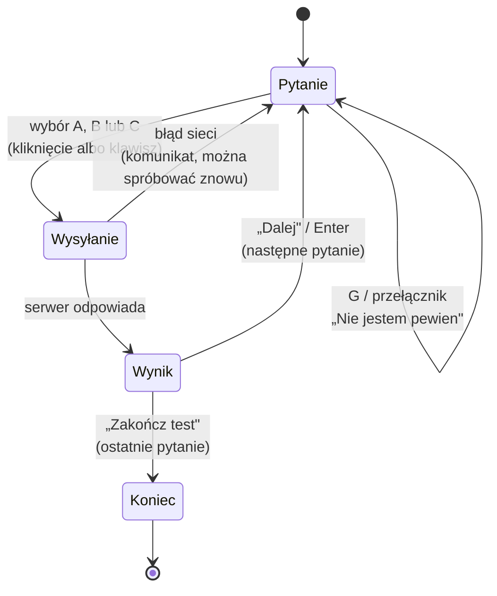
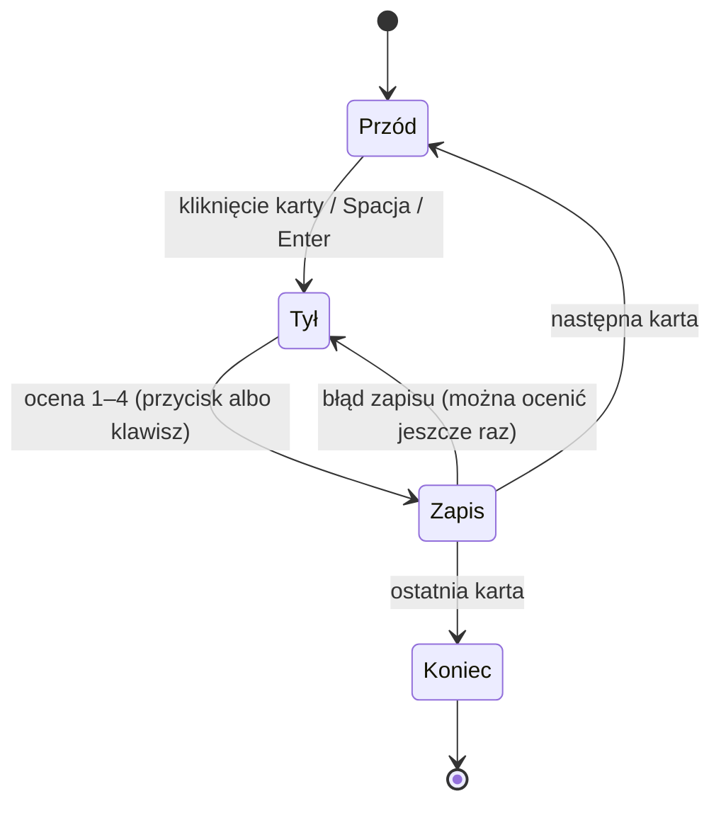
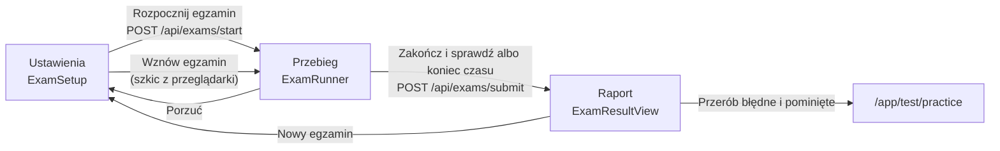

# 04. Nauka w aplikacji

[← Spis treści](README.md)

To najważniejszy dokument frontendu: opisuje, co dzieje się na ekranie podczas nauki. Przypominam podział pracy:
**frontend pokazuje i zbiera odpowiedzi, a o tym, kiedy pytanie wróci, decyduje serwer** (algorytm FSRS-6; jego opis jest
w dokumentacji backendu, rozdział „Nauka: testy, fiszki, FSRS”). Dlatego tu nie ma żadnych wzorów ani dat powtórek,
są tylko ekrany, stany i reguły interfejsu.

## Dwa tryby jednego pytania i trzy rodzaje sesji

W bazie jest jedno pytanie, a **fiszka jest trybem tego samego pytania**, nie osobną kartą: ta sama treść, ale osobny
harmonogram powtórek (FSRS) w teście i w fiszkach. Dlatego w obu trybach frontend rozmawia z serwerem numerem pytania
(`questionId`), a nie numerem „karty”.

| | Test (Testy) | Fiszka (Fiszki) |
|---|---|---|
| Wygląd | Pytanie i trzy odpowiedzi A, B, C, dokładnie jedna poprawna | Przód z pytaniem, po kliknięciu tył z odpowiedzią |
| Kto ocenia | Serwer (porównuje wybraną odpowiedź z poprawną) | Użytkownik, czterema przyciskami |
| Pole „Nie jestem pewien” | Tak | Nie dotyczy |
| Plik sesji | `pages/TestSessionPage.tsx` | `pages/StudySessionPage.tsx` |
| Kolejka z serwera | `GET /api/review/test-queue` | `GET /api/review/flashcard-queue` |
| Skąd się biorą | Z puli pytań użytkownika (patrz [Pula pytań użytkownika](#pula-pytań-użytkownika)) | Z pewnych błędów w testach i z „Dodaj do fiszek” |

Fiszki **zaczynają puste**: pytanie trafia do Fiszek dopiero po **pewnym błędzie** w teście (błędna odpowiedź bez „Nie
jestem pewien”) albo po kliknięciu „Dodaj do fiszek”. Administrator może ukryć samą fiszkę pytania, a pytanie zostaje wtedy
w testach.

## Sesja testowa (`TestSessionPage`)

### Pięć trybów tej samej strony

Ta sama strona obsługuje pięć trybów (parametr `mode`, ustawiany w `app/router.tsx`):

| Tryb | Adres | Skąd pytania | Co jeszcze |
|------|-------|--------------|------------|
| `scope` (domyślny) | `/app/test` z zakresem w adresie: `?fieldId=` (dziedzina), `?actId=` (akt prawny), `?sourceId=` (arkusz); bez żadnego cała pula | `GET /api/review/test-queue` z tym samym zakresem (zaległe + dzienna porcja nowych) | Informacja o zaległościach, „Rozwiąż jeszcze”, „Powtórz jeszcze” |
| `due` | `/app/test/due` | To samo, ale z `extraNewCards=0`: same zaległe, bez nowych | Jak wyżej; gdy nic nie zalega, ekran „Nie masz zaległych powtórek” |
| `mistakes` | `/app/test/mistakes` | `GET /api/review/mistakes-queue` | Zamknięta lista, bez dokładania nowych |
| `practice` | `/app/test/practice?questionIds=1,2,3` | `GET /api/review/practice-queue` | Zamknięta lista (np. błędy z egzaminu); numery z adresu: tylko dodatnie liczby całkowite, bez powtórzeń, do 200 |
| `custom` | `/app/test/custom?questionIds=1,2,3&sessionId=12` | `GET /api/review/practice-queue` | To samo co `practice`, ale numery pochodzą z ekranu „Własny test”; własne podpisy („Własny test”, „Brawo! Własny test zakończony.”), a przycisk powrotu prowadzi do ekranu układania |

Zakres z adresu czyta `useScopeParams` (zły albo brakujący numer jest pomijany), a adresy budują `ROUTES.testScope(...)` i
`ROUTES.studyScope(...)` z `config/routes.ts`. Zakres nigdy nie rozszerza puli: serwer liczy go razem z pulą użytkownika.

W trybach `mistakes`, `practice` i `custom` (lista zamknięta) nie ma informacji o zaległościach ani przycisku „Rozwiąż
jeszcze”, a przycisk powrotu prowadzi do Testów (dla `practice` do Egzaminu, dla `custom` do ekranu „Własny test”).

### Przebieg jednego pytania

1. Użytkownik widzi pytanie, trzy odpowiedzi i przełącznik **„Nie jestem pewien”** (skrót `G`). Przełącznik zaznacza się
   **przed** odpowiedzią i znika po jej wybraniu. Gdy to jego **pierwsze pytanie w życiu** (`testAnswers === 0` w ustawieniach
   interfejsu), pod przełącznikiem stoi jednorazowa podpowiedź „Zaznacz, jeśli zgadujesz. Takie pytanie wróci szybciej, nawet
   przy dobrej odpowiedzi.” (`data-testid="guess-hint"`); po pierwszej odpowiedzi licznik rośnie i podpowiedź już się nie pokazuje.
   Nad pytaniem, obok strzałek podglądu, jest mały [licznik czasu](#licznik-czasu-przy-pytaniu), a pod nim podpis z aktu
   prawnego i źródła pytania (`SourceLabel`, np. „Kodeks cywilny · Notarialna 2024” albo „… · Pytania autorskie”). Gdy w treści
   pytania zmieniło się prawo w ostatnim roku, pod podpisem stoi pomarańczowa plakietka „Zmiana w prawie: 1 października 2026”
   ([niżej](#zmiany-w-prawie)).
2. Wybór odpowiedzi blokuje pozostałe i wysyła `POST /api/review/test-answer` z numerem pytania (`questionId`), wybraną opcją (A, B lub C), czasem
   odpowiedzi w sekundach, znacznikiem `guessed` i (w sesji własnego testu) numerem sesji `sessionId`. Czas liczy się od
   pokazania pytania, ale tylko przy widocznej karcie przeglądarki, a podgląd poprzednich pytań go wstrzymuje. Odpowiedź
   serwera niesie też `newQuestion` (czy to pierwsze zobaczenie tego pytania), z czego frontend liczy „nowe pytania w tej sesji”.
3. Odpowiedź serwera (`TestAnswerResult`) steruje wynikiem:
   - poprawna odpowiedź podświetla się na zielono, wybrana błędna na czerwono, pozostałe wyszarzają;
   - nagłówek „Poprawnie!” albo „Niepoprawnie” i zdanie o zapisanej ocenie (tabela niżej);
   - wyjaśnienie (jeśli jest), plakietka „Zmiana w prawie” z krótkim opisem zmiany (gdy pytanie ma zmianę), podstawa prawna
     (np. „art. 415 k.c.”) i data stanu prawnego (`LegalBasisLine`);
   - podpowiedź o trudnym pytaniu, jeśli `leech` jest prawdą (patrz niżej);
   - informacja o fiszce: „Dodałem fiszkę do tego pytania w Fiszkach.” przy pierwszym pewnym błędzie.
4. Pod wynikiem są przyciski: **Dodaj do fiszek / Usuń z fiszek**, **Ukryj pytanie** (tylko administrator),
   **Zawieś pytanie** (tylko przy trudnym pytaniu) oraz **Dalej** albo **Zakończ test**. **Zgłoś błąd** leży w prawym górnym
   rogu panelu wyniku i pojawia się dopiero po odpowiedzi (patrz [Zgłoś błąd](#zgłoś-błąd)).
5. Gdy zapis się nie uda (np. brak internetu), odpowiedzi odblokowują się i pojawia się komunikat „Nie udało się zapisać
   odpowiedzi. Spróbuj ponownie.”: nic nie przepada.

Jaką ocenę zapisuje serwer, pokazuje zdanie w panelu wyniku (to, co widzi użytkownik, a nie osobna logika frontendu):

| Wynik | „Nie jestem pewien” | Zdanie w panelu | Skutek |
|-------|---------------------|-----------------|--------|
| poprawna | nie | „Zapisano jako „Znam”.” | Pytanie wraca po dłuższej przerwie |
| poprawna | tak | „Zaznaczone jako niepewne: zapisano jako „Nie pamiętam”, pytanie wróci w powtórkach.” | Wraca szybko |
| błędna | nie (pewny błąd) | „Zapisano jako „Nie pamiętam”…” + informacja o fiszce | Wraca szybko, a fiszka trafia do Fiszek |
| błędna | tak | „Zapisano jako „Nie pamiętam”…” | Wraca szybko, bez fiszki |

### Mieszanie odpowiedzi

Domyślnie kolejność odpowiedzi A, B, C jest losowana przy każdym ułożeniu kolejki, żeby użytkownik uczył się treści, a nie
pozycji („zawsze B”). Zasady (`features/tests/shuffle.ts`):

- Litery A, B, C na ekranie to **pozycje**. Serwer zna odpowiedzi pod oryginalnymi kluczami, więc przed wysłaniem litera z
  ekranu jest zamieniana z powrotem (`originalKeyOf`), a poprawna odpowiedź z serwera jest przeliczana na pozycję
  (`displayKeyOf`).
- Pytania, w których odpowiedzi odwołują się do siebie („A i B”, „Żadna z powyższych”, „Obie odpowiedzi są poprawne”,
  „odpowiedź B”), **zostają w oryginalnej kolejności**. Wykrywanie jest ostrożne: lepiej raz nie wymieszać, niż
  wymieszać pytanie, które przestaje mieć sens.
- Ustawienie „Mieszaj kolejność odpowiedzi w testach” jest w Koncie (`shuffleOptions`) i jest pobierane razem z kolejką;
  gdy nie uda się go pobrać, odpowiedzi są mieszane.
- **Egzamin próbny nie miesza odpowiedzi** (zawsze kolejność z bazy).

### Cofanie (podgląd)

Strzałki `←` i `→` (albo przyciski nad pytaniem) pozwalają obejrzeć poprzednie pytania tej sesji w trybie tylko do odczytu
z oznaczeniem „Podgląd”. Historia siedzi **tylko w pamięci strony**: niczego nie wysyła do serwera i znika po wyjściu z
sesji. Z podglądu wraca się przyciskiem „Kontynuuj” (albo „Wróć do podsumowania”).

### Koniec sesji

Ekran „Brawo!” pokazuje liczbę poprawnych odpowiedzi i, zależnie od sytuacji:

| Przycisk | Kiedy | Co robi |
|----------|-------|---------|
| **Powtórz teraz (N)** | Są pytania błędne albo z „Nie jestem pewien” (poza zawieszonymi w tej sesji) | Zaczyna od razu drugi przebieg przez te pytania. Każda odpowiedź jest znowu wysyłana do serwera |
| **Powtórz jeszcze N pytań** | Serwer mówi, że część zaległości nie zmieściła się w dziennym limicie (`deferred > 0`) | Dokłada kolejną porcję zaległych ponad limit: `N = min(20, zaległe)` |
| **Rozwiąż jeszcze N pytań** | Są jeszcze nowe pytania do dołożenia | Dokłada nowe pytania: `N = min(10, dostępne)` |
| **Wróć do Testów** | zawsze | Powrót do listy |
| **Przejrzyj odpowiedzi** | Sesja miała odpowiedzi | Wejście w podgląd |

Dodatkowe porcje („Rozwiąż jeszcze”, „Powtórz jeszcze”, „Powtórz teraz”) są traktowane jak nowa, mniejsza sesja: informacja o
zaległościach z początku znika, bo jej już nie dotyczy.

**Podsumowanie sesji** (`features/review/SessionSummary.tsx`, `data-testid="session-summary"`) stoi na ekranie „Brawo!” pod
wynikiem, w testach i w fiszkach. Ma najwyżej dwa zdania: „Nowe pytania w tej sesji: N” (w fiszkach „Nowe fiszki w tej sesji: N”;
liczone z `newQuestion` w teście i `firstReview` w fiszkach, z odpowiedzi serwera, pokazywane tylko gdy N > 0) i „Jutro wróci N powtórek.” albo „Na jutro nie
masz żadnych powtórek.” (`GET /api/review/due-tomorrow?mode=TEST|FLASHCARD`, liczba powtórek wypadających do końca jutra, razem z tymi, które czekają już teraz). Błąd
pobrania liczby jutrzejszych powtórek nie psuje ekranu: ten wiersz po prostu się nie pokazuje.

## Sesja fiszek (`StudySessionPage`)

- Kolejka to `GET /api/review/flashcard-queue` (zaległe fiszki od tych, które najłatwiej zapomnieć, plus dzienna porcja
  nowych). Adres `/app/study` przyjmuje ten sam zakres co testy (`?fieldId=`, `?actId=`, `?sourceId=`); ekran Fiszek
  podpowiada całą pulę, dziedzinę albo akt prawny. Zawężenie puli do aktów obowiązuje też w fiszkach, ale filtr źródeł nie
  (fiszka wynika z błędu w teście, więc zostaje w nauce niezależnie od źródła pytania).
- Karta ma **przód** (pytanie) i **tył** (odpowiedź), a odwracanie to animacja 3D (obrót o 180°). Strona, która jest
  schowana, ma `aria-hidden`, żeby czytnik ekranu czytał tylko widoczną. Pytanie ze zmianą w prawie ma plakietkę „Zmiana w
  prawie” na przodzie, a z opisem zmiany na tyle, w stopce obok podpisu źródła.
- Cztery oceny, wysyłane przez `POST /api/review` (`questionId`, ocena, czas) jako liczby 1–4:

| Klawisz | Przycisk | Liczba | Kolor |
|---------|----------|--------|-------|
| 1 | Nie pamiętam | 1 | czerwony |
| 2 | Trudne | 2 | pomarańczowy |
| 3 | Znam | 3 | zielony |
| 4 | Łatwe | 4 | złoty (kolor akcentu) |

- **„Nie pamiętam” (1) odkłada kartę na koniec tej samej sesji**, zamiast czekać do następnego dnia. Pod pytaniem pojawia się
  wtedy oznaczenie, że to powtórka. Wyjątek: karta zawieszona w tej sesji nie wraca.
- Jeśli zapis oceny się nie uda, karta zostaje na ekranie z odkrytą odpowiedzią i komunikatem; można ocenić ją jeszcze raz.
- Koniec sesji i przyciski dodatkowe działają jak w teście: „Ucz się jeszcze N fiszek” (max 10 nowych), „Powtórz jeszcze N fiszek”
  (zaległe ponad limit, max 20), „Wróć do Fiszek”, „Przejrzyj powtórki”.
- Pod kartą są przyciski pomocnicze „Zawieś pytanie” (przy trudnej fiszce; zawiesza tylko tryb fiszek) i „Ukryj fiszkę”
  (administrator; ukrywa samą fiszkę, a pytanie zostaje w testach). „Zgłoś błąd” leży w prawym górnym rogu **odwróconej**
  karty (dopiero po odsłonięciu odpowiedzi), tak samo jak w teście.
- Nad kartą jest ten sam mały [licznik czasu](#licznik-czasu-przy-pytaniu); w fiszkach pokazuje czas do odsłonięcia odpowiedzi,
  a na serwer z oceną idzie łączny czas od pokazania karty do oceny (`timeSpentSeconds`, też tylko przy widocznej karcie). Odpowiedź na ocenę niesie `firstReview`
  (pierwsza ocena tej fiszki), z czego powstaje „Nowe fiszki w tej sesji” na ekranie końcowym.

## Skróty klawiszowe

Skróty działają na całym oknie, ale **nie** wtedy, gdy użytkownik pisze w polu tekstowym, gdy trzyma `Ctrl`, `Alt` albo
`Cmd`, ani w obszarach oznaczonych `data-no-shortcuts` (formularz zgłoszenia, przyciski pomocnicze). Reguła jest w
`features/review/keyboard.ts` (`isTyping`). Podpowiedź skrótów (`KeyboardHint`) pokazuje się tylko na szerokich ekranach (od `md`);
na telefonie jej nie ma, a klawiatury i tak nie ma (przy ocenach fiszek i odpowiedziach testu cyfry i litery zostają na
samych przyciskach).

| Ekran | Klawisze | Działanie |
|-------|----------|-----------|
| Test | `A` `B` `C` albo `1` `2` `3` | Wybór odpowiedzi |
| Test | `G` | Przełączenie „Nie jestem pewien” (przed odpowiedzią) |
| Test | `Enter` | Następne pytanie (po odpowiedzi) |
| Test, fiszki | `←` `→` | Poprzednie i następne (podgląd) |
| Fiszki | `Spacja` albo `Enter` | Odsłonięcie odpowiedzi |
| Fiszki | `1` `2` `3` `4` | Ocena |
| Egzamin | `A` `B` `C` albo `1` `2` `3` | Wybór odpowiedzi (ponowny wybór tej samej ją odznacza) |
| Egzamin | `←` `→` | Poprzednie i następne pytanie |
| Egzamin | `F` | Oznaczenie pytania „do sprawdzenia” |

W fiszkach, gdy widać przyciski ocen albo podgląd, `Spacja` jest zablokowana i niczego nie robi (żeby nie oceniać przez
przypadek).

### Podpowiedź skrótów: kiedy znika

Podpowiedź (`features/review/KeyboardHint.tsx`) jest dla początkujących, więc po nauczeniu się skrótów ustępuje:

- **Znika sama po 10 odpowiedziach**, osobno w testach (`testAnswers`) i w fiszkach (`flashcardReviews`). Liczy serwer na koncie,
  więc nie wraca na innym urządzeniu; frontend po każdej zapisanej odpowiedzi zwiększa swoją kopię licznika
  (`useCountAnswer`), żeby podpowiedź zniknęła od razu po dziesiątej, bez kolejnego zapytania.
- Mały przycisk **„×”** obok podpowiedzi chowa ją na stałe w danym trybie (`PUT /api/me/interface`: `testHintHidden` albo
  `flashcardHintHidden`). Ukrycie działa od razu, nawet gdy zapis na koncie się nie uda.
- Klawisz **`?`** (albo mały okrągły przycisk „?” w miejscu podpowiedzi) pokazuje ją z powrotem **na chwilę**: w tej wizycie
  na ekranie, z przyciskiem zamknięcia. Nie zmienia to zapisanego ustawienia.
- **W Koncie nie ma przełącznika** tej podpowiedzi: celowo, żeby nie rozbudowywać ustawień. Przy braku odpowiedzi serwera
  (`GET /api/me/interface` zwraca błąd) frontend niczego nie chowa, bo lepiej pokazać podpowiedź niż ją zgubić.
- Same skróty działają zawsze, niezależnie od tego, czy podpowiedź jest widoczna. Cyfry **1–4** na przyciskach ocen fiszek i litery
  **A, B, C** na odpowiedziach zostają na przyciskach.

## Licznik czasu przy pytaniu

Przy każdym pytaniu testowym i każdej fiszce stoi mały, dyskretny licznik („0:07”, „1:15”; `QuestionTimer`, `data-testid="question-timer"`).
Pokazuje, ile użytkownik myśli nad tym pytaniem.

- **Liczy tylko przy widocznej karcie przeglądarki** (`useQuestionClock` + `QuestionClock`): po przełączeniu na inną kartę stoper
  staje, po powrocie rusza dalej. Zatrzymuje go też odpowiedź, podgląd poprzednich pytań i ekran końcowy. Nowe pytanie albo nowa
  porcja pytań („Powtórz teraz”) zaczyna od zera.
- **Ten sam czas idzie na serwer** z odpowiedzią (`timeSpentSeconds`) i jest podstawą statystyki „średni czas na pytanie”.
- **Kliknięcie licznika go chowa**, a kliknięcie samej ikony pokazuje go z powrotem. Ukrycie zapisuje się na koncie
  (`PUT /api/me/interface`, pole `questionTimerHidden`), więc obowiązuje na każdym urządzeniu. Domyślnie licznik jest widoczny.
  Chowanie nie zatrzymuje pomiaru: serwer dostaje czas także wtedy, gdy licznik jest schowany.
- Czytnik ekranu nie odczytuje kolejnych sekund (czas w przycisku jest `aria-hidden`); przycisk ma opis „Ukryj licznik czasu” /
  „Pokaż licznik czasu”. Przycisk ma wysokość jak sąsiednie strzałki (44 px na telefonie), żeby rząd się nie przesuwał.

## Czas nauki

To **osobna miara** od czasu odpowiedzi na pojedyncze pytanie: ile w sumie użytkownik spędził na nauce, razem z czytaniem wyjaśnień
i zastanawianiem się między pytaniami. Mierzy go `StudyTimeTracker` (w `AppShell`, `features/studytime`), a pokazuje sekcja
„Podsumowanie nauki” w Statystykach.

- Liczy, **gdy bieżący ekran jest ekranem nauki** (`isStudyPath` w `config/navigation.ts`: testy, powtórki, błędy, własny test,
  fiszki i egzamin), karta przeglądarki jest widoczna i w ciągu ostatnich **3 minut** był jakiś ruch (mysz, klawisz, dotyk,
  przewijanie). Po 3 minutach bez ruchu liczenie pauzuje do następnego ruchu.
- Czysta klasa `StudyTimeMeter` nie dotyka przeglądarki, więc jej zasady da się sprawdzić na zmyślonym zegarze. Jedno tyknięcie
  nie doliczy więcej niż 2 sekundy: po uśpieniu komputera nie dopisują się godziny.
- Zebrane sekundy idą na serwer co około **30 sekund** (`POST /api/me/study-time`, najwyżej 300 s w jednym zgłoszeniu), przy
  wyjściu z ekranu nauki i przy zamknięciu strony (`pagehide`, żądanie `keepalive`, `api/keepalive.ts`). Gdy wysłanie się nie
  uda, sekundy wracają do licznika (najwyżej godzina) i idą przy następnym zgłoszeniu. Serwer zapisuje je w podziale na dni.

## Zaległości i dzienny limit

Serwer ogranicza liczbę zaległych powtórek na dzień (limit użytkownika, osobny dla fiszek i testów; zapytanie
`GET /api/review/queue/backlog` podaje tryb i zakres sesji). Frontend tylko to
pokazuje (`features/review/useBacklog.ts`, `BacklogNotice.tsx`):

- Na początku sesji, jeśli `deferred > 0`: „Na dziś najpilniejsze: zaczynasz od tego, co najłatwiej zapomnieć. Jeszcze N
  zaległych powtórek poczeka na kolejne dni.” (nie pokazuje się w dodatkowych porcjach, w podglądzie ani w listach zamkniętych).
- Na końcu sesji dane są pobierane od nowa, a komunikat „Dzienny limit zaległych powtórek wykonany…” zawiera przycisk
  „Powtórz jeszcze”.
- Zapytanie o zaległości **zawsze jest świeże** (bez pamięci podręcznej), nie ponawia się, a jego błąd nie przeszkadza w
  nauce: po prostu nie pokazuje się informacja o zaległościach.

## Fiszka z pytania: „Dodaj do fiszek”

Odpowiedź serwera niesie stan fiszki tego pytania (`FlashcardStatus`); zmiany idą przez `POST` i `DELETE
/api/questions/{id}/flashcard`:

| Stan | Znaczenie | Co widać pod odpowiedzią |
|------|-----------|--------------------------|
| `UNAVAILABLE` | Administrator ukrył fiszkę tego pytania | Nic |
| `AVAILABLE` | Fiszkę można dodać | Przycisk **Dodaj do fiszek** |
| `ADDED_MANUALLY` | Użytkownik sam ją dodał | „W fiszkach” i przycisk **Usuń z fiszek** (cofnięcie) |
| `ADDED_BY_MISTAKE` | Trafiła do Fiszek po pewnym błędzie | Zdanie w panelu wyniku; przycisku nie ma (tego nie da się cofnąć) |

Zmiany w tej sesji są pamiętane (`flashcardOverrides`), więc podgląd poprzednich pytań pokazuje aktualny stan. Po zmianie
odświeżane są liczniki (patrz [05](05-warstwa-api-i-dane.md)).

## Trudne pytania i zawieszanie

- Serwer oznacza pytanie jako **trudne** (`leech`), gdy liczba błędów osiągnie próg (domyślnie 8). Wtedy pod odpowiedzią
  pojawia się `LeechHint`: „To pytanie sprawia Ci trudność: pomyliłeś się w nim już N razy. Jeśli jest niejasne albo
  nieaktualne, zgłoś błąd. Możesz też zawiesić je na jakiś czas.”
- **Zawieś pytanie** (`SuspendQuestionButton`): `PUT /api/me/suspended-questions/{id}?mode=TEST` (w fiszkach
  `mode=FLASHCARD`). Pytanie znika z powtórek tego trybu, postęp zostaje; test i fiszka tego samego pytania zawiesza się
  osobno. Przycisk zmienia tylko opis na „Zawieszone” i podpowiada „Przywrócisz je w Koncie.”
- W **Koncie** (`DifficultQuestionsCard`) są dwie listy: „Zawieszone” (z przyciskiem „Przywróć”) i trudne pytania, które
  nadal są w nauce (z przyciskiem „Zawieś”). Wiersz mówi, w którym trybie pytanie jest trudne („w testach” albo „w fiszkach”),
  a to samo pytanie może być na liście dwa razy. Każda lista ma limit 200 pozycji (limit serwera). Po akcji lista się odświeża, a
  fokus przechodzi na nagłówek sekcji, z której wiersz zniknął.

## Zgłoś błąd

`ReportQuestionButton` otwiera **okno na środku ekranu** (`Dialog`), a nie formularz wstawiony pod pytaniem. Przycisk jest **tylko po
odpowiedzi**: w teście w prawym górnym rogu panelu wyniku (obok „Poprawnie!” / „Niepoprawnie”, poza obszarem `role="status"`,
żeby czytnik nie czytał go razem z wynikiem), w fiszkach w prawym górnym rogu odwróconej karty (`variant="corner"`). Przed
odpowiedzią go nie ma, bo wtedy użytkownik nie widzi jeszcze, co jest poprawne. W oknie: powód (cztery do wyboru: „Zaznaczona odpowiedź jest błędna”, „Przepis się zmienił (pytanie jest nieaktualne)”,
„Literówka albo niejasne sformułowanie”, „Coś innego”; żaden nie jest zaznaczony z góry, a „Wyślij zgłoszenie” jest nieaktywne
bez wyboru) i komentarz do 1000 znaków (przy „Coś innego” wymagany). Wysyła `POST /api/questions/{id}/reports` (to samo zgłoszenie z testu i z fiszki).

- Esc, „Anuluj” i kliknięcie w tło zamykają okno; **kliknięcie w tło nie zamyka okna, gdy jest w nim wpisany komentarz**
  (nie ginie od przypadkowego kliknięcia). Każde otwarcie zaczyna od pustego formularza.
- Po wysłaniu okno pokazuje podziękowanie („Dziękujemy! Zgłoszenie zapisane, sprawdzimy to pytanie.”) i przycisk „Zamknij”; po
  jego zamknięciu w miejscu przycisku zostaje informacja z fokusem, żeby fokus nie przepadł: w rogu panelu krótka „Zgłoszono. Dziękujemy!”,
  a w wariancie pod kartą (`inline`) pełna „Zgłoszenie wysłane. Dziękujemy!”.
  Przy następnym pytaniu wszystko zaczyna od zera (`key={questionId}`).
- Jeśli użytkownik miał już otwarte zgłoszenie tego pytania, serwer je uzupełnia (`updated: true`) i okno mówi o tym osobnym
  zdaniem („Uzupełniliśmy Twoje wcześniejsze zgłoszenie tego pytania. Dziękujemy!”).
- Błąd serwera pokazuje komunikat w oknie, które zostaje otwarte, z zachowanym wyborem i komentarzem; można ponowić.
- Skróty klawiszowe sesji nie działają, gdy okno jest otwarte (m.in. Enter w polu komentarza nie przechodzi do następnego pytania).

Zgłoszenia nie mają ekranu do przeglądania: administrator rozpatruje je w bazie.

## Ukrywanie pytań i fiszek (administrator)

`HideQuestionButton` (`features/admin`) jest widoczny tylko dla roli `ADMIN` (patrz [03](03-logowanie-i-sesja.md)) i ma dwa
warianty:

| Gdzie | Przycisk | Wywołanie | Skutek |
|-------|----------|-----------|--------|
| Sesja testowa | „Ukryj pytanie” | `PUT /api/questions/{id}/hidden` | Pytanie znika wszystkim: z testów, fiszek i egzaminu |
| Sesja fiszek | „Ukryj fiszkę” | `PUT /api/questions/{id}/flashcard-hidden` | Znika sama fiszka, a pytanie zostaje w testach |

Ukrycie wymaga potwierdzenia „Ukryć dla wszystkich użytkowników?” („Tak, ukryj” / „Anuluj”), a po nim pojawia się „Ukryte dla
wszystkich.” albo „Fiszka ukryta dla wszystkich.”. Frontend odświeża liczniki, katalog Testów i pulę. Historia odpowiedzi
zostaje, a przywrócenie jest tylko w bazie (`UPDATE questions SET hidden = false …`, dla fiszki `flashcard_hidden`), bo
przycisku przywracania nie ma.

## Pula pytań użytkownika

Użytkownik uczy się z **puli**: pytań z aktów prawnych swojej ścieżki (pięć aplikacji egzaminacyjnych albo Student), po
opcjonalnym zawężeniu do wybranych aktów i z filtrem źródeł. Pulę liczy serwer (`GET /api/me/pool`, `api/pool.ts`), a
frontend ją tylko pokazuje i zapisuje wybór. Użytkownik aplikacji widzi dziedziny, ale w każdej tylko akty swojej ścieżki
(dziedzinę bez aktów w puli backend w ogóle nie zwraca). **Student uczy się z przedmiotów**: administrator (skryptem SQL)
przypisuje przedmiotom akty prawne, a Student wybiera przedmioty i dostaje wszystkie pytania ich aktów. Nie wybrał żadnego =
uczy się ze wszystkich. Przedmiot bez pytań jest ukryty. Frontend Studenta nie pokazuje wyboru aktów, a pytania nadal należą do
aktów (ten sam akt w dwóch przedmiotach to te same pytania). Wybór przedmiotów zostaje na koncie przy zmianie ścieżki.

**Znacznik „Pula pytań”** (`features/pool/PoolChip.tsx`, `data-testid="pool-chip"`) stoi przy tytule na liście Testów, na
ekranie dziedziny, we „Własnym teście” i w ustawieniach egzaminu. Mówi, z czego użytkownik się uczy, np. „Notarialna”,
„Notarialna, wybrane akty”, „Student, wybrane przedmioty” albo „Student, filtr źródeł” (`describePool`). Gdy pula jest czymś zawężona, znacznik ma złotą
ramkę i kropkę, a podpowiedź (atrybut `title` i tekst dla czytnika ekranu) podaje liczbę pytań w puli. Gdy puli nie uda się
pobrać, znacznika po prostu nie ma, a nauka działa normalnie.

Kliknięcie otwiera okno **„Pula pytań”** (`PoolDialog`), w którym są dwie części do wyboru (zależnie od ścieżki):

- **Przedmioty** (tylko Student; `Pool.courses` z `GET /api/me/pool`): płaska lista pól wyboru z liczbą pytań każdego
  przedmiotu. Nie ma w niej aktów ani dziedzin. Zaznaczenie wszystkich przedmiotów to brak własnego wyboru.
- **Akty prawne** (tylko aplikacje), pogrupowane w dziedziny z aktami ścieżki: pole „Cała dziedzina”, osobny przycisk
  rozwijania dziedziny (rodzeństwo pola wyboru, nie zagnieżdżone w nim, żeby kontrolki nie siedziały jedna w drugiej) i pola
  przy każdym akcie z liczbą jego pytań ze wszystkich źródeł. „Zaznacz wszystkie” wraca do całej ścieżki. Akt typu `TOPIC`
  to zagadnienie bez ustawy.
- **Źródła pytań w Testach**: trzy pola „Moje arkusze”, „Arkusze innych ścieżek” i „Pytania autorskie” (`lib/source.ts`) z
  liczbą pytań każdej grupy; grupa bez pytań w puli jest nieaktywna.

Zasady okna:

- Trzeba zostawić co najmniej jeden akt (Student: przedmiot) i jedną grupę źródeł; inaczej „Zapisz” jest nieaktywne, a
  podpowiedź mówi, czego brakuje. Student nie widzi grupy „Moje arkusze” (nie ma własnych arkuszy).
- Zapis wysyła tylko to, co się zmieniło: `PUT /api/me/pool/acts` (aplikacje; zaznaczenie **wszystkich** aktów wysyła pustą
  listę, czyli zdejmuje zawężenie), `PUT /api/me/pool/courses` (Student, tak samo z pustą listą) i
  `PUT /api/me/pool/source-filter` (`ownSheets`, `otherSheets`, `authored`). Pula jest na koncie, więc działa też na innym
  urządzeniu.
- Zmiana ścieżki w Koncie zdejmuje zawężenie do aktów i przywraca wszystkie trzy grupy źródeł. Wybrane przedmioty Studenta
  zostają, więc powrót na tę ścieżkę nie wymaga ponownego wyboru. Postępy zostają zawsze, chyba że sam zaznaczysz „Zacznij od zera”
  (patrz [Zerowanie postępów](#zerowanie-postępów)).

**Gdzie pula obowiązuje** (stosuje ją serwer, frontend niczego nie filtruje u siebie):

| Obszar | Zawężenie do aktów (Student: przedmiotów) | Filtr źródeł |
|--------|--------------------|--------------|
| Testy: katalog, kolejki, powtórki, „Moje błędy”, własny test | tak | tak |
| Egzamin próbny | **nie** (losuje ze wszystkich aktów ścieżki) | tak |
| Fiszki | tak | **nie** |
| Statystyki testów (przegląd, opanowanie aktów, „Postęp” na Pulpicie) | tak | tak |
| Statystyki fiszek | tak | **nie** |
| Statystyki według źródła | nie (zawsze cała pula ścieżki) | nie |

Po zapisie frontend unieważnia dane, które liczą pytania: katalog Testów, liczniki powtórek, błędów i własnego testu,
ustawienia (plan nauki) i statystyki (`invalidateAfterPoolChange` w `features/pool/hooks.ts`).
Gdy pula zawęża katalog, puste pozycje mają napis „Brak w filtrze źródeł” zamiast „Wkrótce”.

### Student w Testach, Fiszkach i na Pulpicie

Student widzi **przedmioty zamiast dziedzin**: `TestsPage` pokazuje kafelki przedmiotów („Wybierz przedmiot”, bez sekcji źródeł),
a przedmiot otwiera `TestCoursePage` z kafelkami jego aktów. Pulpit pokazuje postęp „według przedmiotów”, Fiszki i filtr aktu
w Statystykach grupują akty pod przedmiotami (`actGroups` w `features/tests/groups.ts`; fiszki nie mają zakresu „cały
przedmiot”, bo zakres sesji to dziedzina, akt albo źródło). Przedmioty przychodzą w katalogu Testów (`TestCatalog.courses`,
każdy z `actIds` i licznikami) i w puli (`Pool.courses`). Przedmioty nakładają się (ten sam akt w dwóch), więc ich liczniki nie
sumują się do puli.

## Ustawienia nauki (Konto)

`features/settings/LearningSettingsCard.tsx` ↔ `GET` i `PUT /api/me/settings`.

| Pole | Zakres sprawdzany we frontendzie | Uwagi |
|------|----------------------------------|-------|
| Najwięcej nowych fiszek dziennie | liczba całkowita 0–200 | Domyślną wartość podaje serwer |
| Nowe pytania dziennie | „Automatycznie (zalecane)” albo „Własny limit” 0–500 | Patrz niżej: limit automatyczny |
| Najwięcej powtórek dziennie | 10–1000 | Osobno dla fiszek i testów; nadmiar czeka do jutra |
| Docelowa retencja | 70%–97% (lista: 80, 85, 90, 95, 97%) | Wartość spoza listy (ustawiona innym kanałem) jest dodawana do listy |
| Mieszaj kolejność odpowiedzi | pole wyboru | Domyślnie włączone |

- Wartość równa domyślnej jest wysyłana jako `null` („użyj domyślnej serwera”), więc późniejsza zmiana domyślnych wartości na serwerze
  obejmie takiego użytkownika. Wyjątek: **limit nowych pytań** ma dwa tryby, a `null` oznacza tu „Automatycznie”; własny limit, także
  równy domyślnemu (40), wysyłany jest jako liczba.
- **Limit nowych pytań: automatyczny albo własny.** Po co jest limit: żeby nowe pytania nie wypierały powtórek (każde nowe
  pytanie wraca później kilka razy). „Automatycznie” (zalecane, nic nie trzeba ustawiać) to co najmniej 40 dziennie, a gdy wybrana
  aplikacja (ścieżka egzaminacyjna) ma termin, limit idzie za planem: tyle nowych pytań, ile trzeba, żeby zdążyć przed ostatnimi dwoma tygodniami, ale
  **nie więcej niż 100** (`maxTestQuestionsPerDay` z planu). „Własny limit” obowiązuje wprost (0–500). Obliczenia robi serwer od
  stanu z początku dnia, więc limit nie zmienia się w trakcie dnia. Ustawienia zwracają limit obowiązujący teraz
  (`newTestQuestionsPerDay`) i znacznik `newTestQuestionsAuto`.
- **Uczciwy komunikat zamiast „podnieś limit”** (`LimitNotice`, reguły w `newQuestionsLimit.ts`; ten sam na Pulpicie i w Koncie,
  w Koncie bez linku do samego siebie): (a) własny limit niższy niż potrzeba, a potrzeba mieści się w maksimum: „Zmień go w
  Ustawieniach albo wybierz limit automatyczny”; (b) potrzeba więcej niż maksimum: „Wszystkich nowych pytań nie zdążysz zacząć
  przed ostatnimi dwoma tygodniami…”, bez prośby o podniesienie limitu (to nic by nie dało), z podpowiedzią zawężenia puli
  w oknie „Pula pytań”; przy limicie automatycznym dopisek „Limit ustawiliśmy na 100.”; (c) własny limit co najmniej tak duży jak potrzeba: brak
  komunikatu.
- **Moja ścieżka.** Użytkownik nie wpisuje własnej daty. W sekcji „Moja ścieżka” (`TrackChoiceSettings`, testid
  `track-choice-settings`) wybiera z listy „Do czego się przygotowuję” jedną z pięciu aplikacji (przy każdej data egzaminu
  albo „termin nieogłoszony”) albo **Studenta**, a termin ustawia administrator (niżej). Przycisk nazywa się „Zmień
  ścieżkę” (albo „Wybierz ścieżkę”, gdy nic jeszcze nie wybrano) i wywołuje `PUT /api/me/track` (`chooseTrack`, hook
  `useChooseTrack` w `features/settings/trackChoice.ts`). **Serwer przy tym zdejmuje zawężenie puli do aktów i przywraca
  filtr źródeł, ale postępów nie rusza**, więc po wyborze frontend odświeża pulę, katalog Testów, liczniki powtórek i błędów,
  Własny test oraz statystyki (`refreshAfterTrackChosen`). Pierwszy wybór zapisuje się od razu; **zmiana** istniejącej ścieżki
  otwiera okno potwierdzenia (`TrackChangeDialog`): „Zmieniasz ścieżkę z X na Y”, ramka **„Twoje postępy zostają”** (stan
  pytań, terminy powtórek, historia, własne testy, egzaminy, statystyki) i niezaznaczone pole **„Zacznij od zera”**. Po jego
  zaznaczeniu okno pokazuje, co zniknie, i wymaga wpisania WYZERUJ; wtedy przycisk mówi „Zmień ścieżkę i wyzeruj”. Najpierw
  zmienia się ścieżka, potem zerują postępy (gdyby zmiana się nie udała, nic nie ginie); gdyby zawiodło samo zerowanie, okno
  mówi, że ścieżka już jest zmieniona, i odsyła do karty „Wyzeruj postępy” w Koncie. Pod listą jedno zdanie opisuje stan egzaminu (`ExamInfo`): ile dni zostało, że
  tryb egzaminacyjny jest włączony, że termin jest nieogłoszony albo że egzamin już się odbył; Student zamiast tego widzi
  „Jako Student nie masz odliczania ani dziennego planu.”.
- **Plan do egzaminu**: gdy wybrana aplikacja ma przyszły termin (Student go nie ma), serwer zwraca plan (ile nowych pytań i fiszek zostało, ile
  dni na ich zaczęcie, sugerowane limity dzienne), a sugerowane limity są tylko informacją (limit nowych pytań robi się sam w trybie „Automatycznie”).
- Ostatnie **14 dni** przed egzaminem serwer zostawia na same powtórki; to stąd bierze się `planningDays`
  (dni do egzaminu − 14, najmniej 0). W tym czasie cel nowych pytań wynosi 0, a Pulpit pokazuje „Ostatnie dwa tygodnie: skup
  się na powtórkach.” Plan jest tylko informacją, nie blokuje nauki, a górną granicą pozostaje dzienny limit.
- Po zapisie unieważniane są liczniki powtórek i statystyki, bo limity zmieniają liczbę powtórek na dziś.
- Przycisk „Wstaw wartości domyślne” tylko wypełnia formularz (limit nowych pytań wraca do „Automatycznie”); zapis wymaga „Zapisz ustawienia”.

### Terminy egzaminów (administrator)

`features/settings/ExamTermsCard.tsx` ↔ `GET /api/exam-terms`, `PUT /api/exam-terms/{trackId}` (`api/examTerms.ts`,
hook `useExamTerms`). Karta w Koncie jest widoczna tylko dla administratora: rolę czyta `useIsAdmin()` z tokenu, ale to
tylko wygoda interfejsu, bo naprawdę chroni `403` z serwera. Dla każdej z pięciu aplikacji (Studenta na liście nie ma, bo nie ma terminu) jest pole daty i przyciski
„Zapisz” oraz „Usuń termin”. Serwer odrzuca datę z przeszłości i oddaloną o więcej niż 3 lata; komunikat błędu jest pokazany
przy wierszu. Zmiana działa od razu u wszystkich, którzy wybrali daną aplikację, ale wyznaczone już terminy powtórek nie
są przeliczane wstecz.

## Okno startowe i wygląd strony

### Okno startowe (`features/onboarding/OnboardingDialog.tsx`)

`OnboardingGate` stoi w `AppShell` i czyta ustawienia nauki. Gdy `track` w ustawieniach jest dokładnie `null` (nowe konto, które nie
wybrało ścieżki), otwiera okno modalne „Witaj w Gradus iuris”. **Wybór jest obowiązkowy**: okno można zamknąć tylko wybierając ścieżkę
(aplikację albo Studenta) i klikając „Zacznij naukę” (albo wylogowując się).

- Dwie grupy wyboru: „Do czego się przygotowujesz?” (lista ścieżek z `GET /api/tracks`: pięć aplikacji z wierszem terminu, a na
  końcu **Student**) i „Wygląd strony” (Ciemny zaznaczony z góry, Jasny). Z aplikacji biorą się odliczanie, plan dnia i pula
  pytań (własne arkusze aplikacji oraz akty prawne, które obejmuje; potem zawęzisz ją w „Puli pytań”). **Student** nie ma
  terminu ani odliczania, a pulę składa z wybranych przedmiotów (pod nazwą stoi podpis „Bez odliczania i planu dnia. Uczysz
  się z wybranych przedmiotów…”). Obie opcje to ten sam `PUT /api/me/track` z numerem ścieżki, a tę samą listę ma „Moja ścieżka” w Koncie,
  więc wybór można zmienić.
- „Zacznij naukę” jest nieaktywne, dopóki nic nie wybrano, a pod przyciskiem stoi podpowiedź „Wybierz aplikację albo
  Studenta, żeby przejść dalej.” Okno nie ma przycisku zamknięcia, Esc i kliknięcie w tło nic nie robią (`Dialog` z
  `dismissible={false}`; gdyby przeglądarka mimo to zamknęła okno, otworzy się z powrotem).
- Wybór wyglądu działa od razu jako **podgląd** (zmienia całą stronę), ale niczego nie zapisuje. Zapis dzieje się dopiero po
  „Zacznij naukę”: najpierw `PUT /api/me/theme` (tylko gdy wygląd się zmienił), potem `PUT /api/me/track`. Błąd któregokolwiek
  kroku zostaje w oknie jako komunikat z serwera i można ponowić (gdy zawiedzie zapis wyglądu, aplikacja nie jest wysyłana).
- Okno nie blokuje aplikacji, gdy nie wiadomo, czy wybór zrobiono: błąd pobrania ustawień, ładowanie albo odpowiedź bez
  pola `track` nie otwierają go (liczy się tylko wyraźne `null`). Konta, które ścieżkę już wybrały, nie widzą okna wcale.
- Okno jest `Dialog`em, więc skróty klawiszowe sesji pod nim nie działają, a fokus jest uwięziony w oknie.

### Wygląd: ciemny i jasny (`features/settings`)

- Karta „Wygląd” w Koncie (`AppearanceCard`, `ThemePicker`, `testid="appearance-card"`) ma dwie duże opcje z próbką koloru:
  Ciemny (domyślny) i Jasny („kolory papieru, jak w dokumentacji”). Wybór zapisuje się od razu na koncie
  (`PUT /api/me/theme`, hook `useChooseTheme`); strona przełącza się natychmiast, a przy błędzie zapisu wraca do poprzedniego
  wyglądu i pokazuje komunikat. Karta działa także wtedy, gdy ustawienia nauki się nie wczytały.
- **Źródłem prawdy jest konto.** `ThemeSync` (w `AppShell`) stosuje wygląd z ustawień, zapisuje jego kopię w przeglądarce
  (`gradus.theme.v1`, patrz [03](03-logowanie-i-sesja.md)) i przy opuszczeniu aplikacji przywraca ciemny. Skrypt w `index.html`
  ustawia jasny wygląd przed pierwszą klatką, ale tylko na ścieżkach `/app`; strona główna, logowanie i strony prawne są
  zawsze ciemne.
- Szczegóły kolorów w [06](06-wyglad-i-komponenty.md#paleta-kolorów-aplikacja).

## Własny test (`features/customTest`)

Sesja nauki ułożona przez użytkownika: wybiera dziedziny i akty prawne z puli (`ScopeTree`; Student: przedmioty), rodzaj pytań
(wszystkie, nowe, „Moje błędy”, zaległe, „Zmiany w prawie”) i liczbę pytań. Opis ekranu jest w [02](02-routing-i-strony.md). Zasady:

- **To nauka, nie egzamin.** Nie ma progu, wyniku „zdał / nie zdał” ani zegara. Sesja kończy się zwykłym ekranem
  „Brawo! Własny test zakończony.”.
- **Odpowiedzi liczą się jak w zwykłym teście.** Idą przez `POST /api/review/test-answer` (z numerem sesji `sessionId`), dostają
  ocenę pamięci (FSRS), a błędne trafiają do „Moich błędów”.
- **Liczba pytań to tylko 10, 20, 50, 100 albo 150** (stała `COUNT_CHOICES`; serwer odrzuca inne liczby komunikatem
  „Wybierz liczbę pytań: 10, 20, 50, 100 albo 150.”). Nie ma pola „Inna liczba” ani wyboru lat egzaminu. Ekran pokazuje
  **tylko te liczby, które się mieszczą** w dostępnych pytaniach (`countOptions` w `selection.ts`): przy 35 pytaniach są 10 i 20,
  a na końcu „Wszystkie (35)”; przy mniej niż 10 pytaniach jest jedna opcja „Wszystkie (N)”. „Wszystkie (N)”, gdy N nie jest
  jedną z liczb, wysyła na serwer najmniejszą dozwoloną liczbę nie mniejszą niż N (dla N do 150), więc serwer daje tyle, ile jest.
- **Co jest wybrane domyślnie** (`pickCountOption`): zapamiętana liczba, a gdy jej nie ma wśród dostępnych, **największa
  dostępna nieprzekraczająca zapamiętanej** (kto prosił o 100, a ma 35 pytań, dostaje „Wszystkie (35)”). Bez zapamiętanego
  wyboru proponujemy 20. Zapamiętywane są rodzaj pytań i liczba (`customTestStorage.ts`) oraz zakres: wersja `v3` zapisuje też, czy numery znaczą akty,
  czy przedmioty (`mode`), i stosuje je tylko wtedy, gdy zgadza się z obecnym rodzajem drzewa.
- **Przedmioty Studenta.** `buildTree` buduje z `catalog.courses` płaską listę (`TreeField.course`, bez rozwijania; `isCourseTree`),
  a `toScope` zwraca `courseIds` (przy zaznaczeniu wszystkiego puste, czyli cała pula). Zapisany test pamięta przedmioty
  (`courseIds`) oraz ich akty (w `actIds`), więc „Ułóż ponownie” działa także po zmianie ścieżki albo przedmiotów.
- **Dwa kroki.** Ekran pyta serwer o liczby pytań (`GET /api/review/custom-test/counts`), a po „Rozpocznij test”
  losuje numery i **zapisuje sesję** (`POST /api/review/custom-test` zwraca `questionIds` i `sessionId`). Sesja
  `/app/test/custom?questionIds=…&sessionId=…` pobiera te pytania kolejką ćwiczeń.
- **Pula obowiązuje automatycznie** (serwer: akty ścieżki po zawężeniu i filtr źródeł), a drzewo wyboru pokazuje tylko
  działy, w których po filtrze jest co rozwiązywać; gdy filtr źródeł wyciął wszystko, ekran mówi „Brak w filtrze źródeł”. Zawieszone, ukryte i niedostępne pytania nie wchodzą do testu.
- **Rodzaj „Zmiany w prawie”** to pytania, w których zmiana prawa (data `lawChange.changedAt`) przypada na ostatnie 365 dni;
  liczy je serwer (`lawChanges` w `custom-test/counts`).
- **Dzienny limit nowych pytań go nie dotyczy.** Użytkownik sam wybiera, ile pytań chce rozwiązać.
- W podsumowaniu nad przyciskiem opis zakresu i rodzaju łączą się przecinkiem („Cały materiał, Wszystkie”), bez środkowych kropek.

### Moje testy

Każdy własny test jest **zapisywany w chwili startu**, nie dopiero po ukończeniu (`MyTestsPage`, `MyTestDetailPage`; adresy
`/app/custom-test/history` i `/app/custom-test/history/:id`, link „Moje testy” na ekranie układania; menu dalej świeci „Testy”).

- **Lista** (`GET /api/custom-tests/sessions`) pokazuje od najnowszego: oznaczenie „Ukończony” albo **„Nieukończony”**, wynik
  („poprawne / pytania”), nazwę zakresu, rodzaj pytań, datę i czas; przy nieukończonym też „odpowiedzi: N z M”. Test zaczęty
  i porzucony zostaje na liście. Gdy testów nie ma, jest zaproszenie „Ułóż test”.
- **Szczegóły** (`GET /api/custom-tests/sessions/{id}`): wynik, rodzaj pytań, data startu, liczba odpowiedzi (i ile z „Nie jestem
  pewien”), czas odpowiadania oraz lista pytań z odpowiedziami, wyjaśnieniami i oznaczeniem, jak poszły; przełącznik „Wszystkie /
  Błędne i bez odpowiedzi”. Do nieukończonego testu nie da się wrócić, ekran mówi o tym wprost. Gdy test nie istnieje albo nie
  należy do użytkownika, ekran pokazuje błąd z linkiem „Wróć do listy testów”.
- **„Ułóż ponownie z tymi ustawieniami”** otwiera ekran układania ze wstępnie zaznaczonymi tymi samymi działami, rodzajem pytań
  i liczbą (ustawienia jadą w stanie nawigacji, `CustomTestPrefill`, z `courseIds` dla Studenta). Akty i dziedziny, których nie ma już w puli (np. po zmianie
  ścieżki), są pomijane z komunikatem; komunikat jest też, gdy od tamtego czasu zmienił się filtr źródeł (test pamięta grupy
  źródeł z chwili układania).
  Przycisk niczego nie uruchamia sam: użytkownik klika „Rozpocznij test”, więc powstaje nowa sesja.
- Do **Moich testów nie trafiają** zwykłe powtórki, „Popraw błędy” ani „Powtórz zaległe”; to osobne sesje.
- W Statystykach („Podsumowanie nauki”) liczba testów to liczba własnych testów, a egzaminy próbne są liczone osobno.

## Egzamin próbny (`features/exam`)

Egzamin ma **stały format**: zawsze **150 pytań** z całej puli ścieżki, a zaliczenie jest od **100 punktów**
(1 punkt za poprawną odpowiedź, bez punktów ujemnych). Użytkownik niczego z tego nie wybiera: ani zakresu, ani liczby pytań,
ani progu. Pytania losuje serwer (ze wszystkich aktów ścieżki, **bez zawężenia do wybranych aktów**, ale z filtrem źródeł), a serwer
także ocenia egzamin i sam ustala próg, więc frontend tylko wyświetla to, co dostał.
Ćwiczenie jednego działu to osobna funkcja, [Własny test](#własny-test-featurescustomtest), który niczego nie zalicza.

Egzamin ma trzy fazy na jednym adresie `/app/exam`: **ustawienia → przebieg → raport**. Nie zmienia harmonogramu powtórek
(odpowiedzi z egzaminu nie trafiają do FSRS), dopóki użytkownik nie przerobi błędów zwykłą sesją.

### Ustawienia

- **Format** pokazują dwa kafelki: „150 pytań z całej puli ścieżki” i „100 punktów do zaliczenia”. To opis, a nie pola
  formularza (stałe `EXAM_QUESTION_COUNT` i `EXAM_PASS_POINTS` w `features/exam/format.ts` służą tylko do wyświetlania;
  prawdziwy próg przychodzi z serwera).
- **Pula pytań:** znacznik puli (jak w Testach) i informacja, ile pytań jest do wylosowania. Gdy pula nie jest zawężona do
  aktów, liczba to `questionCount` z `GET /api/me/pool`; przy zawężeniu serwer nie podaje liczby pytań całej ścieżki, więc
  ekran tylko tłumaczy, że egzamin losuje ze wszystkich aktów ścieżki, niczego nie zgaduje i nie blokuje startu. Gdy filtr
  źródeł wyciął wszystko, ekran każe go zmienić w oknie „Pula pytań”.
- **Limit czasu:** 1–600 minut albo „Bez limitu czasu”. Dopóki użytkownik nie ustawi własnego, czas jest równy liczbie pytań w
  minutach (minuta na pytanie, czyli 150 min). Prawdziwy czas egzaminu nie jest tu odtwarzany, to wybór użytkownika.
- Zapamiętywany jest tylko ostatnio użyty limit czasu (`gradus.exam.settings.v1`).
- **Mniej niż 150 pytań w materiale:** egzamin ma tyle pytań, ile jest, a próg jest proporcjonalnie niższy
  (100 z 150, w górę do pełnego punktu, np. 12 pytań to 8 punktów). Ekran uprzedza o tym przed startem.
- Obok przycisku „Rozpocznij egzamin” jest link „Chcesz poćwiczyć jeden dział? Ułóż własny test” do `/app/custom-test`.
- Pod formularzem jest **historia** ostatnich podejść (do 50; `GET /api/exams/history`): wynik, zakres, data, próg, czas.
  Frontend nadal rozumie podejście bez progu w punktach (`passPoints: null`, próg w procentach, własny zakres); w bazie
  założonej od nowa takich podejść nie ma (zob. „Raport”).

### Przebieg

- Serwer losuje pytania (`POST /api/exams/start`, bez ciała) i zwraca też próg w punktach (`passPoints`), a frontend od razu
  zapisuje **szkic** w przeglądarce. Termin końca
  (`deadlineMs`) jest liczony raz, przy starcie, więc czas płynie dalej także po odświeżeniu strony (jak na prawdziwym egzaminie).
- **Zegar** liczy od terminu końca, a nie od licznika: nie „dryfuje” i nie staje w ukrytej karcie. Czytniki ekranu dostają
  zapowiedzi przy 10, 5 i 1 minucie do końca (nie co sekundę). Ostatnia minuta jest czerwona.
- Użytkownik wybiera odpowiedzi, może **oznaczać pytania „do sprawdzenia”** i skakać po pytaniach przez paletę (lista numerów z
  oznaczeniem odpowiedzianych i oznaczonych) albo strzałkami. Ponowny wybór tej samej odpowiedzi ją odznacza.
- Gdy w materiale jest mniej niż 150 pytań, pod paskiem górnym jest informacja „Wylosowano N z 150 pytań” i o niższym progu.
- Każda zmiana zapisuje szkic. Zamknięcie karty w trakcie egzaminu pokazuje ostrzeżenie przeglądarki.
- **Zakończenie:** okno „Zakończyć egzamin?” podaje liczbę pytań bez odpowiedzi (liczą się jako błędne) i oznaczonych.
  „Porzuć egzamin” kasuje szkic bez oceniania.
- **Koniec czasu** kończy egzamin sam, dokładnie raz.
- **Wysłanie:** `POST /api/exams/submit` z limitem czasu, czasem trwania (ucięty do limitu i do 48 godzin), znacznikiem
  `timedOut` i odpowiedziami (pusta odpowiedź to `null`). Zakresu ani progu klient nie wysyła: ocenia serwer. **Szkic kasuje się dopiero po udanym wysłaniu**: przy
  błędzie ekran mówi, że odpowiedzi są zapisane w tej przeglądarce, i pozwala spróbować jeszcze raz.

### Wznawianie

Szkic leży pod kluczem `gradus.exam.draft.v2` i ma numer wersji (3) oraz adres konta właściciela. Klucz zmieniono w Etapie 32,
bo pytania dostały nowe numery po przebudowie bazy: zapis pod starym kluczem (z „v1” w nazwie) jest ignorowany, a jego numery
pytań i tak do niczego by nie pasowały. Przy wejściu na `/app/exam` aplikacja czyta szkic z pamięci i sprawdza kształt danych:
uszkodzony, nieznanej wersji albo cudzy (inne konto w tej przeglądarce) szkic jest po prostu pomijany. Jeśli szkic jest
poprawny, ekran ustawień oferuje „Wznów egzamin” (a gdy czas minął, „Zakończ i sprawdź”) albo „Porzuć”.

### Raport

`ExamResultView`: werdykt „Zaliczony” lub „Niezaliczony”, wynik (poprawne / wszystkie i procent), próg w punktach
(„100 z 150 pkt”, z dopiskiem „Zabrakło N pkt do zaliczenia”, gdy zabrakło), czas, liczba odpowiedzi udzielonych i pominiętych,
zakres i data. Zaliczenie rozstrzyga serwer (`passed`: poprawne ≥ `passPoints`), frontend niczego nie przelicza.
Podejście bez progu w punktach (`passPoints: null`, spoza stałego formatu) ma w raporcie i w historii próg w procentach z liczbą
poprawnych odpowiedzi, której wymagał (`pointsNeeded`), i nazwę wybranego wtedy zakresu.
Dodatkowo: informacja o automatycznym zakończeniu po czasie, informacja o pytaniach, których nie dało się ocenić (usunięte
albo już niedostępne; nie wliczają się do wyniku), wyniki według źródeł (gdy źródeł jest więcej niż jedno) oraz przegląd
pytań z poprawnymi odpowiedziami, wyjaśnieniami, podstawą prawną i plakietką „Zmiana w prawie” (domyślnie tylko błędne, z przełącznikiem na wszystkie).
Plakietki nie ma w trakcie egzaminu (`ExamRunner`), tylko w raporcie.
Przycisk **„Przerób błędne i pominięte”** otwiera zwykłą sesję testową z tych pytań (`/app/test/practice?questionIds=...`);
dopiero ta sesja zapisuje odpowiedzi w powtórkach.

## Zmiany w prawie

Pytanie może mieć **datę zmiany w prawie** (`lawChange.changedAt`) i krótki opis (`note`); wpisuje je administrator skryptem
SQL. Frontend nic nie liczy: dostaje `lawChange` przy pytaniu (kolejki fiszek i testów, wynik odpowiedzi, sesja własnego
testu, raport egzaminu) albo `null`.

- **Plakietka** (`features/review/LawChangeBadge.tsx`, `data-testid="law-change"`): „Zmiana w prawie: 1 października 2026”
  (`lib/lawChange.ts`). Stoi pod podpisem źródła w teście i na przodzie fiszki; opis zmiany (`law-change-note`) pokazuje się
  dopiero po odpowiedzi (w teście), na tyle fiszki, w raporcie egzaminu i w szczegółach „Moich testów”. W trakcie egzaminu
  plakietki nie ma.
- **Powrót do powtórki.** Serwer w dniu zmiany ustawia pytanie jako zaległe u każdego, kto odpowiadał na nie wcześniej (osobno
  w testach i w fiszkach), więc zaległości po prostu rosną; frontend nie ma na to osobnego kodu.
- **Własny test „Zmiany w prawie”** to kategoria z ostatniego roku (`CustomTestKind` `LAW_CHANGE`, etykieta w
  `features/customTest/kindLabels.ts`).

## Zerowanie postępów

`features/progress` ↔ `GET` i `DELETE /api/me/study-progress` (`api/studyProgress.ts`). Użytkownik może zacząć od zera na dwa
sposoby: karta **„Wyzeruj postępy”** w Koncie (`ResetProgressCard`) albo pole „Zacznij od zera” w oknie zmiany ścieżki.

- Okno pokazuje, **co zniknie, z liczbami** (`ProgressLossList`, `progressLines`): pytania w nauce (testy i fiszki), zapisane
  odpowiedzi, fiszki dodane ręcznie, własne testy, egzaminy próbne i czas nauki. Liczby pobiera `GET /api/me/study-progress`
  dopiero po otwarciu okna. Bez postępów okno mówi „Nie masz jeszcze żadnych postępów” i nie ma czego zerować.
- **Potwierdzenie słowem WYZERUJ** (`ConfirmWordField`): przycisk „Wyzeruj na stałe” jest nieaktywny, dopóki użytkownik nie wpisze
  słowa (spacje wokół i wielkość liter nie mają znaczenia; `isResetConfirmed`). Frontend zawsze wysyła dosłowne `WYZERUJ`
  w ciele `DELETE` (`{ confirm: "WYZERUJ" }`), a serwer sprawdza je jeszcze raz.
- **Co zostaje:** konto, ścieżka, ustawienia nauki (limity, retencja), wybrane przedmioty i akty, grupy źródeł, zgłoszenia błędów
  i same pytania. Czyścimy też szkic egzaminu z pamięci przeglądarki.
- Po zerowaniu frontend unieważnia wszystkie zapytania (`refreshAfterProgressReset` w `features/progress/hooks.ts`), bo liczniki,
  statystyki, katalog Testów, „Moje testy” i historia egzaminów zmieniają się naraz.

## Statystyki i Pulpit

Ekrany statystyk tylko wyświetlają liczby policzone przez serwer. Frontend liczy sam wyłącznie rzeczy czysto prezentacyjne:
ograniczenie procentów do 0–100 i podział „opanowane / w nauce / nowe” z klamrami (`masterySplit` w
`features/statistics/sourceStats.ts`), 28 słupków aktywności i porównanie ostatnich 7 dni z poprzednimi (`selectors.ts`),
serię dni i liczbę odpowiedzi w tym tygodniu. Definicje liczb („Opanowane”, „Skuteczność”, „Pewne błędy”) są w dokumentacji
backendu, rozdział o statystykach.

**Według źródła i według aktów.** Pierwsza część Statystyk (`MasterySection`) to opanowanie pytań według źródła:
`GET /api/statistics/sources` zwraca zawsze trzy grupy (Moje arkusze, Arkusze innych ścieżek, Pytania autorskie) z arkuszami
od najnowszego roku. Użytkownik wybiera zakres widoku: jedną grupę albo „Wszystkie” (`MasteryScope`); domyślnie są to „Moje
arkusze”, gdy mają pytania. Statystyki według źródła liczą całą pulę ścieżki, więc nie zmieniają się od filtra źródeł ani od
zawężenia aktów. Druga część (`ActMasteryList`) pokazuje opanowanie aktów prawnych z puli, a wybór aktu (`ActFilter`) ma tylko
część o fiszkach.

**„Przerobione” a „opanowane”.** Pulpit pokazuje „Przerobione”: pytania, które miały choć jedną odpowiedź. „Opanowane” jest
w Statystykach i oznacza pytanie, którego stabilność w modelu FSRS przekracza 21 dni (backend: `MATURE_STABILITY_THRESHOLD`).
Przy odpowiedziach w terminie stabilność rośnie mniej więcej 2,3 → 11 → 46 dni, więc trzy poprawne odpowiedzi w terminie
(około dwóch tygodni nauki) wystarczą. Błędna odpowiedź albo „Nie jestem pewien” zwykle cofa pytanie do „W nauce”. W pierwszych
dwóch tygodniach „0 opanowanych” jest więc normalne, dlatego tej liczby nie ma na Pulpicie. Gdy pula jest zawężona (akty albo
źródła), karta „Postęp” na Pulpicie dopisuje, że liczy tylko pytania z Twojej puli.
