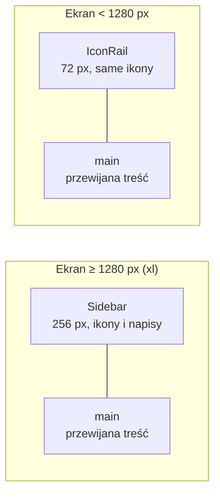

# 06. Wygląd i komponenty

[← Spis treści](README.md)

Ten dokument opisuje, jak aplikacja wygląda i z czego jest złożona wizualnie: paleta kolorów, czcionki, układ ekranu,
wspólne komponenty i zasady dostępności. Wygląd **strony głównej** (landing) ma własne reguły i jest w osobnym
dokumencie: [07](07-strona-glowna.md).

## Jak działa stylowanie

Aplikacja używa **Tailwind CSS 4**: styl zapisuje się jako klasy bezpośrednio w kodzie komponentu
(`className="rounded-2xl border border-line bg-surface p-4"`). Nie ma osobnych plików CSS dla komponentów.
Jedyny plik ze stylami to `src/index.css`, a w nim:

1. `@import "tailwindcss"`: dołącza Tailwinda.
2. `@source not "../docs"`: Tailwind sam przeszukuje projekt w poszukiwaniu nazw klas, więc ta linia wyłącza z
   przeszukiwania katalog `docs/` (Markdown i podgląd HTML to zwykły tekst). Bez niej do zbudowanego CSS trafiałyby
   klasy z samych opisów (np. `container`, `table`).
3. Blok `@theme { … }`: **wszystkie kolory, czcionki, rozmiary tekstu i animacje projektu**. Tailwind 4 robi z każdej
   zmiennej `--color-xxx` klasy `bg-xxx`, `text-xxx`, `border-xxx` itd. Dlatego `--color-accent` daje `bg-accent`,
   `text-accent`, `border-accent`.
4. Kilka zasad globalnych: ciemny schemat kolorów, tło i czcionka `body`, obwódka fokusu, wyłączanie animacji.

Żeby zmienić kolor w całej aplikacji, zmień **jedną wartość** w bloku `@theme`. Nie wpisuje się kolorów szesnastkowo
w komponentach aplikacji. Wyjątek to ikona togi (`togaTrim.ts`) i kilka miejsc na stronie głównej (krzywa zapominania, demo pytania, chipy aplikacji), gdzie kolory są wpisane na sztywno.

Do składania klas służy funkcja `cn(...)` z `lib/cn.ts` (opakowanie `clsx`): `cn("a", warunek && "b", className)`.

## Paleta kolorów (aplikacja)

Aplikacja jest **tylko ciemna**: `color-scheme: dark` jest ustawione na stałe, nie ma przełącznika jasny/ciemny.

| Zmienna | Kolor | Do czego |
|---------|-------|----------|
| `canvas` | `#121214` | Tło całej strony |
| `surface` | `#1a1a1d` | Karty, menu boczne, okna |
| `surface-2` | `#242428` | Wyższy poziom: pola, przyciski drugorzędne, szkielety ładowania |
| `line` | `#313136` | Cienkie obramowania kart i separatory |
| `field` | `#74737a` | Obramowanie pól formularza (jaśniejsze niż `line`, żeby spełnić kontrast 3:1 dla elementów interfejsu) |
| `fg` | `#f2efe9` | Główny tekst |
| `fg-muted` | `#a6a5ab` | Tekst pomocniczy, podpisy, nieaktywne menu |
| `accent` | `#d8b13a` | Złoty akcent: główne przyciski, aktywna pozycja menu, odznaki |
| `accent-fg` | `#211804` | Tekst na złotym tle |
| `accent-2` | `#e8649f` | Różowy akcent drugorzędny (słupki na wykresie powtórek) |
| `success` | `#4fd68a` | Poprawna odpowiedź, potwierdzenia |
| `warning` | `#f08c3c` | Ostrzeżenia, pytania oznaczone „do sprawdzenia” w egzaminie, średni poziom opanowania na paskach |
| `danger` | `#f0565e` | Błędy, błędna odpowiedź, usuwanie |

Reguła: **kolor nigdy nie jest jedyną informacją**. Poprawna i błędna odpowiedź mają też ikonę i opis słowny, a stan
aktywny w menu ma inne tło, nie tylko inny odcień.

### Dodatkowe tokeny tylko dla strony głównej

W tym samym bloku `@theme` są kolory, rozmiary tekstu (`text-lp-h1`, `text-lp-h2`, `text-lp-body` i inne) i animacja,
których używa wyłącznie strona główna (`fg-soft`, `accent-hover`, `band`, cała rodzina `paper-*` i `ink-*` dla
„arkusza egzaminacyjnego” w demo, `on-accent-soft`). Reszta aplikacji ich nie dotyka. Opis w [07](07-strona-glowna.md).

## Czcionki

| Czcionka | Gdzie | Jak ładowana |
|----------|-------|--------------|
| **Manrope** (zmienna, wszystkie wagi) | Cała aplikacja i strona główna. Zmienna `--font-sans` | `import "@fontsource-variable/manrope"` w `main.tsx` |
| **Newsreader** (tylko waga 500) | Wyłącznie nagłówki wyróżnione na stronie głównej. Zmienna `--font-display` (klasa `font-display`) | `import "@fontsource/newsreader/500.css"` w `pages/LandingPage.tsx`, więc ładuje się tylko wraz ze stroną główną |

Obie czcionki są dołączone do paczki z pakietów npm (`@fontsource…`), więc **aplikacja nie łączy się z Google Fonts
ani z żadnym innym zewnętrznym serwerem czcionek** (ważne dla prywatności i działania offline w sieci lokalnej).
Zapasowe czcionki systemowe: `system-ui, sans-serif` dla Manrope oraz `Georgia, "Times New Roman", serif` dla
Newsreader.

## Układ ekranu aplikacji (po zalogowaniu)

Szkielet zdefiniowany jest w `components/layout/AppShell.tsx`:

- Cały szkielet ma wysokość okna (`h-dvh`); przewija się tylko `<main>`, menu stoi w miejscu.
- Poniżej 1280 px menu zwija się do wąskiego paska z samymi ikonami (`IconRail`, 72 px); po najechaniu lub
  ustawieniu fokusu pokazuje się podpowiedź z nazwą. Na telefonie pasek jest więc po lewej stronie, nie na dole.
- Menu jest zdefiniowane raz w `config/navigation.ts` (`NAV_ITEMS`): Pulpit, Testy, Fiszki, Statystyki, Konto.
  `Sidebar` i `IconRail` czytają tę samą listę. Obie mają taką samą funkcję `isNavItemActive` (powtórzona, patrz
  [10](10-znane-ograniczenia.md)). Pozycja jest aktywna, gdy adres jest jej adresem lub podadresem, albo zaczyna się od
  jednego z `activePrefixes` (np. sesja testu `/app/test/...` zapala „Testy”).
- `NavBadge`: złota odznaka z liczbą powtórek przy „Testy” i „Fiszki”. Nic nie rysuje, gdy liczba wynosi 0, a od 100
  pokazuje „99+”. Ma `role="status"` i opis dla czytników ekranu („5 powtórek do zrobienia”).
- `LogoutButton` na dole menu: wylogowuje i przenosi na stronę główną (pełne przeładowanie).

Szerokości progów (Tailwind): `sm` 640 px, `md` 768 px, `lg` 1024 px, `xl` 1280 px. W kodzie najczęściej występuje
`sm:` (odstępy `px-4 sm:px-8`, układy kolumnowe), a `xl:` służy tylko do przełączenia menu.

Nagłówek strony (`PageHeader`): tytuł `h1` (24 px, pogrubiony), opcjonalny podtytuł i miejsce na akcje po prawej (na
wąskim ekranie pod tytułem). Ekrany logowania i rejestracji używają `AuthLayout`: wyśrodkowana karta o szerokości
najwyżej 24 rem z logo nad nią.

## Wspólne komponenty (`components/ui/`)

| Komponent | Opis | Ważne szczegóły |
|-----------|------|-----------------|
| **`Button`** | Przycisk w czterech odmianach (`variant`): `primary` (złoty), `secondary` (szary), `ghost` (przezroczysty), `danger` (czerwony) | Zaokrąglony do końca, minimalna wysokość 44 px (`min-h-11`), przyjmuje wszystkie atrybuty `<button>`. **Domyślnie `variant="primary"`, ale typ przycisku (`type`) nie jest ustawiany**, więc w formularzu trzeba podać `type="button"`, jeśli przycisk nie ma wysyłać formularza |
| **`Card`** | Ramka z zaokrąglonymi rogami i tłem `surface` | Zwykły `div` z klasami; dodatkowe klasy przez `className` |
| **`Dialog`** | Okno modalne | Oparte na natywnym elemencie `<dialog>` i `showModal()`: przeglądarka sama pilnuje fokusu, Esc i zasłania resztę strony przed czytnikami. Trafia do `<body>` przez portal (fiszka ma obrót 3D, który psułby położenie okna). Zamyka się na Esc, kliknięcie tła i przycisk „Zamknij okno”; po zamknięciu fokus wraca na element, który je otworzył. Montowane tylko, gdy ma być widoczne, więc zawsze zaczyna od czystego stanu |
| **`Field`** | Pole tekstowe z etykietą | Etykieta jest powiązana z polem (`useId`), opcjonalna podpowiedź (`hint`) jest podpięta jako `aria-describedby`. Wysokość min. 44 px |
| **`EmptyState`** | Pusty widok: ikona, tytuł, opis, przycisk | Dla list bez wyników i dla sytuacji „nie ma jeszcze czego pokazać” |
| **`ErrorState`** | Błąd ładowania: ikona ostrzeżenia, komunikat, „Spróbuj ponownie” | Przycisk pojawia się, gdy podano `onRetry`. Komunikat domyślny: „Coś poszło nie tak.” |
| **`Skeleton`** | Szary pulsujący prostokąt na czas ładowania | Pulsowanie wyłącza się przy ustawieniu systemowym „ogranicz ruch” (`motion-reduce:animate-none`) |

### Komponenty układu (`components/layout/`)

`AppShell` (szkielet z menu), `Sidebar`, `IconRail`, `NavBadge`, `LogoutButton` (odmiany `full` i `compact`), `PageHeader`,
`AuthLayout`, `Logo` (odmiany `wordmark` z napisem i `monogram` z literą T w złotym kwadracie). Plik `TopBar.tsx`
istnieje, ale **nie jest nigdzie używany** (patrz [10](10-znane-ograniczenia.md)).

### Ikony

- **Ikony interfejsu**: biblioteka `lucide-react` (np. `LayoutDashboard`, `ClipboardList`, `Layers`, `BarChart3`).
  Ikony ozdobne mają `aria-hidden="true"`.
- **`TogaIcon`** (`components/icons/`): własna ikona togi w stylu lucide (siatka 24 × 24, kreska 2). Obrys ma kolor
  tekstu (`currentColor`), a „żabot” (kołnierz) kolor zawodu. Kolory są w `togaTrim.ts` (`TOGA_COLORS`): adwokat
  zielony, radca prawny niebieski, sędzia fioletowy, prokurator czerwony, pytania autorskie złoty, notariusz srebrny,
  komornik miedziany. Dwa kolory (np. adwokat + radca) rysują żabot podzielony na pół. Kolory notariusza i komornika
  zostały dobrane, bo w sprawdzonych źródłach nie ma koloru ich togi. Toga występuje na stronie głównej (sekcja
  funkcji i chipy aplikacji).

## Dostępność (a11y)

Przyjęte w całej aplikacji zasady, które warto zachować przy zmianach:

| Zasada | Jak jest zrobiona |
|--------|-------------------|
| Widoczny fokus z klawiatury | Globalna zasada `:focus-visible { outline: 2px solid var(--color-accent); outline-offset: 2px }` w `index.css` |
| Duże cele dotykowe | Przyciski, pola i pozycje menu mają minimum 44 px (`min-h-11`, `size-11`, `h-11 w-11`) |
| Kontrast | Teksty i obramowania pól dobrane pod ciemne tło (m.in. `field` ma osobny jaśniejszy odcień dla ramek pól) |
| Ograniczenie ruchu | Globalna zasada `@media (prefers-reduced-motion: reduce)` skraca animacje i przejścia do ~0 ms; `Skeleton` wyłącza pulsowanie |
| Czytniki ekranu | Ikony ozdobne `aria-hidden`; odznaki i komunikaty stanu `role="status"`; pola formularzy mają etykiety i `aria-describedby`; okna to natywne `<dialog>` z `aria-labelledby` |
| Ogłoszenia na żywo | Zegar egzaminu ogłasza czas tylko przy progach 10, 5 i 1 minuta (żeby nie czytać każdej sekundy), patrz [04](04-nauka-w-aplikacji.md) |
| Skróty klawiszowe nie przeszkadzają | Wyłączają się, gdy fokus jest w polu tekstowym (`isTyping`) albo na elemencie z `data-no-shortcuts` |
| Język strony | `<html lang="pl">` w `index.html` |

## Animacje

Aplikacja używa animacji oszczędnie: obrót 3D fiszki po odsłonięciu odpowiedzi (`rotateY`, w `StudySessionPage`),
pulsowanie szkieletów ładowania, krótkie pojawienie się wyjaśnienia w demo na stronie głównej (`animate-rise`, zdefiniowane
w `@theme`) oraz płynne przejścia kolorów przy najechaniu. Wszystko to wyłącza ustawienie „ogranicz ruch”.

## Wykresy i wizualizacje

W projekcie **nie ma biblioteki wykresów**. Słupki, pierścień retencji, rytm aktywności i krzywa zapominania są rysowane
zwykłymi elementami HTML i SVG z kolorami z palety (np. słupki powtórek mają `bg-accent-2`). Liczby, które wykresy
pokazują, pochodzą z serwera (`/api/statistics/...`), a przeliczenia na kształt (wysokość słupka, wypełnienie kółka)
są w plikach `selectors.ts` i `*.tsx` w `features/statistics` i `features/dashboard`.

## Jak zmienić wygląd: ściąga

| Chcę zmienić… | Gdzie |
|---------------|-------|
| Kolor (np. złoty akcent) | `src/index.css`, blok `@theme`, zmienna `--color-accent` |
| Czcionkę całej aplikacji | `--font-sans` w `index.css` i import w `main.tsx` |
| Napis w menu albo kolejność pozycji | `src/config/navigation.ts` |
| Wygląd przycisków | `components/ui/Button.tsx` (`VARIANT_CLASSES`). Uwaga: część ekranów ma własne klasy przycisków wpisane w miejscu użycia |
| Szerokość, od której menu się rozwija | `AppShell.tsx` (`xl:flex` i `xl:hidden`) |
| Logo | `components/layout/Logo.tsx` |
| Ikonę karty w przeglądarce | `public/favicon.svg`, `favicon.ico`, `apple-touch-icon.png` |
| Tytuł i opis strony (karta przeglądarki, podgląd w komunikatorach) | `index.html` |
