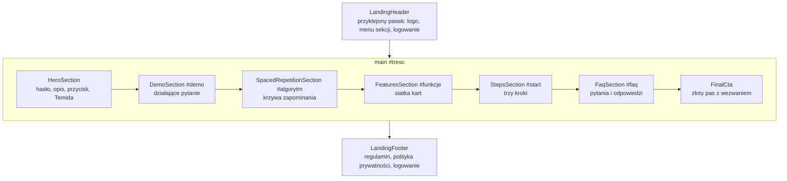

# 07. Strona główna

[← Spis treści](README.md)

Strona główna (adres `/`) to reklamowa wizytówka aplikacji dla osób, które jeszcze nie mają konta. Ma własne reguły
układu, własne tokeny wyglądu i **wszystkie teksty w jednym pliku**, więc większość zmian (np. nowe hasło na górze) robi
się bez dotykania komponentów.

## Gdzie co jest

| Co | Plik |
|----|------|
| Cały ekran strony (składa sekcje) | `pages/LandingPage.tsx` |
| **Wszystkie teksty** | `features/landing/copy.ts` |
| Reguły demo pytania | `features/landing/demo.ts` |
| Sekcje | `features/landing/HeroSection.tsx`, `DemoSection.tsx`, `SpacedRepetitionSection.tsx`, `FeaturesSection.tsx`, `StepsSection.tsx`, `FaqSection.tsx`, `FinalCta.tsx` |
| Nagłówek i stopka | `LandingHeader.tsx`, `LandingFooter.tsx` |
| Klocki wspólne (kontener, sekcja, przycisk-link) | `features/landing/ui.tsx` (`Wrap`, `Section`, `CtaLink`) |
| Polska typografia (twarde spacje) | `features/landing/typography.ts` |
| Interaktywne demo | `DemoQuestion.tsx` |
| Wykres krzywej zapominania | `ForgettingCurve.tsx` |
| Chipy pochodzenia pytań z togami | `OriginChips.tsx` |
| Ilustracja Temidy | `features/landing/assets/temida-medalion.svg` |
| Tokeny wyglądu strony (`lp-*`, `paper-*`, `ink-*`) | `src/index.css`, blok `@theme` |

## Kolejność sekcji

Menu w nagłówku (`COPY.nav`) prowadzi do kotwic: `#demo`, `#algorytm`, `#funkcje`, `#start`, `#faq`. Jest widoczne od
szerokości kontenera 1000 px. Na stronie jest też ukryty link „Przejdź do treści” (widoczny po naciśnięciu Tab), który
przeskakuje do `<main id="tresc">`.

### Zalogowany a niezalogowany

Strona sprawdza `isAuthenticated`. Niezalogowany widzi „Załóż darmowe konto” (prowadzi do `/register`) i link
„Zaloguj się”. Zalogowany nie jest przekierowywany, ale wszędzie zamiast tego widzi **„Przejdź do aplikacji”**
(prowadzi do `/app`), a w hero znika zdanie „Masz już konto?”.

### Potwierdzenie usunięcia konta

Po usunięciu konta aplikacja przenosi na `/?konto=usuniete` (stałe w `features/account/constants.ts`). Strona głównej
rozpoznaje ten parametr i nad treścią pokazuje zielony komunikat „Twoje konto i wszystkie powiązane z nim dane zostały
usunięte…” (`COPY.accountDeleted`, `role="status"`).

## Jak zmienić tekst

Wszystkie napisy są w obiekcie `COPY` w `features/landing/copy.ts`, pogrupowane tak jak sekcje: `nav`, `cta`, `hero`,
`demo`, `spaced`, `features`, `steps`, `faq`, `final`, `footer`. Dwa przykłady:

| Chcę zmienić… | Gdzie |
|---------------|-------|
| Główne hasło („Testy, które pamiętają, co ci umyka.”) | `COPY.hero.title` |
| Opis pod hasłem („Rozwiązuj pytania ABC z egzaminów…”) | `COPY.hero.lead` |
| Nazwę „Tutlaw” w nagłówku i stopce | Nie jest w `copy.ts`. To komponent `components/layout/Logo.tsx`, wspólny z resztą aplikacji |
| Pytania i odpowiedzi FAQ | `COPY.faq.items` (lista `q` i `a`) |
| Pytanie w demo i jego trzy odpowiedzi | `COPY.demo.question` i `COPY.demo.options` oraz poprawna odpowiedź w `demo.ts` (`DEMO_CORRECT`) |
| Napis w stopce („© 2026 Tutlaw…”) | `COPY.footer.note` |

Zasady pisania tekstów (zapisane w komentarzu na początku `copy.ts`):

- Fakty o produkcie (tryby, reguły „Nie jestem pewien”, FSRS-6, filtr pochodzenia, eksport danych) mają odpowiadać
  temu, co aplikacja naprawdę robi.
- **Bez liczb o użytkownikach, zdawalności i liczbie pytań.** Takie liczby dopisuje się dopiero, gdy będą prawdziwe.
  Przykładowe dane w sekcji funkcji są wyraźnie oznaczone („Przykładowe dane”).
- Twardych spacji nie wpisuje się ręcznie (patrz niżej).

### Twarde spacje: `typography.ts`

`COPY` jest owinięty w funkcję `deepNbsp(...)`, która przechodzi po wszystkich napisach i wstawia **twardą spację** po
jednoliterowych spójnikach i przyimkach (a, i, o, u, w, z), w zapisie „art. 8 § 1” i w „13 lat”. Dzięki temu wiersz nie
kończy się na samotnym „w” albo „z”, co w polskiej typografii jest błędem. „FSRS-6” jest zabezpieczone przed złamaniem
po myślniku niewidocznym znakiem U+2060. Piszesz więc tekst zwyczajnie, a spacje poprawia kod.

## Układ: zapytania kontenera zamiast okna

Strona używa **zapytań kontenera** Tailwinda (`@container`, klasy w rodzaju `@min-[960px]:`): układ zależy od szerokości
samej strony, a nie okna przeglądarki. Główny `div` w `LandingPage` ma klasę `@container`. Dzięki temu strona wygląda
tak samo w całym oknie, w wąskiej kolumnie i w podglądzie tabletu.

Dwie zmienne CSS ustawiane w `LandingPage` sterują odstępami w całej stronie:

| Zmienna | Wartość | Do czego |
|---------|---------|----------|
| `--lp-gutter` | `clamp(16px, 4.5cqw, 40px)` | Boczny margines treści |
| `--lp-section` | `clamp(56px, 9cqw, 112px)` | Pionowy odstęp między sekcjami |

(`cqw` to 1% szerokości kontenera.) Typografia jest płynna: rozmiary `text-lp-h1`, `text-lp-h2`, `text-lp-h3`,
`text-lp-lead`, `text-lp-body`, `text-lp-question` mają w `index.css` wzory z `clamp(...)` zależne od szerokości kontenera.

Klocki z `ui.tsx`:

| Klocek | Rola |
|--------|------|
| `Wrap` | Wyśrodkowany kontener o szerokości najwyżej 1180 px z bocznym marginesem `--lp-gutter` |
| `Section` | `<section>` z odstępem pionowym `--lp-section`, nazwą dla czytników (`aria-labelledby`) i odsunięciem kotwicy pod przyklejonym nagłówkiem (`scroll-mt-20`) |
| `CtaLink` | Link wyglądający jak przycisk w trzech rozmiarach (`sm`, `md`, `lg`) i dwóch odcieniach (`gold` na ciemnym tle, `ink` na złotym) |

## Sekcje po kolei

### Hero (pierwszy ekran)

Po Etapie 22 hero zajmuje **cały pierwszy ekran**: widać tylko hasło, opis, przycisk i Temidę, a resztę strony odkrywa
się przewijaniem. Wysokość minimalna to `min(calc(100svh - 65px), 1100px)`:

- `65px` to wysokość przyklejonego nagłówka (64 px + 1 px ramki),
- `svh` to najmniejsza wysokość okna na telefonie (przy widocznym pasku adresu), więc początek następnej sekcji nie
  wchodzi na pierwszy ekran,
- `1100px` to górny limit, żeby na bardzo wysokich ekranach hero nie rozciągało się w pustkę.

To tylko **minimum**: gdy treść jest wyższa niż okno (mały telefon, widok poziomy), hero po prostu rośnie. Od
szerokości kontenera 960 px tekst i Temida leżą obok siebie, poniżej jedno pod drugim. Na dole jest strzałka w dół
(`#demo`), ukryta przed czytnikami i klawiaturą, bo to samo robi link „Zobacz, jak to działa”.

Ilustracja Temidy (`temida-medalion.svg`) jest ozdobna (`alt=""`): kobieta z zasłoniętymi oczami, wagą i mieczem. To
nawiązanie do hasła „Nie jestem pewien działa jak uczciwy sędzia”. Pudełko ilustracji wypełnia wolne miejsce w hero, a
obrazek wpisuje się w nie (`object-contain`), więc na niskim oknie Temida się zmniejsza i całe hero mieści się na ekranie.

### Demo: „Wypróbuj na jednym pytaniu”

`DemoQuestion` to **działające** pytanie ABC na „arkuszu egzaminacyjnym” (jasny papier na ciemnej stronie, kolory
`paper-*` i `ink-*`). Użytkownik zaznacza opcjonalnie „Nie jestem pewien”, wybiera odpowiedź i dostaje komunikat, co
zrobiłby z nią Tutlaw. Reguły są w `demo.ts` i **odpowiadają zasadom prawdziwej aplikacji**:

| Odpowiedź | Pewność | Wynik w demo (`DemoOutcomeId`) | Co robi aplikacja |
|-----------|---------|--------------------------------|-------------------|
| Poprawna | Pewna | `ok-sure` | Pytanie znane, powrót po dłuższej przerwie |
| Poprawna | „Nie jestem pewien” | `ok-unsure` | Traktowana jak niezapamiętana, szybki powrót |
| Błędna | Pewna | `bad-sure` | Szybki powrót **i dodanie do fiszek** |
| Błędna | „Nie jestem pewien” | `bad-unsure` | Szybki powrót, bez fiszki |

Poprawna odpowiedź w demo to „B” (`DEMO_CORRECT = "b"`). Dostępność: pola są prawdziwymi `radio` i `checkbox` (ukrytymi
wizualnie), cały wynik jest w obszarze `aria-live="polite"`, a „Spróbuj jeszcze raz” przywraca fokus na pierwszą opcję.
Demo **nie wysyła niczego na serwer**.

> Jeśli zmienisz reguły oceniania w backendzie (np. co robi „Nie jestem pewien”), zaktualizuj też `demo.ts` i teksty
> `COPY.demo.outcomes`, bo demo jest osobną kopią tych zasad, a nie wywołaniem backendu.

### Pozostałe sekcje

| Sekcja | Zawartość |
|--------|-----------|
| `SpacedRepetitionSection` (`#algorytm`) | Tytuł, trzy akapity o powtórkach (FSRS-6) i wykres `ForgettingCurve`: schemat poglądowy (SVG, bez liczb na osiach); opisy są w HTML pod rysunkiem, żeby skalowały się jak zwykły tekst |
| `FeaturesSection` (`#funkcje`) | Siatka kart („bento”): testy ABC z chipami pochodzenia, „Nie jestem pewien” (karta jasna), powtórki, fiszki, egzamin próbny, statystyki z przykładowymi danymi. Od 640 px dwie kolumny, od 1000 px sześć |
| `StepsSection` (`#start`) | Trzy kroki jako lista numerowana na tle `band`, na końcu przycisk |
| `FaqSection` (`#faq`) | Osiem pytań w natywnych rozwijanych blokach `
`; pytanie o źródła pytań pokazuje chipy pochodzenia |
| `FinalCta` | Złoty pas z wezwaniem i przyciskiem w odcieniu `ink` |

`OriginChips` bierze nazwy i kolejność z `lib/origin.ts` i `features/statistics/originStats.ts`, czyli z tej samej listy,
co filtr pochodzenia w Testach. Dodanie nowego pochodzenia pytań trzeba więc zrobić w jednym miejscu.

## Czego strona nie robi

- Nie pobiera niczego z serwera: jest całkowicie statyczna (poza sprawdzeniem, czy użytkownik jest zalogowany, które
  czyta token z pamięci przeglądarki).
- Nie ma formularza zapisu na listę ani liczników odwiedzin.
- Tytuł karty i opis dla wyszukiwarek oraz komunikatorów są w `index.html` (jeden dla całej aplikacji).
